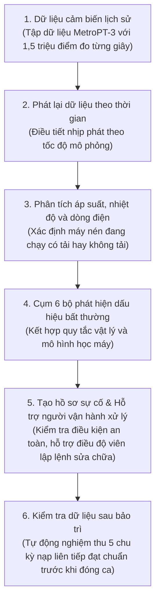

# 01. Cách thức Hoạt động của Hệ thống (Kiến trúc & Luồng Dữ liệu)

> **Mục tiêu tài liệu:** Trả lời một câu hỏi duy nhất: **CompressorGuard hoạt động như thế nào?**  
> **Nguyên tắc:** Giải thích thực tế, ngắn gọn, dễ hiểu cho kỹ sư hoặc người vận hành, không dùng thuật ngữ phô trương.

---

## 1. CompressorGuard Là Gì và Hoạt Động Thế Nào?

Máy nén khí trên đoàn tàu đô thị có nhiệm vụ bơm khí nén vào các bình chứa để nhả phanh và mở cửa toa xe. Khi máy nén bị hỏng hoặc rò rỉ khí, phanh an toàn sẽ tự động ngắt và đoàn tàu phải dừng khẩn cấp giữa tuyến.

Các đoàn tàu hiện nay chỉ dựa vào rơ-le áp suất thấp cơ học (LPS). Thiết bị này chỉ bật báo động khi áp suất trong hệ thống đã tụt xuống mức nguy hiểm. Lúc này sự cố đã trở nên nghiêm trọng, buộc phải dừng chạy tàu và kéo tàu về trạm sửa chữa.

**CompressorGuard giải quyết bài toán này qua một luồng hoạt động đơn giản gồm 6 bước:**

---

## 2. Dữ liệu Được Phân tích Như Thế Nào?

Khi dữ liệu từng giây đi vào hệ thống, các thuật toán sẽ rà soát số liệu qua hai tầng:

### 2.1. Cụm 6 Bộ Phát hiện Độc lập (Detectors)
Hệ thống sử dụng đồng thời 6 bộ phát hiện khác nhau để quan sát tình trạng máy nén từ nhiều góc độ:
1. **Phát hiện sụt áp van xả (`PressureAnomalyDetector`):** Kiểm tra độ sụt áp tại van xả nước ngưng. Khi máy nén nạp tải mà áp suất tại van vượt quá 2,0 bar liên tục, đây là dấu hiệu van xả bị kẹt hoặc hở gioăng làm thất thoát khí.
2. **Phát hiện ứng suất nhiệt (`ThermalStressDetector`):** Theo dõi nhiệt độ dầu bôi trơn máy nén (`Oil_temperature`). Khi nhiệt độ tăng vượt ngưỡng an toàn do máy nén phải chạy quá tải để bù lượng khí rò rỉ, bộ phát hiện này sẽ cảnh báo.
3. **Phát hiện bước nhảy bền bỉ (`TemporalStepDetector`):** Yêu cầu hiện tượng sụt áp phải duy trì ổn định qua ít nhất 3 chu kỳ nạp tải liên tiếp. Nhờ đó, hệ thống loại bỏ được các xung áp suất giật cục thoáng qua và không phát báo động giả.
4. **Phát hiện thống kê theo chế độ chạy (`RegimeAwareStatDetector`):** So sánh các thông số đo đạc với ngưỡng chuẩn riêng biệt của từng chế độ (khi có tải, không tải hoặc khi máy nghỉ).
5. **Mô hình học máy Isolation Forest (`IsolationForestDetector`):** Đánh giá đồng thời 5 thông số (độ sụt áp van, áp suất sau van một chiều, nhiệt độ dầu, dòng điện động cơ và áp suất sau bộ sấy) dựa trên mô hình đã được huấn luyện với dữ liệu vận hành bình thường. Giúp bắt được các sai lệch tinh vi khi từng thông số riêng lẻ chưa chạm ngưỡng cảnh báo.
6. **Bộ theo dõi rơ-le cơ học LPS (`ReactiveLPSDetector`):** Giám sát tiếp điểm của rơ-le áp suất thấp cơ học truyền thống để làm mốc đối chứng an toàn khẩn cấp.

### 2.2. Động cơ Ra Quyết định (DecisionEngine)
Sau khi thu thập kết quả từ 6 bộ phát hiện trên, hệ thống không dùng các công thức cộng điểm phức tạp mà đánh giá tình huống dựa trên **6 nhánh chính sách vận hành rõ ràng**:
1. **Khi rơ-le cơ học LPS bị ngắt:** Bật cảnh báo nguy cấp ngay lập tức vì áp suất hệ thống đã tụt dưới 7,0 bar.
2. **Khi mô hình học máy đồng thuận với bất thường vật lý:** Kích hoạt mức cảnh báo cao nhất, khuyến nghị điều độ viên đưa tàu về chế độ an toàn để bảo dưỡng.
3. **Khi xác nhận suy thoái vật lý bền bỉ:** Tạo hồ sơ ca sự cố trên màn hình điều độ và chuyển sang trạng thái theo dõi chặt chẽ.
4. **Khi có nhiều tín hiệu bất thường kéo dài:** Tiếp tục theo dõi tích lũy thêm chứng cứ, chưa làm phiền điều độ viên.
5. **Khi chỉ là dao động thoáng qua:** Ghi nhận vào nhật ký kỹ thuật, không bật chuông cảnh báo nhằm chống mỏi mệt báo động.
6. **Trạng thái bình thường:** Toàn bộ đoàn tàu vận hành ổn định.

---

## 3. Quy trình Người Vận hành Xử lý Sự cố

Hệ thống được thiết kế theo nguyên tắc: **Máy tính hỗ trợ tính toán, con người ra quyết định cuối cùng**.

1. **Tiếp nhận sự cố:** Khi hệ thống phát hiện rò rỉ khí nén bền bỉ, điều độ viên nhìn thấy cảnh báo trên màn hình, xem đồ thị áp suất và bấm tiếp nhận ca sự cố.
2. **Kiểm tra an toàn tự động (ActionGuard):** Trước khi cho phép đưa đoàn tàu về chế độ an toàn, hệ thống tự động kiểm tra 5 điều kiện kỹ thuật (áp suất mạch khí vẫn đủ để tàu tự chạy về xưởng, rơ-le an toàn chưa ngắt, không có sự cố xung đột khác).
3. **Lập lệnh công tác bảo trì:** Điều độ viên gửi lệnh sửa chữa về xưởng Depot Long Bình để chuẩn bị linh kiện thay thế trong ca đêm.
4. **Nghiệm thu sau bảo trì:** Sau khi đoàn tàu được sửa chữa và chạy thử lại, hệ thống tự động kiểm tra liên tiếp 5 chu kỳ nạp tải. Chỉ khi áp suất van xả và nhiệt độ dầu đều trở về mức an toàn trong cả 5 chu kỳ, điều độ viên mới được phép ký duyệt đóng ca sự cố.
