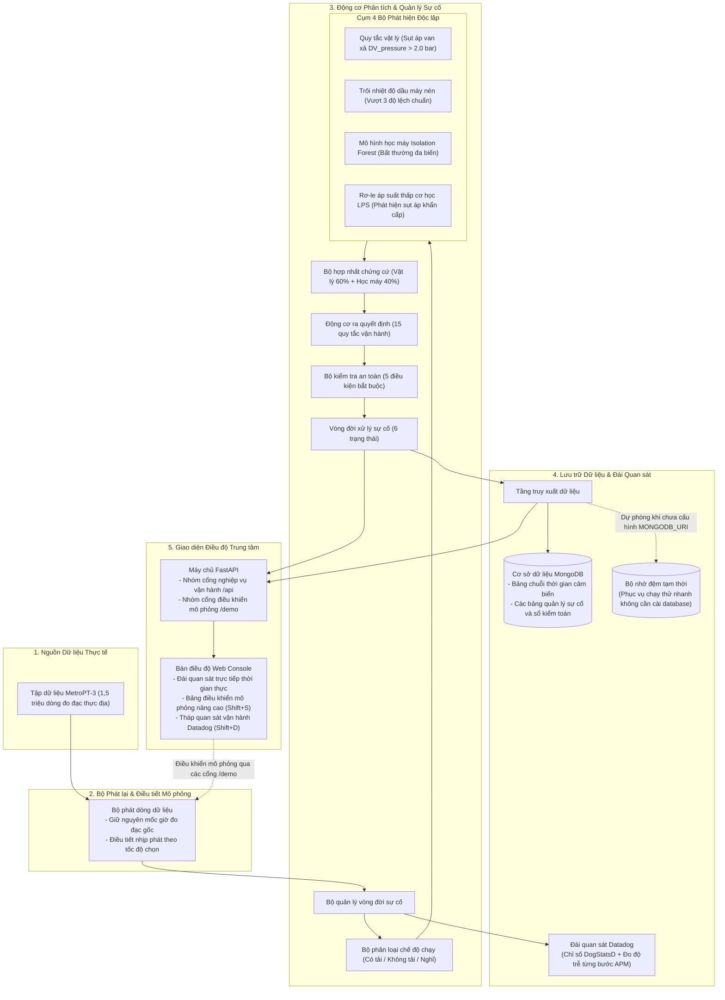
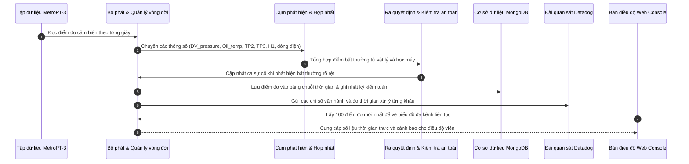

# 01. Kiến trúc Hệ thống & Luồng Dữ liệu Thực tế

> **Dự án:** CompressorGuard — Hệ thống Giám sát & Quản lý Vận hành Máy nén khí Đoàn tàu (MUGVN Hackathon 2026: MongoDB + Datadog)  
> **Nguyên tắc:** Trình bày đúng thực tế mã nguồn, mạch lạc, tự nhiên, hạn chế thuật ngữ tiếng Anh không cần thiết.

---

## 1. Kiến trúc Tổng thể của Hệ thống

CompressorGuard được xây dựng theo mô hình **nguyên khối phân tầng gọn nhẹ** bằng Python và FastAPI, giúp toàn bộ hệ thống dễ vận hành, dễ triển khai và có ranh giới rõ ràng giữa xử lý vật lý, phát hiện bất thường, lưu trữ và giao diện điều độ:

---

## 2. Luồng Dữ liệu Thực tế Khi Vận hành

Khi hệ thống hoạt động, dữ liệu chuyển động nhịp nhàng qua 6 bước khép kín:

> **Về công cụ đẩy dữ liệu MQTT:**  
> Dữ liệu được đưa vào hệ thống trực tiếp qua bộ phát dòng mô phỏng hoặc các cổng API. Tệp mã `publish_mqtt.py` trong thư mục `scripts/` chỉ là công cụ bổ trợ độc lập khi người dùng muốn thử nghiệm phát dữ liệu ra một máy chủ MQTT bên ngoài.

---

## 3. Danh mục Các Cổng Giao tiếp API

Toàn bộ các cổng giao tiếp dưới đây đều được xây dựng thực tế trong mã nguồn:

### 3.1. Nhóm Cổng Nghiệp vụ Vận hành (`/api/*`)

| Phương thức | Cổng API | Chức năng Vận hành | Kết quả Trả về |
| :--- | :--- | :--- | :--- |
| `GET` | `/api/operations` | Lấy bức tranh tổng thể toàn tuyến, tình trạng 3 đoàn tàu và cảnh báo ưu tiên | `200 OK` |
| `GET` | `/api/components` | Danh sách 4 cụm thiết bị của máy nén khí và tuổi thọ linh kiện | `200 OK` |
| `GET` | `/api/sop` | Danh mục cẩm nang quy trình xử lý chuẩn khi có sự cố | `200 OK` |
| `GET` | `/api/shift/current` | Thông tin về ca trực hiện tại của điều độ viên | `200 OK` |
| `POST` | `/api/shift/handover` | Lưu biên bản bàn giao ca trực vào hệ thống | `200 OK` |
| `GET` | `/api/incident` hoặc `/api/case` | Chi tiết ca sự cố nghiêm trọng đang xử lý (thời gian báo trước, mức độ lệch) | `200 OK` |
| `GET` | `/api/evidence` | Bằng chứng chẩn đoán tổng hợp từ cả 4 bộ phát hiện | `200 OK` |
| `GET` | `/api/case/events` hoặc `/api/timeline` | Sổ cái kiểm toán lưu vết toàn bộ thao tác xử lý của con người | `200 OK` |
| `GET` | `/api/action/guard-status` | Báo cáo kiểm tra 5 điều kiện an toàn trước khi xử lý | `200 OK` |
| `POST` | `/api/action/safe-mode` | Phê duyệt đưa đoàn tàu về chế độ an toàn để bảo dưỡng | `200 OK` hoặc `409` |
| `POST` | `/api/case/acknowledge` | Điều độ viên tiếp nhận ca sự cố và gán mức ưu tiên | `200 OK` hoặc `409` |
| `POST` | `/api/case/notes` | Bổ sung ghi chú chẩn đoán kỹ thuật vào hồ sơ sự cố | `200 OK` |
| `POST` | `/api/case/work-order` | Lập lệnh công tác bảo trì gửi về xưởng Long Bình | `200 OK` hoặc `409` |
| `POST` | `/api/case/false-positive` | Đánh dấu sự cố là báo động giả (kèm lý do kỹ thuật và chữ ký) | `200 OK` hoặc `409` |
| `POST` | `/api/case/close` | Đóng ca sự cố sau khi đã nghiệm thu máy nén phục hồi ổn định | `200 OK` hoặc `409` |
| `GET` | `/api/recovery` | Bảng nghiệm thu tự động 5 chu kỳ nạp tải liên tiếp sau sửa chữa | `200 OK` |
| `GET` | `/api/telemetry/window` | Cửa sổ trượt 100 điểm đo mới nhất phục vụ vẽ biểu đồ nhiều kênh | `200 OK` |
| `GET` | `/api/telemetry/analytics` | Thống kê độ lệch chuẩn 60 giây và tỷ lệ chu kỳ nạp tải từ MongoDB | `200 OK` |
| `GET` | `/api/scenarios` | Danh mục các tình huống mô phỏng có sẵn | `200 OK` |
| `POST` | `/api/operations/scenario` | Đổi kịch bản vận hành trực tiếp trên màn hình | `200 OK` |
| `GET` | `/api/validation-reference` | Trích xuất báo cáo kỹ thuật đối chứng lịch sử của đợt sự cố thật | `200 OK` |
| `GET` | `/api/observability/datadog-status`| Trạng thái kết nối với Datadog và kết quả đo thời gian xử lý | `200 OK` |

### 3.2. Nhóm Cổng Điều khiển Mô phỏng (`/demo/*`)

| Phương thức | Cổng API | Chức năng Điều khiển |
| :--- | :--- | :--- |
| `POST` | `/demo/tick` | Chuyển tiếp một điểm đo cảm biến tiếp theo (chế độ từng bước) |
| `POST` | `/demo/play` | Bắt đầu phát dòng dữ liệu tự động |
| `POST` | `/demo/pause` | Tạm dừng phát dữ liệu |
| `POST` | `/demo/speed` | Cài đặt tốc độ mô phỏng (từ 1 lần đến 300 lần thời gian thực) |
| `POST` | `/demo/jump` | Nhảy mốc thời gian mô phỏng đến đúng thời điểm mong muốn |
| `GET` | `/demo/status` | Xem trạng thái phát dữ liệu và mốc thời gian hiện tại |
