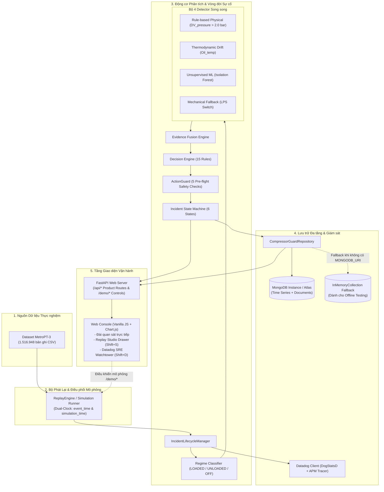
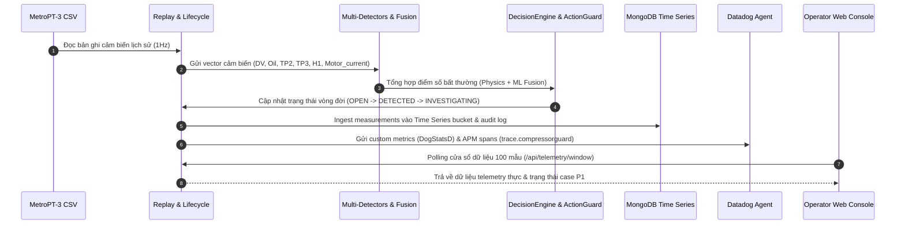

# 01. Kiến trúc Hệ thống & Luồng Dữ liệu Thực tế (System Architecture & Runtime Flow)

> **Dự án:** CompressorGuard — Industrial Operations Command Platform (MUGVN Hackathon 2026: MongoDB + Datadog)  
> **Trạng thái:** Chuẩn hóa kỹ thuật 100% theo mã nguồn thực tế tại commit `d2a2400`.

---

## 1. Kiến trúc Tổng thể (Modular Monolith)

CompressorGuard được thiết kế theo mô hình **Modular Monolith** viết bằng Python/FastAPI, phân định ranh giới rõ ràng giữa xử lý tín hiệu vật lý, suy luận bất thường, lưu trữ dữ liệu chuỗi thời gian và giao diện điều độ viên:

---

## 2. Luồng Dữ liệu Thực tế (Runtime Data Flow)

Hệ thống hoạt động theo trình tự 6 bước đồng bộ:

### 2.1. Nhánh Phát Tùy chọn MQTT (Optional MQTT Export)
- Trong thư mục `scripts/`, script `publish_mqtt.py` là một công cụ độc lập hỗ trợ đẩy dữ liệu cảm biến ra MQTT Broker (Mosquitto) bên ngoài nhằm mục đích trình diễn khả năng tương thích với hạ tầng IoT công nghiệp.
- **Lưu ý kiến trúc:** Máy chủ FastAPI và lõi phân tích **không** sử dụng MQTT làm kênh nhận dữ liệu (ingest) chính. Dữ liệu được đưa vào hệ thống thông qua `ReplayEngine` hoặc các API chuyên dụng.

---

## 3. Danh mục Hợp đồng API Chuẩn (FastAPI API Contract)

Toàn bộ các endpoint dưới đây được trích xuất trực tiếp từ `src/api/routes_product.py` và `src/api/routes_demo.py`:

### 3.1. Phân hệ Nghiệp vụ Vận hành (`/api/*`)

| Phương thức | Đường dẫn API | Chức năng Kỹ thuật | Trạng thái Trả về |
| :--- | :--- | :--- | :--- |
| `GET` | `/api/operations` | Trả về tổng quan hạm đội, danh sách 3 đoàn tàu, KPI và P1 Hero Banner | `200 OK` |
| `GET` | `/api/components` | Danh mục 4 thiết bị con thuộc APU và tình trạng linh kiện | `200 OK` |
| `GET` | `/api/sop` | Danh mục cẩm nang quy trình chuẩn (SOP Playbooks) | `200 OK` |
| `GET` | `/api/shift/current` | Thông tin ca trực hiện tại của điều độ viên | `200 OK` |
| `POST` | `/api/shift/handover` | Lưu biên bản bàn giao ca trực vào MongoDB | `200 OK` |
| `GET` | `/api/incident` hoặc `/api/case` | Chi tiết ca sự cố P1 đang hoạt động (trạng thái, lead time, radar vector) | `200 OK` |
| `GET` | `/api/evidence` | Bằng chứng chẩn đoán hợp nhất từ 4 detector và điểm Isolation Forest | `200 OK` |
| `GET` | `/api/case/events` hoặc `/api/timeline` | Sổ cái kiểm toán bất biến các sự kiện vận hành (Audit Ledger) | `200 OK` |
| `GET` | `/api/action/guard-status` | Báo cáo 5 tiêu chí an toàn trước khi kích hoạt Safe Mode | `200 OK` |
| `POST` | `/api/action/safe-mode` | Cấp phép chuyển nhánh mô phỏng sang chế độ an toàn (Safe Mode) | `200 OK` / `409 Conflict` |
| `POST` | `/api/case/acknowledge` | Điều độ viên tiếp nhận sự cố, gán mức ưu tiên P1 và ghi log kiểm toán | `200 OK` / `409 Conflict` |
| `POST` | `/api/case/notes` | Ghi chú chẩn đoán kỹ thuật vào sổ cái ca sự cố | `200 OK` |
| `POST` | `/api/case/work-order` | Lập lệnh công tác bảo dưỡng gửi về Depot Long Bình | `200 OK` / `409 Conflict` |
| `POST` | `/api/case/false-positive` | Đánh dấu sự cố báo giả (kèm lý do kỹ thuật và chữ ký điều độ viên) | `200 OK` / `409 Conflict` |
| `POST` | `/api/case/close` | Đóng ca sự cố sau khi đã nghiệm thu 5 chu kỳ nạp thành công | `200 OK` / `409 Conflict` |
| `GET` | `/api/recovery` | Bảng nghiệm thu phục hồi 5 mẫu tải (`LOADED`) sau bảo trì | `200 OK` |
| `GET` | `/api/telemetry/window` | Cửa sổ trượt 100 mẫu cảm biến phục vụ vẽ biểu đồ đa kênh | `200 OK` |
| `GET` | `/api/telemetry/analytics` | Thống kê vi phân cửa sổ trượt MongoDB `$setWindowFields` và tỷ lệ tải `$facet` | `200 OK` |
| `GET` | `/api/scenarios` | Danh mục các kịch bản mô phỏng có sẵn trong hệ thống | `200 OK` |
| `POST` | `/api/operations/scenario` | Chuyển đổi kịch bản vận hành trực tiếp | `200 OK` |
| `GET` | `/api/validation-reference` | Trích xuất báo cáo kỹ thuật đối chứng lịch sử của đợt Failure #3 | `200 OK` |
| `GET` | `/api/observability/datadog-status`| Trạng thái kết nối Datadog, 3 Monitors và mẫu vết vết phân tán APM | `200 OK` |

### 3.2. Phân hệ Điều khiển Mô phỏng (`/demo/*`)

| Phương thức | Đường dẫn API | Chức năng Kỹ thuật |
| :--- | :--- | :--- |
| `POST` | `/demo/tick` | Bơm một bản ghi cảm biến tiếp theo vào pipeline (dành cho chế độ step-by-step) |
| `POST` | `/demo/play` | Bắt đầu phát lại dòng dữ liệu tự động theo tốc độ cài đặt |
| `POST` | `/demo/pause` | Tạm dừng phát dòng dữ liệu |
| `POST` | `/demo/speed` | Cài đặt tốc độ mô phỏng ($1\times, 5\times, 10\times, 60\times, 300\times$) |
| `POST` | `/demo/jump` | Nhảy mốc thời gian mô phỏng đến thời điểm chỉ định |
| `GET` | `/demo/status` | Lấy trạng thái nhịp phát dòng, thời gian mô phỏng và mốc dữ liệu gốc |
