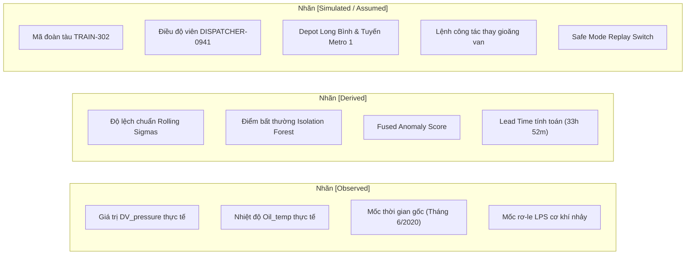

# 02. Từ điển Dữ liệu & Ngữ nghĩa Cảm biến Vật lý (Domain & Data Dictionary)

> **Dự án:** CompressorGuard — Industrial Operations Command Platform (MUGVN Hackathon 2026: MongoDB + Datadog)  
> **Nguồn gốc:** Bộ dữ liệu thực nghiệm chuẩn công nghiệp MetroPT-3 (*Nature Scientific Data*, 2022 / UCI).

---

## 1. Từ điển 15 Tín hiệu Cảm biến Vật lý (MetroPT-3 Sensor Telemetry)

Bảng dưới đây định nghĩa chính xác ngữ nghĩa vật lý của 15 tín hiệu được thu thập từ Hệ thống Cung cấp Khí nén (APU) của đầu máy toa xe:

| Tên Tín hiệu | Đơn vị | Định nghĩa Vật lý & Vị trí Lắp đặt | Giá trị Bình thường | Hành vi khi Rò rỉ Khí (Failure #3) |
| :--- | :---: | :--- | :---: | :--- |
| `timestamp` | UTC | Thời gian ghi nhận mẫu cảm biến (tần số 1Hz) | 2020-02 $\rightarrow$ 2020-08 | Chuỗi sự cố xảy ra từ ngày 05/06 đến 06/06/2020 |
| `TP1` | bar | Áp suất khí nén tại cửa hút (Compressor Inlet) | $\approx 0.0$ bar | Ổn định ở áp suất khí quyển |
| `TP2` | bar | Áp suất đầu xả trực tiếp của máy nén khí | $8.0 - 10.2$ bar (LOADED) | Tăng áp chậm hơn do tải khí bị thất thoát |
| `TP3` | bar | **Áp suất đầu ra của bộ xử lý sấy khí nén (Air Dryer Outlet)** *(Lưu ý: Không phải áp suất bình chứa khí chính)* | $8.0 - 10.0$ bar (LOADED) | Dao động thất thường; tụt nhanh khi máy ngắt tải |
| `H1` | bar | Áp suất sau cụm van một chiều (Check Valve) | $8.0 - 10.0$ bar | Không giữ được áp suất khi dừng nạp |
| `DV_pressure` | bar | **Độ sụt áp qua van xả nước ngưng / tách dầu (Drain Valve)** | $< 0.1$ bar (khi nạp tải) | **Tăng vọt lên > 2.0 bar** do van điện từ bị hở/rò rỉ |
| `Reservoirs` | bar | **Áp suất tích trữ trong các bình khí phanh chính (Main Reservoirs)** | $8.5 - 10.0$ bar | Tụt dốc liên tục; chu kỳ máy nén phải chạy tăng $300\%$ |
| `Motor_current`| A | Cường độ dòng điện động cơ kéo máy nén | $7.0 - 9.5$ A (LOADED) | Duy trì dòng đỉnh liên tục do thời gian nạp kéo dài |
| `Oil_temp` | °C | Nhiệt độ dầu bôi trơn cacte máy nén khí | $55 - 75$ °C | **Tăng vọt lên > 85 °C**, có lúc chạm 98 °C do quá nhiệt |
| `COMP` | bool | Trạng thái máy nén khí ($1 = \text{BẬT}, 0 = \text{TẮT}$) | Luân phiên bật/tắt | Thời gian BẬT chiếm tỷ trọng áp đảo (Duty Cycle $> 80\%$) |
| `DV_electric` | bool | Tín hiệu điện điều khiển van xả nước ngưng | $1$ khi xả chu kỳ | Giữ tín hiệu đóng nhưng cơ khí van vẫn bị hở |
| `TOWERS` | bool | Trạng thái chuyển đổi cột sấy hút ẩm | Luân phiên $0/1$ | Chu kỳ đảo tháp bị rút ngắn do lượng khí đi qua quá lớn |
| `MPG` | bool | Tiếp điểm rơ-le điều áp chính (Main Pressure Governor) | Đóng khi áp $< 8.5$ bar | Duy trì trạng thái đóng liên tục |
| `LPS` | bool | **Rơ-le áp suất thấp cơ khí (Low Pressure Switch)** | **1 (Áp suất an toàn)** | **Nhảy về 0 (BÁO ĐỘNG TỤT ÁP)** lúc 21:52 ngày 06/06 |
| `Pressure_switch`| bool | Công tắc bảo vệ áp suất phụ trợ | 1 (Bình thường) | Nhảy về 0 khi toàn hệ thống cạn khí |

---

## 2. Đính chính Kỹ thuật: Phân biệt `TP3` và `Reservoirs`

> [!IMPORTANT]
> **Đính chính Ngữ nghĩa Cảm biến:**
> - Trong một số tài liệu cũ, `TP3` bị gọi nhầm là *"áp suất bình chứa khí phanh chính"*. Đây là một sai sót kỹ thuật.
> - **Thực tế cơ học:** Cảm biến `TP3` được đặt tại **đầu ra của bộ sấy khí nén (Air Dryer Outlet)**. Nó phản ánh độ thông thoát và chất lượng khí nén trước khi đi vào hệ thống phân phối.
> - Cảm biến đo áp suất thực tế bên trong các bình khí phanh chính là cột `Reservoirs`.
> - Điều kiện kiểm tra an toàn trong `ActionGuard` (`TP3 >= 7.0 bar` và `LPS == 1`) thực chất là bước kiểm chứng **áp suất mạch xả khí nén** có còn duy trì mức an toàn tối thiểu để phục vụ di chuyển đoàn tàu về depot hay không.

---

## 3. Quy chuẩn 3 Nhãn Thông tin Nghiêm ngặt (Information Provenance)

Mọi dữ liệu hiển thị trên giao diện hoặc mô tả trong tài liệu đều phải được gán nhãn thuộc một trong 3 nhóm sau:

### 3.1. Nhãn `[Observed]` — Dữ liệu Quan sát Thực tế
- Toàn bộ các giá trị áp suất (bar), nhiệt độ (°C), dòng điện (A) và trạng thái nhị phân của rơ-le LPS.
- Mốc thời gian xuất hiện sự cố rò khí van xả: Bắt đầu từ $10:00$ ngày $05/06/2020$ và kết thúc khi rơ-le LPS nhảy lúc $21:52$ ngày $06/06/2020$.

### 3.2. Nhãn `[Derived]` — Dữ liệu Tính toán bởi Thuật toán
- Các chỉ số vi phân cửa sổ trượt $60$ giây từ MongoDB: $\sigma_{\text{DV}}$, $\sigma_{\text{Oil}}$.
- Điểm bất thường đa biến không giám sát từ mô hình Isolation Forest ($0.0 \rightarrow 1.0$).
- Thời gian báo trước (Lead Time) tính toán: $33\text{h } 52\text{m}$ (khoảng cách giữa thời điểm thuật toán kích hoạt cảnh báo sớm và thời điểm rơ-le LPS vật lý truyền thống nhảy).

### 3.3. Nhãn `[Simulated / Assumed]` — Bối cảnh Giả lập & Nghiệp vụ Minh họa
- Ánh xạ đoàn tàu thử nghiệm sang mã hiệu `TRAIN-302` trên tuyến Metro Bến Thành – Suối Tiên.
- Định danh người vận hành: `DISPATCHER-0941`.
- Quy trình lập Lệnh công tác bảo trì (Work Order) và điều hướng về Depot Long Bình.
- Cơ chế Safe Mode: Khi người dùng bấm phê duyệt Safe Mode trên giao diện, hệ thống chuyển nhánh phát lại (branching replay) sang chuỗi dữ liệu sau bảo trì ngày $08/06/2020$ để kiểm chứng hồi phục.
