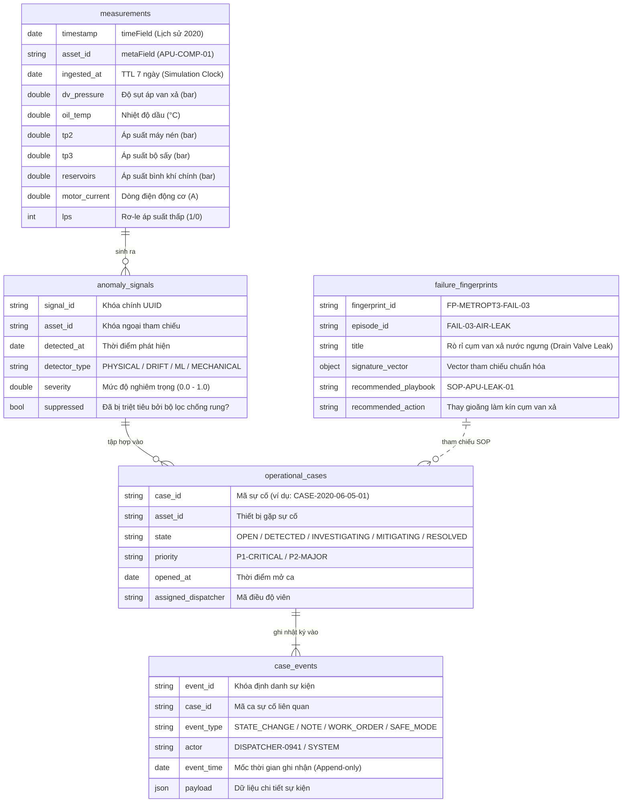

# 03. Mô hình Dữ liệu & Mẫu Truy vấn MongoDB (MongoDB Data Model & Query Patterns)

> **Dự án:** CompressorGuard — Industrial Operations Command Platform (MUGVN Hackathon 2026: MongoDB + Datadog)  
> **Trạng thái:** Chuẩn hóa kỹ thuật 100% theo mã nguồn thực tế tại commit `d2a2400`.

---

## 1. Danh mục 5 Collections Thực tế trong Mã nguồn

Hệ thống sử dụng MongoDB để quản trị toàn diện cả dữ liệu chuỗi thời gian tần số cao và dữ liệu nghiệp vụ có cấu trúc thông qua 5 collections chính thức:



### 1.1. Cấu hình Time Series Collection `measurements`
- **Tạo Collection:** 
  ```python
  db.create_collection(
      "measurements",
      timeseries={
          "timeField": "timestamp",
          "metaField": "asset_id",
          "granularity": "seconds"
      }
  )
  ```
- **Quy tắc Dual-Clock & TTL Index:**
  - Để bảo toàn dữ liệu lịch sử gốc (tháng 06/2020) không bị MongoDB tự động xóa, trường `timestamp` **tuyệt đối không** gắn TTL.
  - Hệ thống tạo chỉ mục TTL 7 ngày ($604.800$ giây) trên trường `ingested_at` (thời điểm bản ghi được bơm vào database theo giờ mô phỏng thực tế):
    ```python
    db["measurements"].create_index("ingested_at", expireAfterSeconds=604800)
    ```

---

## 2. Các Aggregation Pipeline Thực tế

Trong `src/storage/repository.py`, hai pipeline tính toán được thực thi trực tiếp trên MongoDB:

### 2.1. Pipeline #1: Vi phân Cửa sổ Trượt 60s (`$setWindowFields`)
Pipeline này tính toán giá trị trung bình trượt và độ lệch chuẩn của cảm biến `dv_pressure` và `oil_temp` trong cửa sổ 60 giây gần nhất để phát hiện độ bất ổn định:

```javascript
db.measurements.aggregate([
  {
    $match: {
      asset_id: "APU-COMP-01",
      timestamp: { $gte: ISODate("2020-06-05T09:40:00Z"), $lte: ISODate("2020-06-05T11:40:00Z") }
    }
  },
  {
    $setWindowFields: {
      partitionBy: "$asset_id",
      sortBy: { timestamp: 1 },
      output: {
        dv_rolling_avg: {
          $avg: "$dv_pressure",
          window: { range: [-60, 0], unit: "second" }
        },
        dv_rolling_std: {
          $stdDevSamp: "$dv_pressure",
          window: { range: [-60, 0], unit: "second" }
        }
      }
    }
  }
])
```

### 2.2. Pipeline #2: Phân tích Chu kỳ Tải Đa chiều (`$facet` + `$group`)
Pipeline này phân tích tỷ lệ chu kỳ nạp tải (Duty Cycle) và phân bố nhiệt động học theo chế độ hoạt động:

```javascript
db.measurements.aggregate([
  {
    $match: {
      asset_id: "APU-COMP-01",
      timestamp: { $gte: startTime, $lte: endTime }
    }
  },
  {
    $facet: {
      regime_distribution: [
        {
          $group: {
            _id: "$regime",
            sample_count: { $sum: 1 },
            avg_oil_temp: { $avg: "$oil_temp" },
            max_dv_pressure: { $max: "$dv_pressure" }
          }
        }
      ],
      total_metrics: [
        {
          $group: {
            _id: null,
            total_samples: { $sum: 1 },
            avg_motor_current: { $avg: "$motor_current" }
          }
        }
      ]
    }
  }
])
```

---

## 3. Đính chính Kỹ thuật Minh bạch: Truy vấn Đối sánh Fingerprint

> [!IMPORTANT]
> **Đính chính Kỹ thuật về `match_failure_fingerprint()`:**
> - Trong một số tài liệu dự thảo ban đầu, cơ chế so khớp mẫu sự cố lịch sử được gọi là *"MongoDB Vector Search Pipeline"*. Đây là một cách gọi chưa chuẩn xác với mã nguồn thực tế.
> - **Cơ chế hoạt động thực sự trong `src/storage/repository.py`:**
>   1. Hàm `match_failure_fingerprint()` sử dụng câu lệnh query cơ bản `find({}, {"_id": 0})` để lấy danh sách các mẫu sự cố chuẩn hóa (seed fingerprints) từ collection `failure_fingerprints`.
>   2. Sau đó, thuật toán **tính toán khoảng cách Cosine Similarity trực tiếp bằng Python** (`math.sqrt` và tích vô hướng vector giữa đặc trưng quan sát và đặc trưng tham chiếu).
>   3. Kết quả được sắp xếp theo `similarity_score` giảm dần để gợi ý cẩm nang SOP và hành động khắc phục phù hợp.
> - Đây là thiết kế thực dụng và hiệu quả cao cho số lượng tập mẫu fingerprint có giới hạn ($< 100$ mẫu sự cố chuẩn ngành).

---

## 4. Bằng chứng Đo kiểm & Môi trường Kiểm thử

- **Môi trường In-Memory Emulation:** Mã nguồn cung cấp lớp `InMemoryCollection` trong `src/storage/mongo_client.py` hỗ trợ chạy demo offline và unit test mà không bắt buộc cài đặt MongoDB daemon.
- **Kiểm chứng trên MongoDB Server Thực:**
  - Dự án cung cấp script độc lập `scripts/verify_mongodb_timeseries.py`.
  - Script này kiểm tra 4 tiêu chí cốt lõi trên một `mongod` thật:
    1. Cấu trúc Time Series Collection thực và tính năng tự động gom bucket.
    2. Ràng buộc bảo toàn dữ liệu: Không có TTL trên `timestamp` lịch sử; tồn tại TTL 7 ngày trên `ingested_at`.
    3. Kết quả tính toán của `$setWindowFields` khớp hoàn toàn với tính toán độc lập bằng `pandas`.
    4. Kết quả thống kê `$facet` + `$group` khớp với tái tính toán `pandas`.
