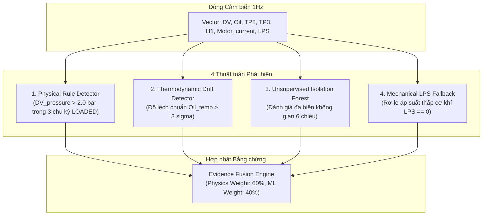
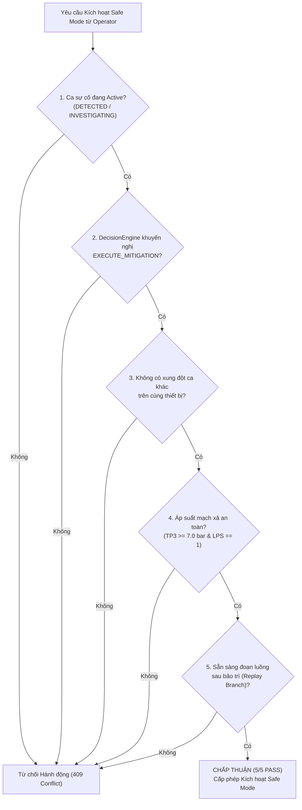
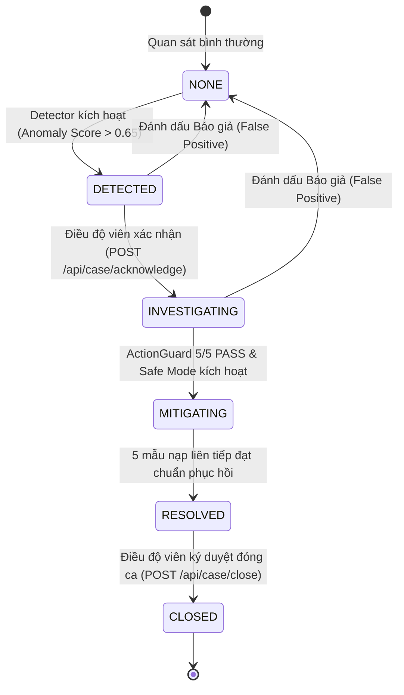

# 04. Động cơ Phát hiện & Vòng đời Quản trị Sự cố (Detection & Incident Lifecycle)

> **Dự án:** CompressorGuard — Industrial Operations Command Platform (MUGVN Hackathon 2026: MongoDB + Datadog)  
> **Trạng thái:** Chuẩn hóa kỹ thuật 100% theo mã nguồn thực tế tại commit `d2a2400`.

---

## 1. Bộ 4 Detector Độc lập (Multi-Detector Suite)

Để khắc phục nhược điểm báo động giả của các hệ thống AI hộp đen đơn lẻ, CompressorGuard phối hợp 4 thuật toán phát hiện độc lập:

### 1.1. Chi tiết Kỹ thuật Từng Detector
1. **Rule-based Physical Detector (`PhysicalDrainValveDetector`):**
   - Giám sát độ sụt áp van xả `DV_pressure`. Khi máy nén nạp tải (`COMP == 1`), áp suất van xả bình thường phải duy trì $< 0.1$ bar.
   - Khi có rò rỉ khí do kẹt van điện từ hoặc rách gioăng, áp lực tích tụ tại van vượt quá $2.0$ bar. Thuật toán yêu cầu hiện tượng này duy trì trong ít nhất 3 chu kỳ nạp liên tiếp để loại trừ nhiễu thoáng qua (transient spikes).
2. **Thermodynamic Drift Detector (`ThermodynamicDriftDetector`):**
   - So sánh nhiệt độ dầu cacte máy nén `Oil_temp` với baseline chu kỳ nạp thông thường. Khi rò rỉ khí làm tăng chu kỳ làm việc của máy nén lên $> 80\%$, nhiệt độ dầu tăng trôi dạt (drift) vượt ngưỡng 3 độ lệch chuẩn ($> 3\sigma$).
3. **Unsupervised ML Detector (`IsolationForestDetector`):**
   - Mô hình cây cô lập không giám sát được huấn luyện trước trên tập dữ liệu lành mạnh của tháng 03/2020.
   - Đầu vào là vector 6 chiều chuẩn hóa: `[DV_pressure, Oil_temp, TP2, TP3, H1, Motor_current]`. Trả về điểm bất thường liên tục từ $0.0$ đến $1.0$.
4. **Mechanical LPS Fallback Detector (`MechanicalLPSDetector`):**
   - Giám sát tiếp điểm rơ-le áp suất thấp cơ học `LPS`. Khi $LPS = 0$, sự cố đã chuyển sang giai đoạn khẩn cấp cấp độ thảm họa.

---

## 2. Hợp nhất Bằng chứng & Động cơ Ra quyết định (DecisionEngine)

- **Trọng số Hợp nhất (Evidence Fusion):**
  $$\text{Fused Score} = 0.6 \times \text{Score}_{\text{Physics}} + 0.4 \times \text{Score}_{\text{ML}}$$
  Hệ thống chỉ kích hoạt ca sự cố mức độ ưu tiên P1 khi **cả mô hình vật lý và mô hình học máy cùng đồng thuận** (Disagreement Check = PASS).
- **Quy tắc Ra quyết định (15 Decision Rules):**
  Hệ thống ánh xạ điểm hợp nhất vào 4 nhóm hành động rõ ràng:
  - `MONITOR`: Tín hiệu dao động nhẹ, ghi nhận vào log, chưa làm phiền điều độ viên.
  - `INVESTIGATE`: Phát hiện dấu hiệu rò rỉ khí sớm, kích hoạt ca sự cố trên Web Console.
  - `EXECUTE_MITIGATION`: Đủ bằng chứng vật lý và ML, khuyến nghị điều độ viên kích hoạt Safe Mode và lập lệnh công tác Depot.
  - `VERIFY_RECOVERY`: Đánh giá dữ liệu sau sửa chữa để đóng ca sự cố.

---

## 3. Chốt chặn An toàn ActionGuard (5 Pre-Flight Safety Checks)

Để đảm bảo hệ thống không bao giờ tự ý đưa ra quyết định sai lầm ảnh hưởng đến an toàn chạy tàu, `ActionGuard` bắt buộc kiểm tra 5 điều kiện tiên quyết trước khi cho phép chuyển sang **Safe Mode**:

---

## 4. Máy Trạng thái Vòng đời Sự cố (Incident State Machine)

Vòng đời sự cố tuân theo máy trạng thái 6 nấc nghiêm ngặt, có kiểm tra tính hợp lệ của mọi bước chuyển trạng thái (State Transition Validation):

---

## 5. Tiêu chuẩn Nghiệm thu Phục hồi (5-Sample Loaded Recovery)

Sau khi đoàn tàu được bảo trì và luồng dữ liệu chuyển sang mốc sau sửa chữa (ngày 08/06/2020), hệ thống **không** tự động đóng ca sự cố ngay mà yêu cầu kiểm chứng qua **Bảng Nghiệm thu 5 Mẫu Tải**:
- **Điều kiện 1:** Máy nén phải bước vào chu kỳ nạp tải thực tế (`regime == LOADED` và `motor_current > 6.0 A`).
- **Điều kiện 2:** Áp suất van xả $DV_{\text{pressure}} \le 0.1$ bar (chứng minh van đã đóng kín hoàn toàn).
- **Điều kiện 3:** Nhiệt độ dầu cacte $Oil_{\text{temp}} \le 75.0$ °C (nhiệt độ nằm trong dải an toàn).
- Khi toàn bộ 5 chu kỳ nạp liên tiếp đạt chuẩn `PASS`, hệ thống mới cho phép điều độ viên bấm nút đóng ca sự cố (`POST /api/case/close`).
