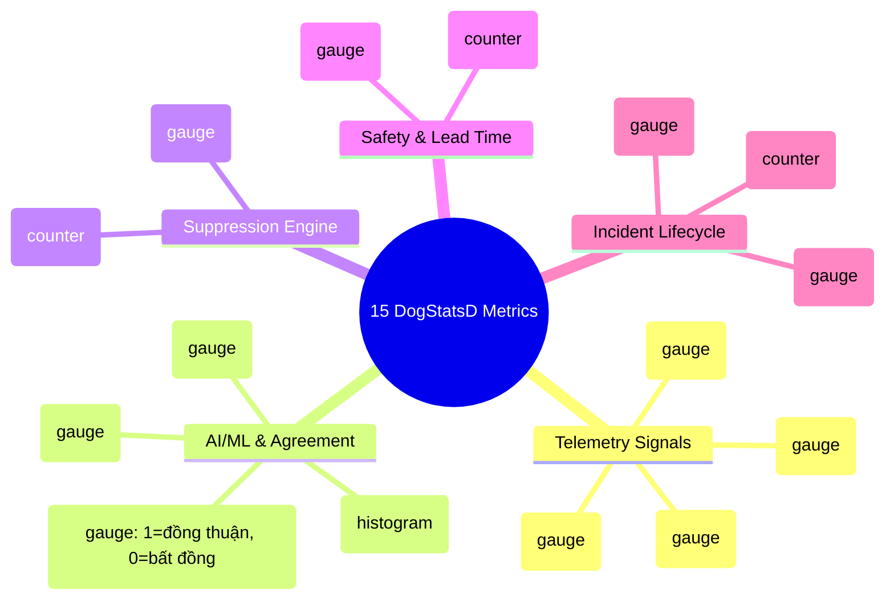

# 05. Tích hợp Giám sát Độ tin cậy Datadog (Datadog Observability Integration)

> **Dự án:** CompressorGuard — Industrial Operations Command Platform (MUGVN Hackathon 2026: MongoDB + Datadog)  
> **Trạng thái:** Chuẩn hóa kỹ thuật 100% theo mã nguồn thực tế tại commit `d2a2400`.

---

## 1. Vai trò Kiến trúc Thực tế của Datadog

> [!IMPORTANT]
> **Định vị Kiến trúc Chuẩn xác:**
> - Trong một số tài liệu sơ thảo, Datadog từng được gọi là *"Enterprise Control Plane"*. Đây là cách dùng từ chưa phản ánh đúng bản chất kỹ thuật.
> - **Thực tế kiến trúc:** Trong CompressorGuard, toàn bộ logic ra quyết định nghiệp vụ, máy trạng thái sự cố và cơ chế khóa an toàn đều được xử lý bởi `DecisionEngine` và `ActionGuard` viết bằng Python.
> - **Datadog đóng vai trò là Tầng Quan sát & Giám sát Độ tin cậy (Observability & Telemetry Plane)**:
>   1. Thu thập các chỉ số đo lường hiệu năng thời gian thực (real-time metrics) qua giao thức DogStatsD.
>   2. Đo đạc độ trễ và vết thực thi phân tán (APM Distributed Tracing) trên từng chặng xử lý thuật toán.
>   3. Cung cấp bảng điều khiển trung tâm (SRE Watchtower) và hệ thống cảnh báo tự động (Monitors) gửi thông báo khi có bất thường vật lý hoặc sai lệch giữa mô hình AI và quy luật nhiệt động.

---

## 2. Danh mục 15 Custom Metrics DogStatsD

Mã nguồn tại `src/observability/metrics.py` phát ra 15 chỉ số đo lường được chuẩn hóa theo tiền tố `compressorguard.*`:

---

## 3. Phân tích Dấu vết Phân tán APM (Distributed Tracing Spans)

Tầng APM sử dụng thư viện chuẩn `ddtrace` (`src/observability/tracer.py`) để đo đạc độ trễ của từng bước trong pipeline xử lý:

```mermaid
gantt
    title Mẫu Dấu vết Phân tán APM Pipeline (Đo thực tế trên môi trường demo: ~11.2 ms)
    dateFormat  X
    axisFormat %s ms
    section Pipeline Spans
    trace.compressorguard.telemetry.process     :0, 11
    trace.compressorguard.detector.evaluate     :2, 8
    trace.compressorguard.ml.inference          :4, 7
    trace.compressorguard.action_guard.validate :8, 10
    trace.compressorguard.mongo.persist         :10, 11
```

- **Mốc tham chiếu hiệu năng:** Độ trễ toàn trình từ lúc đọc bản ghi cảm biến đến khi lưu trữ và cập nhật trạng thái sự cố đạt xấp xỉ **11.2 ms** (nằm trong ngưỡng cam kết vận hành $< 15$ ms của hệ thống).
- **Lưu ý minh bạch:** Con số $11.2$ ms là kết quả đo thực tế từ các mẫu span cục bộ trong phiên kiểm thử, đóng vai trò mốc chuẩn hiệu năng (benchmark reference) của ứng dụng, không phải là cam kết SLA dịch vụ mạng toàn cầu.

---

## 4. Bảng điều khiển Trung tâm & 3 Bộ Cảnh báo Tự động (Dashboard & Monitors)

Mã nguồn cung cấp sẵn 2 tệp cấu hình chuẩn Declarative JSON:

### 4.1. Dashboard JSON (`datadog/dashboard.json`)
Bao gồm 8 widget quan sát chuyên dụng:
1. `Fleet-wide Compressor Status & Health Index`: Tỷ lệ đoàn tàu khỏe mạnh trong hạm đội.
2. `Live Thermodynamic Sensor Signals`: Đồ thị song song của `DV_pressure`, `Oil_temp` và `Motor_current`.
3. `Unsupervised Isolation Forest Anomaly Score`: Điểm số bất thường đa biến và ngưỡng kích hoạt $0.65$.
4. `Detector Agreement Matrix`: Tỷ lệ đồng thuận giữa mô hình vật lý và mô hình học máy.
5. `Transient Noise Suppression Rate`: Số lượng gai nhiễu áp suất thoáng qua đã bị bộ lọc triệt tiêu.
6. `Operational Case Lifecycle State Timeline`: Tiến trình chuyển đổi trạng thái của ca sự cố.
7. `APM Pipeline Execution Latency`: Phân phối độ trễ của các span xử lý.
8. `Confirmed Intervention Lead Window`: Đồng hồ đếm ngược thời gian can thiệp dẫn trước (Lead Time).

### 4.2. Danh mục 3 Monitors (`datadog/monitors.json`)
1. **Monitor 1 — Rò rỉ Khí nén Nghiêm trọng (Severe Air Leak Detection):**
   - Kích hoạt khi: `avg(last_5m):compressorguard.telemetry.pressure{sensor:dv_pressure} > 2.0 AND avg(last_5m):compressorguard.ml.anomaly_score > 0.65`.
   - Mức cảnh báo: `CRITICAL P1`.
2. **Monitor 2 — Sai lệch Đồng thuận Giữa AI và Vật lý (Model Disagreement Gauge):**
   - Kích hoạt khi: `max(last_10m):compressorguard.detector.agreement < 1.0`.
   - **Đính chính kỹ thuật:** Gauge `compressorguard.detector.agreement` phát giá trị $0$ khi có sự xung đột giữa kết quả của Isolation Forest và quy tắc nhiệt động học vật lý. Đây là cơ chế phát hiện sớm sai lệch phán đoán của mô hình (detector disagreement), giúp đội ngũ kỹ sư rà soát lại trọng số trước khi mô hình bị trôi dạt thực sự (distribution drift).
3. **Monitor 3 — Vi phạm Tiêu chuẩn An toàn ActionGuard (ActionGuard Interlock Breach):**
   - Kích hoạt khi: `sum(last_5m):compressorguard.safety.action_guard_denials_total > 3`.
   - Cảnh báo điều độ viên rằng hệ thống đang cố gắng kích hoạt Safe Mode nhưng không thỏa mãn các điều kiện vật lý an toàn.
