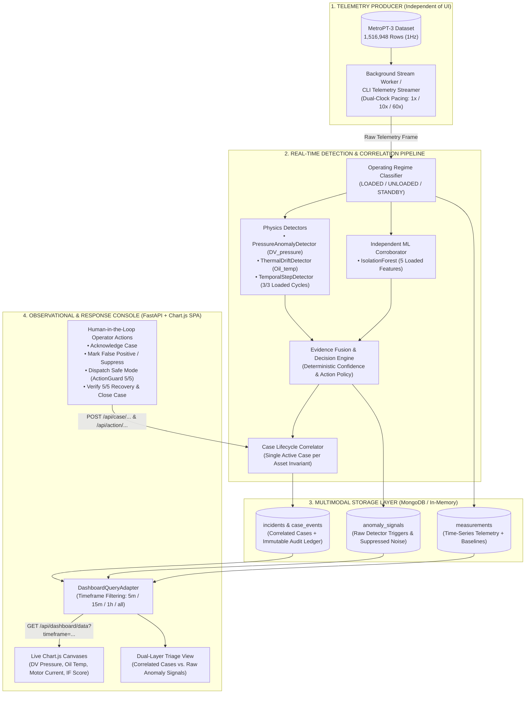

# CompressorGuard v3.0 — System & Live Stream Architecture

> **Architecture Pattern:** Decoupled Producer–Pipeline–Storage–Observer (ThreatLens AI Live Pattern)  
> **Status:** Normative Architecture Specification (v3.0)  
> **Core Principle:** *"The Dashboard Does Not Drive Telemetry. The Stream Lives in the Backend; the Console Observes, Investigates, and Acts."*

---

## 1. Architectural Shift: From "Browser-Ticked Auto-Pilot" (v2) to "Decoupled Live Stream" (v3)

Ở phiên bản cũ (v2.x), giao diện trình duyệt (`app.js`) phải chạy vòng lặp `setInterval` gọi `POST /demo/tick` hoặc bắt người dùng bấm các nút nhảy mốc thời gian (`Jump Milestone`) để đẩy từng điểm dữ liệu đi tiếp. Điều này làm lộ rõ cảm giác "auto-pilot / kịch bản dựng sẵn".

Sang phiên bản **v3.0**, CompressorGuard áp dụng kiến trúc **Live Stream tách rời (Decoupled Producer–Consumer)** lấy cảm hứng trực tiếp từ **ThreatLens AI**:

| Thành phần | Kiến trúc cũ (v2.x — Browser-Driven) | Kiến trúc mới (v3.0 — ThreatLens-Style Live Architecture) |
| :--- | :--- | :--- |
| **Luồng sinh dữ liệu (Producer)** | Phụ thuộc vào trình duyệt: Tab web phải bấm `Play` để gọi `POST /demo/tick`. Đóng tab web là hệ thống ngừng chạy. | **Độc lập hoàn toàn với UI:** Chạy bằng **Background Stream Worker** trên Server hoặc **CLI Telemetry Streamer** (`scripts/stream_telemetry.py`). Tự động bơm dữ liệu cảm biến `MetroPT-3` theo nhịp Dual-Clock vào Pipeline. |
| **Tầng lưu trữ & Tương quan (Storage & Correlation)** | Chỉ giữ trạng thái đơn lẻ trong bộ nhớ tạm thời của bước nhảy. | Lưu trữ đầy đủ 3 lớp dữ liệu vào **MongoDB** (kèm In-Memory Adapter dự phòng):<br/>1. `measurements` (Raw Telemetry Time-Series)<br/>2. `anomaly_signals` (Raw Detector Alerts & Suppressed Spikes)<br/>3. `incidents` & `case_events` (Correlated Operational Cases & Audit Ledger) |
| **Vai trò của Web Console (Consumer UI)** | Vừa làm trình điều khiển kịch bản (`Play/Jump`), vừa hiển thị các đoạn text hardcode tĩnh. | **Pure Observer & Responder Console:** Tự động truy vấn dữ liệu từ DB/API theo khung thời gian (`timeframe`: `5m`, `15m`, `1h`, `6h`, `all`), vẽ biểu đồ **Chart.js** thời gian thực, chuyển đổi giữa **Correlated Cases** và **Raw Sensor/Signal Stream**, và thực thi các lệnh điều độ thật. |
| **Công cụ điều khiển Simulator** | Nằm chình ình trên thanh Header chính của sản phẩm. | Tách biệt ra CLI hoặc ẩn trong ngăn kéo phụ (`Simulation Studio`), tuân thủ nguyên tắc: **Dashboard vận hành không tự sinh traffic giả.** |

---

## 2. End-to-End Live Architecture Diagram



---

## 3. Core Architectural Components (Chi Tiết Các Khối Kiến Trúc)

### 3.1. Independent Telemetry Producer (`StreamWorker` / CLI Streamer)
Thay vì đợi trình duyệt gọi `/demo/tick`, hệ thống vận hành luồng dữ liệu theo 2 chế độ linh hoạt (tương tự ThreatLens AI):
1. **Background Live Stream Daemon (Mặc định khi chạy Server):**
   - Khi khởi động FastAPI (`run_demo.py`), một `asyncio` background task tự động chạy ngầm trên server, đẩy các bản ghi từ `ScenarioStream` qua `IncidentLifecycleManager.tick()` theo tốc độ thực tế của đồng hồ mô phỏng (`simulation_time`).
   - Người dùng mở trình duyệt ở bất kỳ thời điểm nào (hoặc mở 2–3 tab trình duyệt cùng lúc) đều nhìn thấy **cùng một trạng thái thời gian thực đồng bộ từ Server**.
2. **CLI Stream / Scenario Runner (`scripts/stream_telemetry.py`):**
   - Cho phép kỹ sư bắn luồng dữ liệu từ cửa sổ dòng lệnh độc lập (ví dụ: bơm kịch bản `failure_3`, tua nhanh đến điểm bùng phát, hoặc nạp luồng dữ liệu sau bảo trì) mà không cần đụng vào giao diện Dashboard.

### 3.2. Dual-Clock Semantics (Ngữ Nghĩa Hai Đồng Hồ)
- **`event_time` (Historical Sensor Clock):** Giữ nguyên 100% dấu thời gian gốc của cảm biến trong tập dữ liệu `MetroPT-3` (ví dụ `2020-06-05 09:50:39 UTC`). Mọi phép tính độ lệch $\sigma$, cửa sổ trượt 3 chu kỳ mang tải, và khoảng thời gian dẫn trước **33 giờ 52 phút** đều tính trên `event_time`.
- **`simulation_time` (Server Wall-Clock Pacing):** Điều tiết nhịp bơm dữ liệu ở phía Server. Khoảng nghỉ giữa 2 lần bơm tỷ lệ thuận với $\Delta \text{event\_time}$ thực tế chia cho hệ số tốc độ (`speed_multiplier`).

### 3.3. Two-Layer Operational Visibility: Raw Signals vs. Correlated Cases
Học tập trực tiếp từ thiết kế `Correlated Incidents` vs. `Raw Security Alerts` của **ThreatLens AI**, CompressorGuard phân tách rõ 2 tầng quan sát trên giao diện:

1. **Tầng 1 — Raw Telemetry & Anomaly Signal Stream (`measurements` + `anomaly_signals`):**
   - Hiển thị luồng dữ liệu cảm biến liên tục trên biểu đồ **Chart.js** (`DV_pressure`, `Oil_temp`, `Motor_current`, `Isolation Forest Score`).
   - Ghi nhận mọi xung cảnh báo thô từ các bộ phát hiện vật lý, bao gồm cả các xung nhiễu thoáng qua bị hệ thống tự động chặn lại (ví dụ: xung áp suất `0.52 bar` lúc `00:33:07` chỉ kéo dài 1 chu kỳ nên bị gán nhãn `SUPPRESSED_TRANSIENT` — không tạo Case giả gây mệt mỏi cho ca trực).
2. **Tầng 2 — Correlated Operational Cases (`incidents` + `case_events`):**
   - Khi và chỉ khi các tín hiệu thô hội tụ đủ điều kiện vật lý qua nhiều chu kỳ mang tải (`Pressure + Thermal + Temporal Persistence`), `CaseLifecycleCorrelator` mới gom chúng lại thành **1 Hồ Sơ Sự Cố Duy Nhất (`Single Active Case`)** trên tài sản `APU-COMP-01`.
   - Mọi tín hiệu tiếp theo (như `Isolation Forest Corroboration` lúc `10:15:00` hay `Conventional LPS=1` lúc `19:42:19 ngày hôm sau`) đều được tự động gom (correlate) vào làm giàu cho chính Hồ sơ sự cố đó, tuyệt đối không sinh ra hàng chục cảnh báo trùng lặp.

### 3.4. `DashboardQueryAdapter` & Timeframe-Based API
Tương tự `DashboardQueryAdapter` trong ThreatLens AI, tầng API cung cấp dữ liệu tổng hợp theo khung thời gian (`timeframe`: `5m`, `15m`, `1h`, `6h`, `all` tính từ `current_event_time` trở về trước):
- **`GET /api/dashboard/data?timeframe=15m`** (hoặc các endpoint chuyên biệt `/api/operations`, `/api/telemetry/window`, `/api/case`, `/api/evidence`, `/api/recovery`, `/api/case/events`):
  - Trả về chuỗi thời gian thực tế để vẽ các canvas Chart.js.
  - Trả về danh sách `Correlated Cases` và `Raw Anomaly Signals`.
  - Trả về bảng kiểm tra trực tiếp 5 điều kiện an toàn của `ActionGuard` (`passed: true/false` động theo trạng thái thực).

### 3.5. Human-in-the-Loop Operator Actions (Tương Tác Điều Hành Thật)
Thay vì tự động chuyển trạng thái từ đầu đến cuối, Operator trực tiếp tương tác với hệ thống qua các lệnh ghi vào DB và sổ cái `CaseEvent`:
1. **`POST /api/case/acknowledge` (Tiếp nhận & Phân loại):** Chuyên viên nhận xử lý sự cố (`DISPATCHER-0941`), gắn mức ưu tiên (`P1-CRITICAL`).
2. **`POST /api/case/notes` (Ghi chú điều tra):** Lưu nhận định kỹ thuật vào dòng thời gian của Case.
3. **`POST /api/case/false-positive` (Đánh dấu Cảnh báo giả / Nhiễu):** Cho phép Operator đóng/bỏ qua một cảnh báo nếu xác định là nhiễu cảm biến, kèm lý do audit.
4. **`POST /api/action/safe-mode` (Kích hoạt Can thiệp An toàn qua `ActionGuard`):**
   - Kiểm tra 5 điều kiện an toàn (`case_confirmed`, `mitigation_recommended`, `single_active_case`, `simulation_mode_active`, `replay_branch_available`).
   - Nếu gọi sớm khi chưa đủ bằng chứng đa biến $\rightarrow$ chặn ngay lập tức với lỗi **HTTP 409 Conflict**.
   - Nếu đạt `5/5 PASS` $\rightarrow$ chuyển Case sang `MITIGATING` và rẽ nhánh luồng dữ liệu Server sang phân đoạn sau bảo trì (`2020-06-08 16:05:00 UTC`).
5. **`POST /api/case/close` (Nghiệm thu Phục hồi & Giải phóng Tàu):**
   - Chỉ mở khóa khi `RecoveryVerifier` đếm đủ **5/5 chu kỳ `LOADED` liên tiếp** đạt chuẩn vật lý (`DV_pressure < 0.05 bar` và `Oil_temp < 67.0 °C`).
   - Operator ký xác nhận nguyên nhân gốc (`Confirmed Root Cause`) và đưa tài sản `APU-COMP-01` trở lại trạng thái `HEALTHY`.

---

## 4. Cấu Trúc Thư Mục Mã Nguồn Chuẩn Hóa (v3.0 Layout)

```text
iot-hackathon/
├── dataset/
│   └── MetroPT3(AirCompressor).csv       # 1.51M dòng dữ liệu cảm biến thực tế
├── src/
│   ├── api/
│   │   ├── app.py                        # FastAPI Factory + Background Live Stream Worker
│   │   ├── routes_product.py             # Observational & Operator Action Endpoints
│   │   ├── routes_demo.py                # Background Stream Pacing & Scenario Controls
│   │   └── schemas.py                    # Pydantic DTOs
│   ├── engine/
│   │   ├── replay.py                     # ScenarioStream & Dual-Clock Replay Engine
│   │   ├── regime.py                     # Operating Regime Classifier (LOADED/UNLOADED)
│   │   ├── detectors.py                  # Pressure, Thermal, Temporal & Isolation Forest
│   │   ├── fusion.py                     # EvidenceFusionEngine (Provenance & Confidence)
│   │   ├── decision.py                   # Pure Deterministic DecisionEngine
│   │   ├── action_guard.py               # 5-Check Pre-Flight Safety Policy
│   │   ├── recovery.py                   # 5/5 Consecutive LOADED RecoveryVerifier
│   │   └── lifecycle.py                  # IncidentLifecycleManager & Case Correlator
│   ├── storage/
│   │   ├── mongo_client.py               # MongoDB Atlas + In-Memory Fallback
│   │   └── repository.py                 # Multimodal Repository & Query Adapter
│   ├── observability/
│   │   ├── metrics.py                    # DogStatsD Custom Metrics
│   │   ├── tracer.py                     # Datadog APM Distributed Tracing
│   │   └── logger.py                     # Structured JSON Logging with Trace Correlation
│   └── static/                           # [ĐÃ XÓA CŨ - SẼ XÂY DỰNG LẠI THEO CHUẨN THREATLENS AI]
│       └── (Clean Chart.js + Dark Operations Console)
└── tests/                                # 96+ Automated Evaluation Gate & Domain Tests
```
