# CompressorGuard: Product & UX Specification (Operations Command Platform)

> **Document Version:** 2.3 (Fleet-Centric Case Architecture & Dual-Clock Live Simulation)  
> **Target:** Operations Command Platform for Critical Rail Fleet Assets  
> **Core Promise:** **Detect earlier → Prove why → Act safely → Verify recovery.**

---

## 1. Product Thesis (The North Star)

* **Category:** Operations Command Platform for Rail Fleet Critical Physical Assets (Not an IoT dashboard, not an anomaly scoring utility).
* **Target User & Persona:** Fleet Operations Specialist responsible for Lisbon Metro train lines (Linha Azul).
* **The Business & Operational Spine:**
  $$\text{Fleet} \longrightarrow \text{Train} \longrightarrow \text{APU} \longrightarrow \text{Compressor} \longrightarrow \text{Case} \longrightarrow \text{Evidence} \longrightarrow \text{Decision} \longrightarrow \text{Action} \longrightarrow \text{Recovery} \longrightarrow \text{Operational Outcome}$$
  - **Fleet:** Where leadership and dispatch understand transit service continuity.
  - **Asset:** Where physical component degradation occurs.
  - **Case:** The structured unit of operational work assigned to a dispatcher.
  - **Evidence:** The thermodynamic provenance that earns operator trust.
  - **Decision & Action:** Policy-governed safe simulation intervention (`ActionGuard`).
  - **Verification:** Proof of telemetry stabilization before closing the case and releasing the asset.
* **Strict Separation of 3 Data Layers:**
  1. **Layer A — Business Context (Asset Registry):** Fleet, Train, APU, Compressor, Criticality, Line Assignment.
  2. **Layer B — Observed Telemetry & Computed State:** Sensor facts, sigmas, regimes, corroboration scores.
  3. **Layer C — Validation Reference (Ground Truth):** Maintenance reports (Failure #3 Air Leak) used strictly to validate historical scenarios, never leaked into online detectors.
* **The 3 Unforgettable Claims:**
  1. **33 hours 52 minutes Confirmed Intervention Window:** Calculated deterministically from confirmed degradation detection (`2020-06-05 09:50:39 UTC`) to reactive Low Pressure Switch alert (`2020-06-06 19:42:19 UTC`).
  2. **Evidence Provenance > Anomaly Score:** 4-signal structured cross-sensor thermodynamics with explicit source provenance: Pressure ($+23.75\sigma$), Thermal drift ($+5.71\sigma$), Temporal 3-cycle step persistence, plus **Multivariate Isolation Forest (5 features in LOADED regime) as independent corroboration**.
  3. **Closed-Loop Recovery Verification:** Operator action verified by `ActionGuard` branches to real post-maintenance telemetry (June 8, 2020 16:05:00 UTC); Case is closed only when 5 consecutive healthy LOADED observations are verified.
* **Strict Anti-Scope (Noise to Avoid):**
  - No LLM Chatbots or conversational Q&A widgets.
  - No synthetic 50-train random simulators.
  - No fake `[🔴 LIVE]` badges (labeled honestly as `[ LIVE SIMULATION · HISTORICAL DATA ]`).
  - No fake SIL-2 or track gradient sensors.
  - No raw 15-sensor metric dumping on primary operator screens.

---

## 2. Cognitive Progression (The 5 Judge Questions)

A judge looking at the system must have their questions answered in this exact sequence without reading a manual:

```
[00:00 - 00:15]  1. WHO AM I & WHAT SCOPE?
                 └──► Fleet Operations Specialist guarding Metro Fleet -> Train #302 -> APU-COMP-01.

[00:15 - 00:35]  2. WHAT CHANGED & HOW EARLY?
                 └──► Confirmed degradation detected at 09:50:39 UTC.
                      Confirmed Intervention Window: 33h 52m ahead of mechanical LPS alert!

[00:35 - 00:55]  3. WHY TRUST THE SYSTEM?
                 └──► 4 Provenance-backed Evidence Cards (Pressure, Thermal, Persistence) +
                      Independent Multivariate ML Corroboration (IF score 0.382 > 0.35 on 5 loaded features).

[00:55 - 00:75]  4. WHAT CAN I DO?
                 └──► ActionGuard validates 5 safety checks -> Dispatches Simulated Safe Mode
                      intervention, branching to real post-maintenance telemetry.

[00:75 - 00:90]  5. DID IT WORK?
                 └──► Telemetry satisfies recovery criteria (5/5 healthy LOADED observations verified) ->
                      Operator signs off Case -> Asset released back to revenue service!
```

---

## 3. Information Hierarchy (Progressive Disclosure)

The experience is strictly partitioned into 4 tiers of disclosure:

```text
┌────────────────────────────────────────────────────────────────────────┐
│ TIER 1: PERIPHERAL AWARENESS (Visible in 3 seconds)                    │
│ • Operational Scope: Lisbon Metro (Linha Azul) -> Train #302 -> APU-COMP-01│
│ • Live Simulation Header: [ LIVE SIMULATION · HISTORICAL DATA ]        │
│ • Operational Counters: 1 MONITORED ASSET | 1 ACTIVE CASE | 1 TRAIN RISK│
│ • Hero Metric: 33H 52M CONFIRMED INTERVENTION WINDOW                   │
│ • Primary Call-to-Action: [ ACTIVATE SAFE MODE (SIMULATED INTERVENTION) ]│
├────────────────────────────────────────────────────────────────────────┤
│ TIER 2: FACTUAL DECISION BASIS (Visible in 10 seconds)                 │
│ • 4 Co-located Evidence Cards with Provenance:                         │
│     1. Discharge Pressure: 2.18 bar (+23.75σ) [Source: PressureDetector]│
│     2. Oil Temperature: 74.97 °C (+5.71σ) [Source: ThermalDetector]     │
│     3. Temporal Step Persistence: 3/3 Loaded Cycles [Source: Temporal]  │
│     4. Multivariate Isolation Forest: 0.382 (>0.35) [Role: Corroboration]│
│ • Conventional Benchmark Milestone: LPS=1 expected at T-33h 52m       │
│ • Recovery Tracker: 0/5 -> 5/5 Consecutive Healthy LOADED Observations │
├────────────────────────────────────────────────────────────────────────┤
│ TIER 3: VALIDATION REFERENCE & DETAILED AUDIT (On-Demand Drawer)        │
│ • Historical Ground Truth Report: Failure #3 — Air Leak / High Stress   │
│ • Maintenance Action: June 8, 2020 replacement of desiccant drain valve│
│ • Principle: Online facts decide; Historical ground truth validates.   │
├────────────────────────────────────────────────────────────────────────┤
│ TIER 4: BACKGROUND SUBSTANCE (Internal Telemetry & APM Logs)           │
│ • 1.5 million raw CSV sensor points via ScenarioStream                 │
│ • Dual-clock pacing engine (event_time vs simulation_time)             │
│ • Datadog APM distributed traces and DogStatsD gauges                  │
└────────────────────────────────────────────────────────────────────────┘
```

---

## 4. Formal Case Lifecycle & ActionGuard

The operational Case follows a strict, finite state machine:

```mermaid
stateDiagram-v2
    [*] --> NONE: ScenarioStream Initialized
    NONE --> OBSERVING: 00:33:07 (Transient 0.52 bar spike; Case suppressed)
    OBSERVING --> DETECTED: 09:50:39 (DV > 2.0 bar sustained across 3 loaded cycles)
    DETECTED --> INVESTIGATING: 10:15:00 (Thermal drift + ML IF corroboration > 0.35)
    INVESTIGATING --> MITIGATING: POST /api/action/safe-mode (ActionGuard verified)
    MITIGATING --> VERIFYING_RECOVERY: First tick of post-maintenance stream (08/06 16:05+)
    VERIFYING_RECOVERY --> VERIFYING_RECOVERY: Counting healthy observations (Breach -> reset to 0)
    VERIFYING_RECOVERY --> RESOLVED: 5/5 Consecutive healthy LOADED observations verified
    RESOLVED --> CLOSED: POST /api/case/close (Dispatcher sign-off & asset release)
    CLOSED --> [*]
```



### ActionGuard Pre-Flight Checks:
1. `case_confirmed`: Current phase is `DETECTED` or `INVESTIGATING`.
2. `mitigation_recommended`: DecisionEngine recommends mitigation based on multi-sensor evidence.
3. `no_conflicting_case`: Asset has no parallel active cases (Single Active Case Invariant).
4. `simulation_mode_active`: Confirms execution in safe simulated intervention mode.
5. `replay_branch_available`: Post-maintenance telemetry segment is loaded and verified.

---

## 5. Domain REST API Contracts

### 5.1 `GET /api/operations` (Operations Landing Page & Fleet Context)
```json
{
  "fleet_id": "FLEET-METRO-AZUL",
  "fleet_name": "Linha Azul Fleet",
  "summary": {
    "monitored_assets": 1,
    "active_cases": 1,
    "trains_at_risk": 1,
    "confirmed_intervention_window": "33h 52m"
  },
  "asset_hierarchy": {
    "train_id": "TRAIN-302",
    "subsystem": "Air Production Unit (APU)",
    "asset_id": "APU-COMP-01",
    "asset_health": "CRITICAL",
    "operating_regime": "LOADED",
    "active_case_id": "CASE-20200605-01",
    "operational_risk": "Pneumatic line pressure collapse risk. Train stoppage in tunnel if unaddressed."
  },
  "simulation": {
    "mode": "LIVE_SIMULATION",
    "scenario": "Failure #3 (MetroPT-3)",
    "event_time": "2020-06-05T09:50:39Z",
    "speed": "60x",
    "status": "RUNNING"
  }
}
```

### 5.2 `GET /api/incident` (or `/api/case` — Case Dossier)
```json
{
  "case_id": "CASE-20200605-01",
  "asset_id": "APU-COMP-01",
  "train_id": "TRAIN-302",
  "fleet": "Linha Azul",
  "phase": "INVESTIGATING",
  "asset_health": "CRITICAL",
  "operational_confidence": "HIGH",
  "detection_milestone": {
    "confirmed_detection_timestamp": "2020-06-05T09:50:39Z",
    "conventional_lps_timestamp": "2020-06-06T19:42:19Z",
    "confirmed_intervention_window_minutes": 2032,
    "confirmed_intervention_window_formatted": "33h 52m"
  },
  "action_guard_status": {
    "case_confirmed": true,
    "mitigation_recommended": true,
    "conflicts_cleared": true,
    "can_dispatch_safe_mode": true
  },
  "summary": "Confirmed discharge valve leakage with severe thermal drift and multivariate ML corroboration."
}
```

### 5.3 `GET /api/evidence` (Evidence Pack With Provenance)
```json
{
  "case_id": "CASE-20200605-01",
  "operating_regime": "LOADED",
  "evidence_pack": [
    {
      "code": "PRESSURE_SEVERE",
      "signal_name": "Discharge Valve Pressure (DV_pressure)",
      "observed_value": 2.1856,
      "baseline_value": -0.0164,
      "unit": "bar",
      "sigma_deviation": 23.75,
      "status": "CRITICAL",
      "is_primary": true,
      "provenance": {
        "source": "PressureAnomalyDetector",
        "method": "Loaded-regime baseline deviation",
        "timestamp": "2020-06-05T09:50:39Z",
        "regime": "LOADED"
      }
    },
    {
      "code": "THERMAL_STRESS_DRIFT",
      "signal_name": "Compressor Oil Temperature (Oil_temp)",
      "observed_value": 74.97,
      "baseline_value": 54.98,
      "unit": "°C",
      "sigma_deviation": 5.71,
      "status": "SEVERE",
      "is_primary": false,
      "provenance": {
        "source": "ThermalDriftDetector",
        "method": "Thermal drift cumulative threshold",
        "timestamp": "2020-06-05T09:50:39Z",
        "regime": "LOADED"
      }
    },
    {
      "code": "TEMPORAL_STEP_CONFIRMED",
      "signal_name": "Temporal Step Persistence",
      "observed_value": 2.202,
      "baseline_value": 0.0,
      "unit": "bar_diff",
      "sigma_deviation": 0.0,
      "status": "CONFIRMED",
      "is_primary": false,
      "provenance": {
        "source": "TemporalStepDetector",
        "method": "Consecutive loaded cycle persistence (3/3)",
        "timestamp": "2020-06-05T09:50:39Z",
        "regime": "LOADED"
      }
    },
    {
      "code": "MULTIVARIATE_CORROBORATION",
      "signal_name": "Multivariate Isolation Forest",
      "observed_value": 0.382,
      "baseline_value": 0.35,
      "unit": "score",
      "sigma_deviation": 0.0,
      "status": "CORROBORATED",
      "is_primary": false,
      "provenance": {
        "source": "IsolationForestModel",
        "method": "Multivariate boundary on 5 loaded features (DV, H1, Oil, Current, TP3)",
        "timestamp": "2020-06-05T09:50:39Z",
        "regime": "LOADED",
        "role": "Independent corroboration (elevates mitigation confidence)"
      }
    }
  ]
}
```

### 5.4 `GET /api/case/events` (Chronological CaseEvent Ledger)
```json
{
  "case_id": "CASE-20200605-01",
  "events": [
    {
      "timestamp": "2020-06-04T00:33:07Z",
      "event_type": "OBSERVATION",
      "title": "Transient Pressure Excursion",
      "detail": "Transient spike of 0.52 bar observed; thermal normal; case creation suppressed to prevent alert fatigue.",
      "actor": "CompressorGuard Engine",
      "source": "PressureAnomalyDetector",
      "case_phase": "OBSERVING"
    },
    {
      "timestamp": "2020-06-05T09:50:39Z",
      "event_type": "CASE_CREATED",
      "title": "Confirmed Degradation Detected",
      "detail": "Discharge pressure 2.18 bar sustained across 3 loaded cycles (+23.75σ). Operational Case opened.",
      "actor": "CompressorGuard Engine",
      "source": "PressureAnomalyDetector",
      "case_phase": "DETECTED"
    },
    {
      "timestamp": "2020-06-05T10:15:00Z",
      "event_type": "CORROBORATION",
      "title": "Multivariate Corroboration Confirmed",
      "detail": "Oil temp reached 74.97°C (+5.71σ); Isolation Forest score 0.382 > 0.35. Escalated to INVESTIGATING.",
      "actor": "ML Pipeline",
      "source": "IsolationForestModel",
      "case_phase": "INVESTIGATING"
    },
    {
      "timestamp": "2020-06-05T10:15:20Z",
      "event_type": "ACTION",
      "title": "Safe Mode Simulated Intervention",
      "detail": "Operator verified ActionGuard conditions and executed simulated isolation. Stream branched to post-maintenance telemetry.",
      "actor": "DISPATCHER-0941",
      "source": "ActionGuard",
      "case_phase": "MITIGATING"
    },
    {
      "timestamp": "2020-06-06T19:42:19Z",
      "event_type": "BENCHMARK_LPS",
      "title": "Reactive Benchmark Reached",
      "detail": "Mechanical Low Pressure Switch (LPS=1) tripped in historical unmitigated baseline. Confirmed lead time: 33h 52m.",
      "actor": "Benchmark Tracker",
      "source": "MetroPT-3 Baseline",
      "case_phase": "MITIGATING"
    },
    {
      "timestamp": "2020-06-08T16:05:50Z",
      "event_type": "RECOVERY",
      "title": "Recovery Criteria Verified",
      "detail": "5/5 consecutive loaded observations verified (DV < 0.05 bar, Oil < 67°C).",
      "actor": "RecoveryVerifier",
      "source": "RecoveryCriteriaPolicy",
      "case_phase": "RESOLVED"
    }
  ]
}
```

### 5.5 `POST /api/action/safe-mode`
```json
{
  "action_id": "ACT-SM-001",
  "status": "ACTIVATED",
  "execution_mode": "SIMULATION_BRANCH",
  "target_state": "MITIGATING",
  "stream_branch": {
    "source": "METROPT-3_POST_MAINTENANCE",
    "offset_timestamp": "2020-06-08T16:05:00Z"
  }
}
```

### 5.6 `GET /api/recovery`
```json
{
  "case_id": "CASE-20200605-01",
  "is_recovering": true,
  "is_verified": false,
  "consecutive_healthy_observations": 4,
  "target_healthy_observations": 5,
  "criteria": {
    "dv_pressure_max": 0.05,
    "oil_temp_max": 67.0,
    "required_regime": "LOADED"
  }
}
```

### 5.7 `POST /api/case/close` (Case Sign-Off & Asset Release)
```json
{
  "case_id": "CASE-20200605-01",
  "status": "CLOSED",
  "asset_id": "APU-COMP-01",
  "asset_health": "HEALTHY",
  "closed_at": "2020-06-08T16:06:10Z",
  "closed_by": "DISPATCHER-0941",
  "summary": "Verified physical recovery after maintenance. Train released back to normal revenue service."
}
```

---

## 6. Simulation Controls (`/demo/*`)

Simulation controls govern the dual-clock `SimulationRunner`. They do **not** synthesize fake telemetry.

* **`POST /demo/reset`**: Resets the simulation to the initial onset milestone (`onset_0950`) or baseline.
* **`POST /demo/tick`**: Advances the simulation cursor respecting $\Delta\text{event\_time}$ pacing.
* **`POST /demo/jump`**: Jumps to verified historical milestones: `onset_0950`, `ml_corroborated_1015`, `lps_reactive_1942`, `post_maintenance_1605`.
