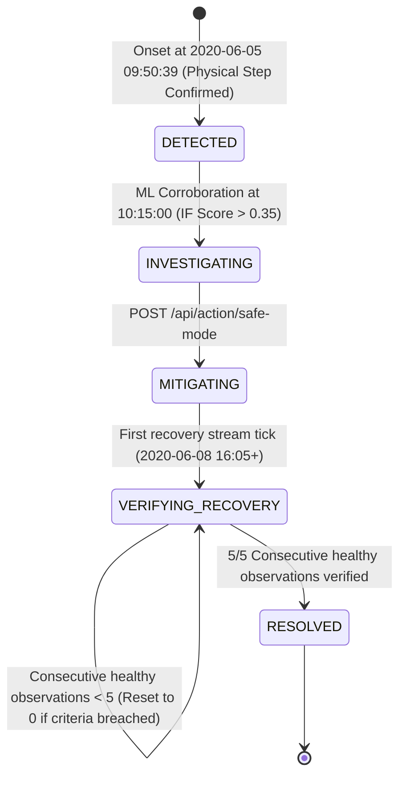

# CompressorGuard: Product & UX Specification (90-Second Golden Path)

> **Document Version:** 2.2 (Backend Vertical Slice Contract Frozen)  
> **Target:** Incident Command Console for Critical Physical Assets  
> **Core Promise:** **Detect earlier → Prove why → Act safely → Verify recovery.**

---

## 1. Product Thesis (The North Star)

* **Category:** Incident Command Console for Critical Physical Assets (Not an IoT dashboard, not an anomaly scoring utility).
* **Target User & Persona:** Fleet Operations Specialist responsible for Lisbon Metro trains.
* **Core Problem:** Compressor discharge valve leaks progress silently. Reactive mechanical alarms (`LPS = 1`) only sound when line pressure has already collapsed, forcing trains out of service.
* **The 3 Unforgettable Claims:**
  1. **33 hours 52 minutes Lead Time:** Derived dynamically from detection timestamp and verified LPS milestone.
  2. **Evidence > Anomaly Score:** 4-signal structured cross-sensor thermodynamics ($+23.75\sigma$ pressure, $+5.71\sigma$ thermal drift, temporal step persistence tracking, and multivariate ML corroboration).
  3. **Closed-Loop Physical Recovery:** Operator action branches to real post-maintenance telemetry to prove physical stabilization across sustained evaluation observations.
* **Domain Precision on "Evaluation Observations":**
  Để loại bỏ triệt để semantic drift (cycle vs sample vs window), hệ thống chuẩn hóa thống nhất toàn bộ các tầng domain, engine và API sang **Evaluation Observations** (`consecutive_healthy_observations`). Mỗi observation là một điểm kiểm định thực tế 10 giây khi máy nén mang tải (`LOADED`) đạt đồng thời cả 2 tiêu chí vật lý: $\text{DV\_pressure} < 0.05\text{ bar}$ và $\text{Oil\_temp} < 67.0^\circ\text{C}$.
* **Strict Anti-Scope (Noise to Avoid):**
  - No LLM Chatbot or conversational assistant.
  - No synthetic 50-train fleet simulator.
  - No extra machine learning models (Isolation Forest on LOADED regime is sufficient).
  - No raw telemetry metric dumping on the primary screen.

---

## 2. Cognitive Progression (The 5 Judge Questions)

A judge looking at the system must have their questions answered in this exact sequence without reading a manual:

```
[00:00 - 00:15]  WHO AM I?        ──► Fleet Operations Specialist guarding Metro Train APU-COMP-01.
[00:15 - 00:35]  WHAT HAPPENED?   ──► Severe degradation in Air Dryer Discharge Valve.
                 HOW EARLY?       ──► 33h 52m ahead of conventional pressure-loss alert.
[00:35 - 00:55]  WHY TRUST?       ──► 4 Co-located Evidence Signals (Pressure + Temp + Temporal Persistence + ML).
[00:55 - 00:75]  WHAT CAN I DO?   ──► Trigger Reversible Safe Mode (Isolate leaking valve).
[00:75 - 00:90]  DID IT WORK?     ──► Real telemetry cools down & stabilizes; 5/5 healthy observations verified.
```

---

## 3. Information Hierarchy (Progressive Disclosure)

The experience is strictly partitioned into 4 tiers of disclosure:

```
┌────────────────────────────────────────────────────────────────────────┐
│ TIER 1: PERIPHERAL AWARENESS (Visible in 3 seconds)                    │
│ • Asset Identity: APU-COMP-01 (Lisbon Metro)                           │
│ • Incident State: DETECTED / INVESTIGATING / RESOLVED                  │
│ • Hero Metric: 33H 52M EARLY LEAD TIME                                 │
│ • Primary Call-to-Action: [ACTIVATE SAFE MODE]                         │
├────────────────────────────────────────────────────────────────────────┤
│ TIER 2: FACTUAL DECISION BASIS (Visible in 10 seconds)                 │
│ • 4 Co-located Evidence Cards:                                         │
│     1. Discharge Pressure: 2.18 bar (+23.75σ) [CRITICAL]               │
│     2. Oil Temperature: 74.97 °C (+5.71σ) [SEVERE]                     │
│     3. Temporal Persistence: Step diff > 0.5 bar [CONFIRMED]           │
│     4. Multivariate Isolation Forest: 0.382 (> 0.35 threshold)         │
│ • Timeline Milestone: Conventional LPS Alert predicted at T-33h 52m    │
│ • Recovery Tracker: 0/5 -> 5/5 Consecutive Healthy Observations        │
├────────────────────────────────────────────────────────────────────────┤
│ TIER 3: ON-DEMAND TRUST VERIFICATION (Revealed on "Why?" click)        │
│ • Operating Regime: LOADED (Motor current > 0.5A, DV_electric active)   │
│ • Baseline Reference: Normal Loaded Pressure (-0.016 ± 0.09 bar)       │
│ • Persistence Window: 3/3 Recent Observations Sustained                │
│ • Physical Signal Provenance: Real timestamps from June 5, 2020        │
├────────────────────────────────────────────────────────────────────────┤
│ TIER 4: BACKGROUND SUBSTANCE (Internal only / Terminal / Logs)         │
│ • 1.5 million raw CSV sensor points                                    │
│ • Scikit-learn baseline training matrices                              │
│ • Raw sliding window buffers & memory arrays                           │
└────────────────────────────────────────────────────────────────────────┘
```

---

## 4. Formal State Machine & Transitions

The incident lifecycle follows a strict, single-path state machine. Invalid transitions are rejected with HTTP 409 Conflict.



### Transition Validation Rules:
1. `trigger_safe_mode()` is **ONLY** valid when current state is `INVESTIGATING` (or `DETECTED`).
2. Calling `trigger_safe_mode()` while in `MITIGATING`, `VERIFYING_RECOVERY`, or `RESOLVED` raises `InvalidStateTransitionError` (HTTP 409 Conflict).
3. In `VERIFYING_RECOVERY`, any observation failing $\text{DV\_pressure} < 0.05$ or $\text{Oil\_temp} < 67.0$ in `LOADED` regime **instantly resets `consecutive_healthy_observations` to 0**.
4. Transition to `RESOLVED` occurs **only** when `consecutive_healthy_observations >= 5`.

---

## 5. Domain State & API Contract

### 5.1 Product Domain API (Business Operations)

#### `GET /api/incident`
Lead time is derived dynamically from detection timestamp and verified LPS milestone ($T_{\text{LPS}} - T_{\text{detection}} = 2032\text{ min} = \text{33h 52m}$).
```json
{
  "incident_id": "APU-INC-20200605-01",
  "asset_id": "APU-COMP-01",
  "lifecycle_state": "INVESTIGATING",
  "asset_health": "CRITICAL",
  "operational_confidence": "HIGH",
  "lead_time": {
    "lead_time_minutes": 2032,
    "lead_time_formatted": "33h 52m",
    "conventional_alert_timestamp": "2020-06-06T19:42:19Z",
    "earliest_detection_timestamp": "2020-06-05T09:50:39Z"
  },
  "summary": "Multi-detector physical signals confirmed and corroborated by multivariate Isolation Forest. Safe Mode recommended."
}
```

#### `GET /api/evidence`
Includes all 4 domain evidence signals directly in `evidence_pack` for clean progressive disclosure, alongside a top-level `persistence` block for instant UI status binding.
```json
{
  "incident_id": "APU-INC-20200605-01",
  "regime": "LOADED",
  "evidence_pack": [
    {
      "code": "PRESSURE_SEVERE",
      "signal_name": "Discharge Valve Pressure",
      "observed_value": 2.1856,
      "baseline_value": -0.0164,
      "unit": "bar",
      "sigma_deviation": 23.75,
      "status": "CRITICAL",
      "is_primary": true
    },
    {
      "code": "TEMPORAL_STEP_CONFIRMED",
      "signal_name": "Temporal Persistence Tracking",
      "observed_value": 2.202,
      "baseline_value": 0.0,
      "unit": "bar_diff",
      "sigma_deviation": 0.0,
      "status": "CONFIRMED",
      "is_primary": false
    },
    {
      "code": "THERMAL_STRESS_SEVERE",
      "signal_name": "Compressor Oil Temperature",
      "observed_value": 74.97,
      "baseline_value": 54.98,
      "unit": "°C",
      "sigma_deviation": 5.71,
      "status": "SEVERE",
      "is_primary": false
    },
    {
      "code": "ML_CORROBORATED",
      "signal_name": "Multivariate Isolation Forest",
      "observed_value": 0.382,
      "baseline_value": 0.350,
      "unit": "score",
      "sigma_deviation": null,
      "status": "CORROBORATED",
      "is_primary": false
    }
  ],
  "persistence": {
    "confirmed": true,
    "recent_observations": 3,
    "required_observations": 3
  }
}
```

#### `POST /api/action/safe-mode`
```json
// Success Response (HTTP 200)
{
  "action_id": "ACT-SM-001",
  "status": "ACTIVATED",
  "execution_mode": "SIMULATION_BRANCH",
  "target_state": "MITIGATING",
  "stream_branch": {
    "source": "METROPT-3_POST_MAINTENANCE",
    "offset_timestamp": "2020-06-08T16:05:00Z"
  }
}

// Error Response (HTTP 409 Conflict - e.g. when called twice or already resolved)
{
  "error": "INVALID_STATE_TRANSITION",
  "detail": "Action safe-mode is not permitted when incident is in state MITIGATING."
}
```

#### `GET /api/recovery`
Exposes exact observation count evaluated against physical criteria.
```json
{
  "incident_id": "APU-INC-20200605-01",
  "is_recovering": true,
  "is_verified": false,
  "consecutive_healthy_observations": 3,
  "target_healthy_observations": 5,
  "latest_telemetry": {
    "dv_pressure_bar": -0.016,
    "oil_temp_c": 64.8,
    "regime": "LOADED"
  },
  "criteria": {
    "dv_pressure_max": 0.05,
    "oil_temp_max": 67.0,
    "required_regime": "LOADED"
  }
}
```

---

### 5.2 Demo & Simulation Controls (`/demo/*`)

Simulation controls manipulate the replay stream for deterministic presentation. They do **not** synthesize fake telemetry.

* **`POST /demo/reset`**: Resets the simulation to the initial onset milestone (`onset_0950`) or baseline.
* **`POST /demo/tick`**: Advances the replay cursor by one telemetry observation point (10 seconds).
  - If in degradation stream $\rightarrow$ feeds detectors and decision engine.
  - If in recovery stream $\rightarrow$ feeds `RecoveryVerifier`.
  - If already `RESOLVED` $\rightarrow$ no-op idempotent.
* **`POST /demo/jump`**: Jumps the replay cursor to a verified real timestamp.
  - Allowed milestones: `onset_0950`, `ml_corroborated_1015`, `lps_reactive_1942`, `post_maintenance_1605`.
  - Any unknown milestone returns HTTP 400 Bad Request.

---
*End of CompressorGuard Product & UX Specification v2.2 (Backend Contract Frozen).*
