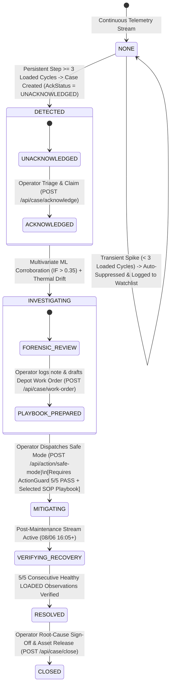

# CompressorGuard v3.0 — Production-Ready UI/UX & Human-in-the-Loop Operational Mechanism Specification

> **Document Version:** 3.0 (Production-Grade Operations Console & Human-in-the-Loop Case Governance)  
> **Date:** 2026-10-11  
> **Target System:** CompressorGuard Industrial Operations Command Platform  
> **Status:** Normative Architecture & UX Design Spec

---

## 1. Executive Summary & Architectural Diagnosis

Ở phiên bản v2.3, dù phần lõi Domain Engine (Replay, Detectors, Fusion, Decision, RecoveryVerifier) đã đạt độ chính xác toán lý trên dữ liệu `MetroPT3(AirCompressor).csv`, lớp giao diện (`src/static/app.js`, `src/static/index.html`) và một phần luồng tương tác vẫn mang dáng dấp của một **"bản trình chiếu tự động (auto-pilot demo)"** thay vì một sản phẩm SaaS/Enterprise sẵn sàng vận hành thực tế (Production-Ready):

1. **Simulation Controls chiếm lĩnh Header chính:** Hàng nút nhảy mốc thời gian (`00:33`, `09:50`, `10:15`, `T-33h`, `16:05`) đặt ngay trên thanh công cụ chính khiến người dùng có cảm giác đang bấm nút chuyển slide kịch bản dựng sẵn.
2. **Dữ liệu hiển thị trên UI bị Hardcode tĩnh (~90%):** Các con số quan trọng (`2.1856 bar`, `74.97 °C`, `-0.016 bar`, `64.12 °C`) và cả 5 trạng thái `✓ PASS` của `ActionGuard` được viết cứng trong HTML template thay vì phản ánh trạng thái động từng giây từ API.
3. **Thiếu vắng Biểu đồ Chuỗi Thời Gian (Time-Series Strip Charts) & Ma Trận Cảm Biến:** Một hệ thống giám sát máy nén khí công nghiệp nhưng thiếu biểu đồ đường thời gian thực đối chiếu áp suất, nhiệt độ, dòng điện mô-tơ (`LOADED` vs `UNLOADED`) và ngưỡng cảnh báo.
4. **Cơ chế xử lý sự cố thiếu vai trò điều khiển của Operator (Human-in-the-Loop):** Hệ thống tự động nhảy trạng thái từ đầu đến cuối; thiếu bước **Acknowledge & Triage (Tiếp nhận & Phân loại)**, **Forensic Notes (Ghi chú điều tra)**, **Playbook & Depot Work Order Selection (Chọn quy trình SOP & Lập lệnh điều động xưởng)**, và **Root-Cause Sign-Off (Xác nhận nguyên nhân gốc khi đóng hồ sơ)**.
5. **Bố cục 5 Sub-Tabs rời rạc kiểu thuyết trình:** Không gian xử lý sự cố bị chia cắt thành 5 tab chứa nhiều đoạn văn giải thích lý thuyết thay vì một **3-Pane Incident Investigation Workbench** mật độ cao chuẩn công nghiệp (tương tự Datadog Incident Management / Siemens Senseye).

---

## 2. Nguyên Tắc Thiết Kế Sản Phẩm Production-Ready (v3.0 Core Principles)

### 2.0. Kiến Trúc Luồng Live Tách Rời (ThreatLens-Style Decoupled Producer–Consumer Live Mechanism)
- **Nguyên tắc cốt lõi:** *"The Dashboard Does Not Trigger Telemetry."* Giao diện Web tuyệt đối không dùng `setInterval` gọi `POST /demo/tick` để tự kéo dữ liệu như bản v2.x cũ.
- **Tầng Producer độc lập (Background Stream Worker / CLI Telemetry Streamer):**
  - Luồng dữ liệu cảm biến `MetroPT-3` được bơm tự động bởi **Server-Side Background Stream Worker** (hoặc script CLI độc lập `scripts/stream_telemetry.py`) theo nhịp đồng hồ kép (`event_time` giữ nguyên từ CSV, `simulation_time` điều tiết tốc độ ở tầng backend).
  - Mỗi khung dữ liệu đi qua `Regime Classifier -> Detectors -> Isolation Forest -> Evidence Fusion -> Case Correlator` và ghi trực tiếp vào **MongoDB** (`measurements`, `anomaly_signals`, `incidents`, `case_events`).
- **Tầng Consumer quan sát & phản ứng (Pure Observational & Response Console):**
  - Dashboard chỉ đóng vai trò quan sát độc lập: truy vấn dữ liệu từ DB/API theo khung giờ (`timeframe`: `5m`, `15m`, `1h`, `6h`, `all`), vẽ biểu đồ **Chart.js** thời gian thực, cho phép chuyển đổi giữa **Correlated Operational Cases** và **Raw Telemetry / Anomaly Signals**, và gửi lệnh phản ứng của Operator (`Acknowledge`, `Mark False Positive`, `Safe Mode via ActionGuard`, `Close Case`).
  - Xem chi tiết kiến trúc tại [`docs/ARCHITECTURE.md`](file:///d:/Code/Projects/self-projects/iot-hackathon/docs/ARCHITECTURE.md).

### 2.1. Tách Bạch Tuyệt Đối "Product Runtime UI" và "Simulation / Replay Studio Drawer"
- **Giao diện chính (Primary Operations Console):** Chỉ hiển thị các thành phần của một hệ thống điều hành công nghiệp thực thụ: Top Command Header, bộ lọc `Timeframe` (`5m`, `15m`, `1h`, `all`), trạng thái kết nối luồng viễn thám (`LIVE SIMULATION · HISTORICAL DATA`), bộ chọn ca trực (`DISPATCHER-0941`), bảng tìm kiếm/lọc tài sản hạm đội, biểu đồ chuỗi thời gian đa kênh (**Chart.js**), và bàn làm việc điều tra sự cố.
- **Ngăn kéo điều khiển mô phỏng (CLI / Collapsible Simulation Studio Drawer):** Toàn bộ công cụ phục vụ demo/kiểm thử (`Play/Pause Server Stream`, `Speed 1x..300x`, `Scenario Switcher`, và `Diagnostic Milestone Bookmarks`) được điều khiển qua CLI hoặc gom vào một ngăn kéo thu gọn ở góc dưới bên phải (`Shift + S`). Khi đóng ngăn kéo này, giao diện hoàn toàn sạch bóng các nút điều khiển kịch bản.

### 2.2. Zero Hardcoded UI Telemetry (100% Data-Driven Rendering)
- Tuyệt đối không hardcode bất kỳ con số đo lường nào (`2.1856 bar`, `74.97 °C`, `-0.016 bar`, `✓ PASS`) trong mã giao diện.
- Mọi thành phần UI phải đọc trực tiếp từ phản hồi JSON của backend/DB khi làm mới (`refreshData()`):
  - Đồ thị chuỗi thời gian (**Chart.js**) và bảng 15 cảm biến đọc từ `GET /api/telemetry/window` (hoặc `/api/dashboard/data?timeframe=...`).
  - Trạng thái 4 detector đọc từ `GET /api/evidence` (hiển thị cả trạng thái `NORMAL` khi chưa vượt ngưỡng).
  - Hàng rào 5 điều kiện an toàn đọc từ `GET /api/action/guard-status` (hiển thị rõ `FAIL` màu đỏ/vàng kèm lý do từ chối khi chưa đủ điều kiện, và chỉ chuyển sang `PASS` xanh khi thực sự thỏa mãn).

### 2.3. Đa Kịch Bản & Khả Năng Mở Rộng Hạm Đội (Multi-Scenario & Fleet Grid)
- Hỗ trợ chuyển đổi linh hoạt giữa 4 kịch bản thực tế trích xuất từ tập dữ liệu `MetroPT-3`:
  1. `failure_3`: Failure #3 — Air Leak & High Thermal Stress (Tháng 06/2020)
  2. `failure_1`: Failure #1 — Air Leak & High Duty Cycle (Tháng 04/2020)
  3. `failure_4`: Failure #4 — Oil Contamination & Thermal Stress (Tháng 07/2020)
  4. `healthy_baseline`: Healthy Baseline — Normal Operations (Tháng 02/2020)
- Bảng **Fleet Asset Data Grid** tại màn hình chính cho phép tìm kiếm theo `Train ID / Asset ID`, lọc theo `Health State (ALL / CRITICAL / DEGRADING / HEALTHY)` và `Operating Regime (LOADED / UNLOADED)`.

---

## 3. Cơ Chế Vận Hành Sự Cố Có Sự Tham Gia Thực Của Operator (Human-in-the-Loop Workflow)



### Bảng Phân Vai Giữa Hệ Thống Tự Động (Engine) và Chuyên Viên Điều Độ (Operator)

| Giai đoạn | Tác vụ của Engine (Tự động 24/7) | Tác vụ của Operator (Human-in-the-Loop) |
| :--- | :--- | :--- |
| **1. Giám sát & Lọc nhiễu (`NONE`)** | Đánh giá cửa sổ trượt 10 mẫu trên chế độ `LOADED`. Tự động chặn xung nhiễu đơn lẻ (như mốc `00:33:07`) và ghi vào bảng `Anomaly & Suppression Watchlist`. | Theo dõi biểu đồ Time-Series; có thể ghim (pin) hoặc đánh dấu đã xem các cảnh báo bị chặn trên Watchlist. |
| **2. Mở Hồ Sơ Sự Cố (`DETECTED`)** | Mở Case duy nhất cho tài sản (`Single Active Case Invariant`) khi áp suất xả lệch chuẩn bền vững qua 3 chu kỳ mang tải. Tính toán `Confirmed Intervention Window`. | **Tiếp nhận hồ sơ (`Acknowledge Case`):** Xác nhận người phụ trách ca trực, phân loại mức độ ưu tiên (`P1-CRITICAL` / `P2-HIGH`) và nhập ghi chú ban đầu. |
| **3. Điều tra & Chuẩn bị Can thiệp (`INVESTIGATING`)** | Chạy `IsolationForestDetector` trên 5 đặc trưng mang tải để kiểm chứng độc lập. Cập nhật trạng thái `ActionGuard` từ `3/5 PASS` lên `5/5 PASS`. | Đối chiếu biểu đồ tương quan Đa cảm biến, ghi nhận **Forensic Note**, chọn quy trình chuẩn (**Playbook `SOP-APU-ISO-04`**) và lập phiếu **Depot Maintenance Work Order** (chọn xưởng `Depot Oriente`, khung giờ cắt tàu). |
| **4. Kích hoạt Can thiệp (`MITIGATING`)** | Kiểm tra nghiêm ngặt 5 cổng chính sách `ActionGuard`. Nếu hợp lệ, ghi sổ cái `CaseEvent` và rẽ nhánh con trỏ luồng dữ liệu sang phân đoạn thực tế sau bảo trì (`2020-06-08 16:05:00 UTC`). | Bấm xác nhận thực thi lệnh can thiệp mô phỏng (`Execute Safe Mode Intervention`) sau khi đã kiểm tra bảng pre-flight `5/5 PASS`. |
| **5. Kiểm chứng & Nghiệm thu Đóng Case (`VERIFYING_RECOVERY` $\rightarrow$ `CLOSED`)** | Đếm từng mẫu đo trong chế độ `LOADED` thỏa mãn đồng thời `DV_pressure < 0.05 bar` và `Oil_temp < 67.0 °C` (reset về `0/5` nếu vi phạm). Khi đạt `5/5`, mở khóa quyền đóng hồ sơ. | Kiểm tra bảng 5 mẫu đo nghiệm thu thực tế, chọn **Confirmed Root Cause Tag** (`Desiccant Drain Valve Leak`), nhập **Engineering Sign-Off Notes**, và ký duyệt giải phóng tàu về trạng thái `HEALTHY`. |

---

## 4. Đặc Tả Hợp Đồng API Mở Rộng (Production API Contracts v3.0)

Bên cạnh các API hiện hữu (`/api/operations`, `/api/case`, `/api/evidence`, `/api/recovery`, `/api/case/events`, `/api/action/safe-mode`, `/api/case/close`, `/api/validation-reference`), kiến trúc v3.0 định nghĩa thêm các hợp đồng dữ liệu động sau:

### 4.1. `GET /api/telemetry/window?limit=60` (Luồng Dữ Liệu Cảm Biến Thời Gian Thực Cho Biểu Đồ)
Cung cấp chuỗi điểm đo thực tế từ bộ đệm cửa sổ trượt / MongoDB Time Series để vẽ biểu đồ đa kênh và hiển thị ma trận cảm biến mà không cần hardcode bất kỳ giá trị nào:
```json
{
  "asset_id": "APU-COMP-01",
  "scenario_id": "failure_3",
  "current_event_time": "2020-06-05T09:50:39Z",
  "sampling_interval_seconds": 10,
  "baselines": {
    "dv_pressure_loaded_mean": -0.0164,
    "dv_pressure_loaded_std": 0.0927,
    "dv_pressure_severe_threshold": 2.0,
    "oil_temp_loaded_mean": 54.98,
    "oil_temp_loaded_std": 3.50,
    "oil_temp_severe_threshold": 74.0,
    "recovery_dv_max": 0.05,
    "recovery_oil_max": 67.0,
    "if_corroboration_threshold": 0.35
  },
  "points": [
    {
      "timestamp": "2020-06-05T09:50:39Z",
      "regime": "LOADED",
      "dv_pressure_bar": 2.1856,
      "oil_temp_c": 74.97,
      "motor_current_a": 6.84,
      "tp2_bar": 8.91,
      "tp3_bar": 8.74,
      "h1_bar": -0.012,
      "reservoirs_bar": 8.75,
      "lps_active": 0.0,
      "pressure_switch": 1.0,
      "oil_level_low": 0.0,
      "caudal_impulses": 138.2,
      "if_anomaly_score": 0.382
    }
  ]
}
```

### 4.2. `GET /api/action/guard-status` (Đánh Giá Trực Tiếp 5 Điều Kiện ActionGuard)
Trả về trạng thái thực tế của từng điều kiện trong 5 cổng kiểm định an toàn tại thời điểm hiện tại:
```json
{
  "asset_id": "APU-COMP-01",
  "case_id": "APU-INC-20200605-01",
  "lifecycle_state": "DETECTED",
  "is_permitted": false,
  "passed_count": 4,
  "total_checks": 5,
  "denial_reason": "Mitigation not recommended by DecisionEngine (awaiting multivariate corroboration).",
  "checklist": [
    {
      "id": "CASE_CONFIRMED",
      "label": "Case is active and confirmed (DETECTED / INVESTIGATING)",
      "passed": true,
      "current_value": "DETECTED"
    },
    {
      "id": "MITIGATION_RECOMMENDED",
      "label": "DecisionEngine recommends EXECUTE_MITIGATION (Multi-sensor + ML)",
      "passed": false,
      "current_value": "MONITOR_CLOSELY"
    },
    {
      "id": "SINGLE_ACTIVE_CASE",
      "label": "Single active case invariant holds on asset APU-COMP-01",
      "passed": true,
      "current_value": "1 active case"
    },
    {
      "id": "SIMULATION_MODE",
      "label": "Audit-controlled simulation intervention boundary verified",
      "passed": true,
      "current_value": "LIVE_SIMULATION"
    },
    {
      "id": "REPLAY_BRANCH_AVAILABLE",
      "label": "Post-maintenance historical stream segment ready (2020-06-08T16:05:00Z)",
      "passed": true,
      "current_value": "AVAILABLE"
    }
  ]
}
```

### 4.3. `POST /api/case/acknowledge`, `POST /api/case/notes`, `POST /api/case/work-order`
Các API ghi nhận thao tác điều hành thực của chuyên viên vào hồ sơ sự cố và sổ cái `CaseEvent`:
```json
// POST /api/case/acknowledge Request
{
  "operator_id": "DISPATCHER-0941",
  "priority": "P1-CRITICAL",
  "note": "Acknowledged pressure step breach on Train #302. Monitoring thermal drift and ML corroboration."
}

// POST /api/case/work-order Request
{
  "operator_id": "DISPATCHER-0941",
  "playbook_id": "SOP-APU-ISO-04",
  "target_depot": "Depot Oriente",
  "maintenance_window": "Next Terminal Turnaround",
  "instructions": "Isolate Dryer Tower #2 drain valve and inspect desiccant seal."
}
```

### 4.4. `GET /api/scenarios` & `POST /api/operations/scenario`
Cho phép chuyển đổi kịch bản vận hành từ ngăn kéo `Replay Studio Drawer`:
```json
// GET /api/scenarios Response
{
  "active_scenario_id": "failure_3",
  "scenarios": [
    {
      "scenario_id": "failure_3",
      "name": "Failure #3 — Air Leak & Thermal Drift (June 2020)",
      "asset_id": "APU-COMP-01",
      "stream_start": "2020-06-05 09:40:00",
      "stream_end": "2020-06-06 20:00:00"
    },
    {
      "scenario_id": "failure_1",
      "name": "Failure #1 — Air Leak & High Duty Cycle (April 2020)",
      "asset_id": "APU-COMP-01",
      "stream_start": "2020-04-10 00:00:00",
      "stream_end": "2020-04-12 23:59:59"
    },
    {
      "scenario_id": "failure_4",
      "name": "Failure #4 — Oil Contamination & Thermal Stress (July 2020)",
      "asset_id": "APU-COMP-01",
      "stream_start": "2020-07-08 00:00:00",
      "stream_end": "2020-07-10 23:59:59"
    },
    {
      "scenario_id": "healthy_baseline",
      "name": "Healthy Baseline — Nominal Service (February 2020)",
      "asset_id": "APU-COMP-01",
      "stream_start": "2020-02-10 08:00:00",
      "stream_end": "2020-02-10 12:00:00"
    }
  ]
}
```

---

## 5. Kiến Trúc Giao Diện 3 Màn Hình Chính & 3-Pane Case Workbench

1. **Screen 01 — Fleet Operations & Live Telemetry Matrix (`[1] FLEET & TELEMETRY`):**
   - Bảng điều khiển mật độ cao kết hợp **Filterable Fleet Asset Grid** (bên trái) và **Multi-Channel Synchronized Strip Charts** (`DV_pressure`, `Oil_temp`, `Motor_current & LOADED Regime`, `IF Score` bên phải).
   - Phía dưới là bảng **Real-Time Anomaly & Suppression Watchlist** tự động ghi nhận các xung dao động ngắn hạn bị thuật toán chặn lại (ví dụ mốc `00:33:07`) mà không cần hộp văn bản tĩnh.
2. **Screen 02 — Active & Historical Incident Queue (`[2] INCIDENT QUEUE`):**
   - Quản lý danh sách hồ sơ sự cố theo chuẩn ITSM/APM (lọc theo trạng thái `Acked / Unacked`, `Phase`, `Severity`, tìm kiếm theo mã tàu/tài sản), đảm bảo bất biến **Single Active Case per Asset**.
3. **Screens 03–07 — 3-Pane Incident Investigation Workbench (`[3] CASE WORKBENCH`):**
   - Thay vì 5 tab rời rạc chứa văn bản tĩnh, không gian xử lý sự cố được hợp nhất thành **Workbench 3 Cột** (vẫn hỗ trợ điều hướng nhanh tới 5 góc nhìn chuyên sâu `What Changed`, `Why Evidence`, `What Did We Do`, `Did It Work`, `Case Timeline`):
     - **Left Pane (Context & 4-Signal Evidence Provenance):** Định danh hồ sơ, đồng hồ `Confirmed Intervention Window`, và 4 thẻ bằng chứng đọc số liệu trực tiếp từ API.
     - **Center Pane (Synchronized Forensic Charts & 5/5 Recovery Monitor):** Đồ thị phân tích tương quan vật lý, sơ đồ chuỗi nhân quả nhiệt động lực học, và bảng kiểm chứng trực tiếp 5 mẫu `LOADED` liên tiếp sau bảo trì.
     - **Right Pane (Operator Command Console, Dynamic ActionGuard & Live Audit Ledger):** Nơi Operator bấm `Acknowledge`, ghi `Forensic Note`, xem bảng kiểm định `ActionGuard (x/5 PASS)`, chọn `Playbook SOP-APU-ISO-04`, lập `Work Order`, kích hoạt `Safe Mode`, ký duyệt `Close Case`, và theo dõi sổ cái `CaseEvent` cập nhật tức thì.
