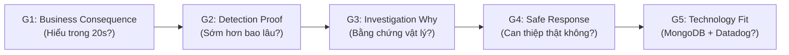
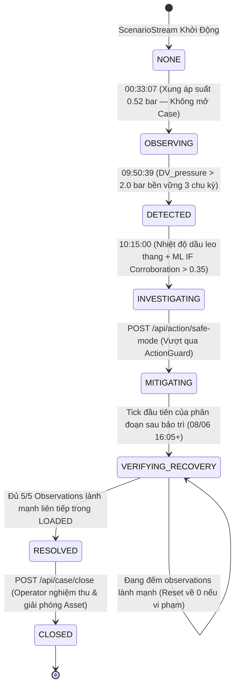
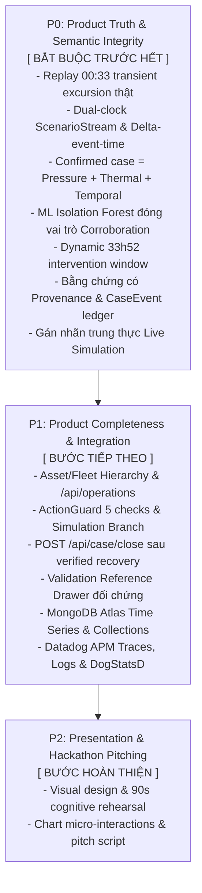

# COMPRESSORGUARD — MASTER CONTEXT & SYSTEM DOSSIER

> **Document Type:** Master Context & Single Source of Truth (SSOT)  
> **Status:** Active & Incrementally Appendable  
> **Target:** MUGVN Hackathon 2026 (MongoDB + Datadog)  
> **Core Mission:** **Detect earlier → Prove why → Act safely → Verify recovery.**  
> **Maintainer/Role:** Lead System Architect & Fleet Operations Engineering  

---

## MỤC LỤC TỔNG QUAN

1. [Phần 1: Executive Summary & Project North Star](#phần-1-executive-summary--project-north-star)
2. [Phần 2: Hackathon Strategy & Comparative Post-Mortem](#phần-2-hackathon-strategy--comparative-post-mortem)
3. [Phần 3: Physical Domain & Ground Truth Dataset (MetroPT-3)](#phần-3-physical-domain--ground-truth-dataset-metropt-3)
4. [Phần 4: Product Thesis & 90-Second Golden Experience Spec](#phần-4-product-thesis--90-second-golden-experience-spec)
5. [Phần 5: Backend Domain Architecture & Vertical Slice v2.1 (Frozen)](#phần-5-backend-domain-architecture--vertical-slice-v21-frozen)
6. [Phần 6: Master Spec Technology Blueprint (MongoDB & Datadog)](#phần-6-master-spec-technology-blueprint-mongodb--datadog)
7. [Phần 7: Strategic Roadmap & Rules of Engagement Cho AI Tiếp Theo](#phần-7-strategic-roadmap--rules-of-engagement-cho-ai-tiếp-theo)
8. [Phần 8: Rail Economics & Operational Value Model (Normative)](#phần-8-rail-economics--operational-value-model-normative)

---

## PHẦN 1: EXECUTIVE SUMMARY & PROJECT NORTH STAR

### 1.1 Định Vị Sản Phẩm (What is this?)
**CompressorGuard** là một **Operations Command Platform cho Thiết Bị Vật Lý Trọng Yếu Của Hạm Đội Đường Sắt (Rail Fleet Critical Physical Assets)** — chuyên phục vụ hệ thống cung cấp khí nén **Air Production Unit (APU)** trên các đoàn tàu điện ngầm đô thị (Lisbon Metro).

> [!IMPORTANT]
> **Định vị cốt lõi:**
> - **KHÔNG PHẢI** là một dashboard hiển thị telemetry thông thường.
> - **KHÔNG PHẢI** là một công cụ chấm điểm anomaly đơn thuần ("Anomaly Detector + Dashboard").
> - **KHÔNG PHẢI** là một chatbot AI/LLM phụ trợ.
> - **LÀ** một **hệ thống vận hành vòng lặp khép kín có cấu trúc phân cấp hạm đội (Closed-Loop Fleet Operations Platform)**:
>   $$\text{Fleet} \longrightarrow \text{Train} \longrightarrow \text{APU} \longrightarrow \text{Compressor} \longrightarrow \text{Case} \longrightarrow \text{Evidence} \longrightarrow \text{Decision} \longrightarrow \text{Action} \longrightarrow \text{Recovery} \longrightarrow \text{Business Impact}$$
> - **Triết lý vai trò:**
>   - **Fleet:** Nơi ban điều hành và kinh doanh hiểu bài toán vận tải.
>   - **Asset:** Nơi sự cố vật lý xảy ra.
>   - **Case:** Đơn vị công việc có cấu trúc để con người điều độ xử lý.
>   - **Evidence:** Bằng chứng vật lý chứng minh vì sao phải tin cậy hệ thống.
>   - **Decision & Action:** Can thiệp an toàn có hàng rào chính sách bảo vệ.
>   - **Verification:** Kiểm chứng phục hồi từ cảm biến thực trước khi trả tài sản về khai thác.

---

### 1.2 Bài Học Tiền Lệ Công Nghiệp (Industrial Precedents)
Mô hình tổ chức của CompressorGuard trực tiếp kế thừa kiến trúc từ các nền tảng quản trị tài sản công nghiệp hàng đầu thế giới:
* **Siemens Senseye:** Tổ chức tài sản theo phân cấp (Asset Hierarchy: Site $\rightarrow$ Line $\rightarrow$ Machine); liên kết sự cố (Case) gắn chặt vào từng Asset; thực thi bất biến *"Chỉ duy nhất một Case mở trên một Asset tại một thời điểm"*; hồ sơ Case luôn mang theo các bằng chứng đo lường liên quan.
* **IBM Maximo:** Sử dụng Asset Hierarchy, Health, Risk, Criticality làm bối cảnh nghiệp vụ để người vận hành đưa ra quyết định hành động bảo trì trước khi hỏng hóc gây gián đoạn dây chuyền.
* **Alstom HealthHub:** Định vị bảo dưỡng dự đoán gắn liền với quản trị hạm đội tàu (Fleet Management), với mục tiêu cốt tử là tối ưu hóa độ sẵn sàng (Availability), độ tin cậy (Reliability), và triệt tiêu thời gian dừng tàu chết đứng giữa tuyến (Downtime).

---

### 1.3 Ba Lớp Dữ Liệu Phân Minh (Strict 3-Tier Data Separation)
Một phát hiện kiến trúc sống còn là: **Tuyệt đối không trộn lẫn 3 lớp dữ liệu khác biệt về nguồn gốc (provenance)**:

| Tầng Dữ Liệu | Thành Phần Đại Diện | Nguồn Gốc & Bản Chất | Không Được Làm Gì |
|---|---|---|---|
| **A. Business Context** (Asset Registry) | Fleet (Linha Azul), Train (#302), APU, Compressor (APU-COMP-01), Criticality, Location. | Sổ bộ tài sản vận tải, không phải dữ liệu cảm biến. | Không biến thành sensor telemetry. |
| **B. Observed / Computed Operational State** | $\text{DV\_pressure} = 2.1856\text{ bar}$, $\text{Oil\_temp} = 74.97^\circ\text{C}$, $\text{regime} = \text{LOADED}$, $+23.75\sigma$, $+5.71\sigma$, IF score $= 0.382$. | Dữ liệu cảm biến đo đạc thực tế và các chỉ số suy luận từ động cơ phân tích. | Không trộn lẫn với ground truth lịch sử. |
| **C. Validation Reference** (Historical Ground Truth) | Failure #3: Air Leak / High stress; Báo cáo bảo dưỡng thực tế từ đơn vị vận hành Lisbon Metro. | Hồ sơ kỹ thuật bảo dưỡng dùng để đối chứng, kiểm nghiệm tính đúng đắn của kịch bản lịch sử. | **Tuyệt đối không leak ngược** vào thuật toán phát hiện online. |

---

### 1.4 Ba Tuyên Ngôn Bất Khả Chiến Bại (3 Killer Claims)
Khi trình bày với bất kỳ ai (Ban Giám khảo, Khách hàng, hay AI agent kế nhiệm), đây là 3 thông điệp bắt buộc phải ghi nhớ:

| # | Killer Claim | Ý Nghĩa Kỹ Thuật & Vận Hành Thực Chiến |
|---|---|---|
| **1** | **33 Giờ 52 Phút Confirmed Intervention Window** | Phát hiện suy thoái được xác nhận lúc **09:50:39 ngày 05/06/2020**, tạo ra cửa sổ can thiệp vận hành kéo dài đúng **2032 phút** (33h 52m) trước mốc cảnh báo rơ-le cơ học phản ứng thụ động (**19:42:19 ngày 06/06/2020**). Đây là khoảng thời gian quý giá để đưa tàu về xưởng sửa chữa ban đêm, tránh tàu chết đứng giữa đường hầm. |
| **2** | **Bằng Chứng Đa Nguồn Có Nguồn Gốc (Evidence Provenance > Anomaly Score)** | Không yêu cầu người dùng "tin mù quáng vào điểm số AI". Hệ thống dọn ra chuỗi 4 bằng chứng có xuất xứ rõ ràng: Áp suất xả $+23.75\sigma$ ($2.18\text{ bar}$ vs $-0.016\text{ bar}$), Trôi dạt nhiệt độ dầu $+5.71\sigma$ ($74.97^\circ\text{C}$ vs $54.98^\circ\text{C}$), Bước nhảy kiên định 3 chu kỳ, và **Kiểm chứng đa biến độc lập bởi Isolation Forest** ($0.382 > 0.35$ trên 5 features có tải) đóng vai trò nâng cao độ tin cậy quyết định. |
| **3** | **Kiểm Chứng Phục Hồi Thực Tế (Recovery Criteria Verified)** | Hành động kích hoạt Safe Mode được bảo vệ bởi `ActionGuard` 5 điều kiện, mô phỏng can thiệp an toàn và rẽ nhánh luồng dữ liệu sang phân đoạn thực tế sau bảo trì (ngày 08/06/2020). Hệ thống chỉ đóng Case khi và chỉ khi kiểm chứng đủ **5/5 quan sát lành mạnh liên tiếp trong chế độ `LOADED`** đạt chuẩn vật lý ($\text{DV} < 0.05\text{ bar}$, $\text{Oil} < 67^\circ\text{C}$). |

---

### 1.5 Giới Hạn Nghiêm Ngặt Về Phạm Vi (Strict Anti-Scope)
Để bảo toàn tính thực chiến và sự trung thực trí tuệ tuyệt đối, hệ thống áp dụng các nguyên tắc cấm:
* ❌ **CẤM LLM Chatbot:** Không làm trợ lý hỏi đáp hội thoại; chuyên viên vận hành cần hành động trong 5 giây, không ngồi chat.
* ❌ **CẤM Fake Fleet Simulator:** Không tạo ra 50 đoàn tàu ảo ngẫu nhiên; giữ vững Vertical Slice sâu sắc trên tài sản đại diện `APU-COMP-01` gắn trong cây phân cấp hạm đội thực.
* ❌ **CẤM Nhãn [🔴 LIVE] giả tạo:** Dữ liệu là viễn thám lịch sử MetroPT-3; màn hình hiển thị trung thực `[ LIVE SIMULATION · HISTORICAL DATA ]`.
* ❌ **CẤM Fake SIL-2 & Cảm biến độ dốc giả:** Không bịa đặt cảm biến độ dốc ray hay cơ cấu chấp hành vật lý không có trong dataset; thay bằng `ActionGuard` chính sách can thiệp mô phỏng rõ ràng.
* ❌ **CẤM Bày bừa biểu đồ đo lường thô:** Không hiển thị 15 biểu đồ sensor đồng thời trên màn hình chính gây quá tải thị giác.

---

## PHẦN 2: HACKATHON STRATEGY & COMPARATIVE POST-MORTEM

### 2.1 Bối Cảnh So Sánh Giữa Hai Dự Án
Trong workspace phát triển, chúng ta sở hữu 2 codebase:
1. `hackathon/` — **ThreatLens AI SOC Copilot** (Dự án hackathon trước đó).
2. `iot-hackathon/` — **CompressorGuard** (Dự án đang phát triển cho MUGVN Hackathon 2026).

Qua quá trình phân tích đối sánh sâu (Deep Post-Mortem), chúng ta rút ra những bài học sống còn về cách một dự án hackathon giành chiến thắng trước ban giám khảo.

---

### 2.2 Vì Sao `hackathon/` (ThreatLens AI) Gây Ấn Tượng Mạnh?
* **Bản chất kỹ thuật thực sự:** ThreatLens dùng mô hình Machine Learning khá đơn giản (Two-stage Logistic Regression) kết hợp với các luật YAML và MongoDB Atlas. Phần kỹ thuật toán học không quá phức tạp.
* **Nhưng nó thắng ở đâu?** Nó thắng ở **Surface-First & Narrative-Driven**:
  - Giao diện có tính hành động cực kỳ cao (Command Center, IP Blast Radius, Threat Investigator, Remediation Workflow).
  - Nó biến một capability (phân tích log web) thành một **trải nghiệm hoàn chỉnh**:
    $$\text{Ingest Logs} \longrightarrow \text{Correlation} \longrightarrow \text{Investigation} \longrightarrow \text{Evidence} \longrightarrow \text{Action}$$
  - Khi xem demo 3 phút, Giám khảo liên tục có việc để làm: *Có alert $\rightarrow$ click $\rightarrow$ thấy bằng chứng $\rightarrow$ hiểu chuyện gì xảy ra $\rightarrow$ ấn nút xử lý*.

---

### 2.3 Điểm Mù Ban Đầu Của `iot-hackathon/` (CompressorGuard)
* **Sức nặng kỹ thuật vượt trội:** CompressorGuard sở hữu nền tảng toán học, vật lý nhiệt động lực, bộ lọc dữ liệu thực MetroPT-3 (1.5 triệu dòng) và phân loại regime rất sâu sắc.
* **Nhược điểm cốt tử ban đầu:** Mắc phải hội chứng **"Engine is smart, trust me"**:
  - Hệ thống chỉ có script dòng lệnh hoặc test suite chạy ngầm.
  - Ban giám khảo không thể "cảm nhận" được sự nguy cấp của chiếc máy nén khí chỉ qua các dòng log terminal.
  - Nguy cơ bị đánh đồng với một bài tập thống kê dữ liệu thời gian (Time-series benchmark) thay vì một hệ thống vận hành thực chiến.

---

### 2.4 Định Luật Cốt Lõi Về Phân Tầng Sản Phẩm
Một sai lầm phổ biến của kỹ sư khi thấy dự án chưa đủ thuyết phục là **viết thêm feature** (thêm chatbot, thêm mô hình deep learning, thêm dashboard). Đây là con đường dẫn đến thất bại. Hãy nhớ phân tầng:

```
[ Engineering ]  -->  [ Capability ]  -->  [ Product ]  -->  [ Demo Experience ]
(Thuật toán,         (Phát hiện rò rỉ,     (Console giải quyết    (Kịch bản 90s
 toán học, DB)        tính delta áp suất)   vấn đề của Metro OP)   khiến judge thán phục)
```

> [!TIP]
> **Định luật hackathon:**
> $$\text{Feature} \neq \text{Capability} \neq \text{Product} \neq \text{Demo} \neq \text{Engineering}$$
> CompressorGuard đã thừa **Engineering** và **Capability**. Điều duy nhất còn thiếu là đóng gói nó thành một **Product** với một **Demo Experience** không thể bị đánh bại.

---

### 2.5 Năm Cổng Đánh Giá Của Ban Giám Khảo (5 Evaluation Gates)
Khi giám khảo chấm điểm một dự án hackathon, họ vô thức đi qua 5 cổng theo thứ tự ưu tiên:



1. **Gate 1 — Business Consequence (20 giây đầu):** Giám khảo phải hiểu ngay: APU hỏng $\rightarrow$ mất phanh/cửa $\rightarrow$ đoàn tàu chết đứng trong hầm $\rightarrow$ đình trệ toàn bộ mạng lưới metro.
2. **Gate 2 — Detection Proof:** Không phải claim suông: Hệ thống chỉ ra rò rỉ trước hệ thống cũ **33 giờ 52 phút**.
3. **Gate 3 — Investigation Why:** Trả lời dứt khoát câu hỏi "Tại sao?": Dẫn chứng áp suất xả tăng vọt và nhiệt độ dầu bốc cao vượt baseline.
4. **Gate 4 — Safe Response & Verified Recovery:** Kích hoạt Safe Mode và chứng minh hệ thống đã hồi phục bằng dữ liệu thực.
5. **Gate 5 — Technology Fit:** Chứng minh MongoDB (Time Series, Aggregations) và Datadog (Metrics, Traces) là giải pháp tối ưu cho bài toán này, không phải gắn vào để đối phó đề bài.

---

## PHẦN 3: PHYSICAL DOMAIN & GROUND TRUTH DATASET (METROPT-3)

### 3.1 Hồ Sơ Tập Dữ Liệu UCI MetroPT-3
* **Nguồn dữ liệu:** Kho lưu trữ UCI Machine Learning Repository & Nature Scientific Data (2022).
  - Dataset: *MetroPT-3 (Air Compressor)*.
  - Thực tế thu thập: Hệ thống cung cấp khí nén (Air Production Unit - APU) trên đoàn tàu điện ngầm Metro de Lisboa (Bồ Đào Nha).
* **Quy mô dữ liệu:**
  - Tổng số bản ghi: **1,516,948 dòng dữ liệu cảm biến**.
  - Tần số lấy mẫu gốc: **1 Hz** (1 giây/mẫu).
  - Chu kỳ truyền từ xa ban đầu: Batch 5 phút qua sóng di động GSM lên máy chủ trung tâm.
  - Kích thước: ~208 MB tệp CSV nguyên bản (`dataset/MetroPT3(AirCompressor).csv`).
* **Đặc tính Ground Truth:**
  - Không có nhãn bất thường cho từng dòng đơn lẻ (không có point-level synthetic labels).
  - Có **Event-level Ground Truth** thông qua nhật ký bảo dưỡng thực tế của đơn vị vận hành tàu đô thị (Maintenance Reports).

---

### 3.2 Hệ Thống Cảm Biến Của Air Production Unit (APU)
Hệ thống APU bao gồm máy nén piston, tháp làm khô không khí (Air Dryer), bình lắng dầu và các van xả. Toàn bộ 15 trường dữ liệu được phân chia thành 4 nhóm nghiệp vụ:

| Tên Cột Trong Dataset | Nhóm Thiết Bị | Đơn Vị | Ý Nghĩa Vật Lý & Vai Trò Trong Giám Sát |
|---|---|---|---|
| `timestamp` | Thời gian | YYYY-MM-DD HH:MM:SS | Dấu thời gian đo đạc thực tế của cảm biến |
| `TP2` | Áp suất | bar | Áp suất tại bình trung gian (Intermediate Pressure) |
| `TP3` | Áp suất | bar | Áp suất đầu ra của máy nén khí (Compressor Discharge Pressure) |
| `H1` | Áp suất | bar | Áp suất bình chứa chính (Main Reservoir Pressure) |
| `DV_pressure` | Áp suất xả | bar | **CẢM BIẾN CHỦ ĐẠO:** Áp suất van xả của tháp làm khô khí (Discharge Valve Pressure). Ở trạng thái bình thường mang tải, van đóng kín nên áp suất gần như bằng 0 (thực tế -0.016 bar). Khi van hở rò rỉ, áp suất xả tăng vọt lên > 2 bar. |
| `Reservoirs` | Áp suất | bar | Áp suất tổng tại các bình trữ khí phụ |
| `Oil_temp` | Nhiệt độ | °C | **CẢM BIẾN BẰNG CHỨNG:** Nhiệt độ dầu bôi trơn máy nén. Khi máy nén làm việc quá tải do rò rỉ khí, nhiệt độ dầu trôi dạt mạnh từ 54°C lên gần 75°C. |
| `Motor_current` | Dòng điện | A | Cường độ dòng điện cấp cho mô-tơ máy nén. Dùng để xác định chế độ có tải (`> 0.5A`) hay không tải. |
| `COMP` | Tín hiệu số | 0 / 1 | Trạng thái rơ-le điều khiển máy nén (Compressor Control Signal) |
| `DV_electric` | Tín hiệu số | 0 / 1 | Tín hiệu điện kích hoạt van xả điện từ (Discharge Valve Solenoid) |
| `TOWERS` | Tín hiệu số | 0 / 1 | Trạng thái van chuyển đổi tháp làm khô (Tháp 1 / Tháp 2) |
| `MPG` | Tín hiệu số | 0 / 1 | Tín hiệu van điều áp chính (Main Pressure Governor) |
| `LPS` | Còi cơ học | 0 / 1 | **LOW PRESSURE SWITCH:** Cảm biến rơ-le áp suất thấp cơ học. Bật lên 1 khi áp suất bình chính sập dưới ngưỡng an toàn tối thiểu (7.0 bar). Đây là ngưỡng cảnh báo truyền thống cũ. |
| `Pressure_switch`| Tín hiệu số | 0 / 1 | Công tắc áp suất khí nén |
| `Oil_level` | Mức dầu | 0 / 1 | Cảm biến phao báo mức dầu bôi trơn thấp |
| `Caudal_impulses`| Lưu lượng | xung/s | Tín hiệu xung đo lưu lượng khí qua ống dẫn |

---

### 3.3 Tầm Quan Trọng Tuyệt Đối Của Chế Độ Vận Hành (Operating Regimes)
Một sai lầm cơ bản trong phân tích chuỗi thời gian công nghiệp là **tính toán baseline gộp chung mọi chế độ**. 
Máy nén khí có chu kỳ đóng ngắt liên tục giữa 3 chế độ:

1. **`LOADED` (Mang tải nạp khí):** Mô-tơ quay mạnh (`Motor_current > 0.5A`), van xả đóng, khí nén được bơm vào bình trữ `H1`. Áp suất `TP3` tăng lên ~9.0 bar.
2. **`UNLOADED` (Chạy không tải):** Mô-tơ ngắt hoặc chạy không tải xả khí, áp suất giảm.
3. **`STANDBY` / `OFF` (Nghỉ hoàn toàn):** Không có dòng điện tiêu thụ.

> [!CAUTION]
> **Quy tắc phân vùng (Regime Separation Invariant):**
> Các ngưỡng vật lý và mô hình ML (Isolation Forest) **bắt buộc phải được đánh giá riêng biệt trong chế độ `LOADED`**. Nếu trộn lẫn dữ liệu `UNLOADED` hoặc `STANDBY`, phương sai sẽ bị bóp méo, gây ra hàng loạt cảnh báo giả (False Positives).

---

### 3.4 Cơ Chế Suy Thoái Vật Lý Của Sự Cố Vàng (Thermodynamic Failure Breakdown)
Vào đầu tháng 6/2020, một sự cố nghiêm trọng diễn ra trên đoàn tàu số hiệu APU-01 theo chuỗi phản ứng dây chuyền:

```
[Van Xả Hở Rò Rỉ] ──► [Áp Suất Xả DV_pressure Nhảy Vọt (+23.75σ)]
         │
         ▼
[Máy Nén Phải Bơm Bù Liên Tục] ──► [Nhiệt Độ Dầu Oil_temp Bốc Cao (+5.71σ)]
         │
         ▼
[Sau 33h 52m Chịu Đựng] ──► [Bình Trữ Khí Sập Áp, Rơ-le Cơ Học LPS=1 Bật Còi Báo Động]
```

1. **Giai đoạn bình thường (Normal Baseline):**
   - Áp suất xả `DV_pressure` ở mức: **$-0.016 \pm 0.09\text{ bar}$**.
   - Nhiệt độ dầu `Oil_temp` ở mức: **$54.98 \pm 3.5^\circ\text{C}$**.
2. **Thời điểm khởi phát suy thoái (Onset Milestone): `2020-06-05 09:50:39`**
   - Van xả của tháp làm khô khí bị hở (Mechanical pilot valve degradation).
   - Áp suất tại cảm biến `DV_pressure` đột ngột nhảy vọt lên **$2.1856\text{ bar}$** (tương đương độ lệch khổng lồ **$+23.75\sigma$**).
   - Nhiệt độ dầu máy nén `Oil_temp` bắt đầu leo dốc và đạt **$74.97^\circ\text{C}$** (**$+5.71\sigma$**).
   - Mô hình Multivariate Isolation Forest ghi nhận anomaly score vọt lên **$0.382$** (vượt ngưỡng kiểm chứng $0.35$).
3. **Thời điểm còi báo động cũ phát tác (Conventional Alert): `2020-06-06 19:42:19`**
   - Sau gần 34 giờ máy nén gồng gánh trong tình trạng rò rỉ, lưu lượng nạp không còn bù đắp được lượng thoát khí.
   - Áp suất bình chính sập, rơ-le cơ học nhảy: **`LPS = 1`**.
   - Còi báo động trong buồng lái hú vang, tàu bị cưỡng chế kéo về Depot.
4. **Khoảng thời gian dẫn trước (Early Lead Time):**
   $$T_{\text{lead}} = T_{\text{LPS (19:42:19)}} - T_{\text{Onset (09:50:39)}} = 2032\text{ phút} = \mathbf{33\text{ giờ } 52\text{ phút}}.$$

---

### 3.5 Dữ Liệu Phục Hồi Sau Bảo Trì (Post-Maintenance Recovery Ground Truth)
Sau khi đoàn tàu được đưa vào xưởng kỹ thuật sửa chữa thay thế van xả bị rò rỉ:
* **Thời điểm bắt đầu chuỗi dữ liệu sau bảo trì:** **`2020-06-08 16:05:00`**.
* **Trạng thái vật lý được xác lập lại:**
  - `DV_pressure` giảm về mức an toàn: **$-0.016\text{ bar}$** ($< 0.05\text{ bar}$).
  - `Oil_temp` hạ nhiệt dần về mức an toàn: **$64.1^\circ\text{C}$** ($< 67.0^\circ\text{C}$).
* **Cơ chế rẽ nhánh Replay Reversible Safe Mode:**
  Khi chuyên viên vận hành nhấn `[ACTIVATE SAFE MODE]`, con trỏ phát dữ liệu của `ReplayEngine` sẽ rẽ nhánh (stream branching) sang phân đoạn `2020-06-08 16:05:00` để bắt đầu quá trình kiểm chứng phục hồi từ cảm biến thực tế.

---

## PHẦN 4: PRODUCT THESIS & OPERATIONAL EXPERIENCE SPEC

### 4.1 Triết Lý Thiết Kế Trải Nghiệm (Spec The Experience, Not The Interface)
Một sai lầm rất lớn trong phát triển phần mềm hackathon là vội vàng code giao diện HTML/Tailwind/CSS trước khi chốt luồng nhận thức (Cognitive Flow). 
Khi bạn nhảy vào code UI quá sớm, bạn sẽ tự thuyết phục bản thân rằng những nút bấm và bảng màu ngẫu nhiên là hợp lý, trong khi người dùng hoặc giám khảo nhìn vào lại thấy lộn xộn và không hiểu chuyện gì đang xảy ra.

> [!IMPORTANT]
> **Nguyên tắc vàng:**
> *"Đặc tả trải nghiệm nhận thức, không đặc tả giao diện cơ học."*
> Giám khảo không cần biết nút bấm nằm bên trái hay bên phải, bo góc bao nhiêu pixel. Giám khảo cần biết: **Họ phải trải qua những trạng thái tâm lý nào, theo thứ tự nào, và hệ thống chứng minh điều gì ở mỗi giây?**

---

### 4.2 Tiến Trình Nhận Thức Trong 90 Giây (The 5 Judge Questions)
Trong vòng 90 giây trình diễn live demo, màn hình console phải trả lời chính xác 5 câu hỏi xuất hiện trong tâm trí giám khảo mà không cần thuyết trình viên phải giải thích dài dòng:

```
[00:00 - 00:15]  1. TÔI LÀ AI & PHẠM VI NÀO? (WHO & WHERE?)
                 └──► Fleet Operations Specialist, giám sát Metro Fleet -> Train #302 -> APU-COMP-01.

[00:15 - 00:35]  2. ĐIỀU GÌ XẢY RA & DẪN TRƯỚC BAO LÂU? (WHAT & HOW EARLY?)
                 └──► Confirmed degradation detected lúc 09:50:39 UTC. 
                      Confirmed Intervention Window 33h 52m trước còi cơ học LPS!

[00:35 - 00:55]  3. VÌ SAO PHẢI TIN? (WHY TRUST?)
                 └──► 4 Bằng chứng có nguồn gốc rõ ràng (Pressure +23.75σ, Thermal +5.71σ, 
                      Persistence 3 chu kỳ) + ML Isolation Forest độc lập xác nhận (0.382 > 0.35).

[00:55 - 00:75]  4. TÔI CÓ THỂ LÀM GÌ? (WHAT CAN I DO?)
                 └──► ActionGuard kiểm tra 5 điều kiện an toàn -> Kích hoạt Safe Mode mô phỏng 
                      (Simulated Intervention) rẽ nhánh luồng dữ liệu sau bảo trì.

[00:75 - 00:90]  5. NÓ CÓ HIỆU QUẢ THẬT KHÔNG? (DID IT WORK?)
                 └──► Dữ liệu cảm biến thực đạt 5/5 observations có tải lành mạnh -> 
                      Recovery criteria verified -> Operator ký đóng Case & giải phóng Asset!
```

---

### 4.3 Cây Phân Cấp Hạm Đội & Operations Landing Page (Fleet as Spine)
Screen 01 được **giữ lại và nâng cấp** thành **Operations Landing Page**. Đây là nơi cung cấp góc nhìn hạm đội hoàn chỉnh, giúp chuyển đổi câu chuyện từ một cảnh báo sensor lẻ loi thành một bài toán vận hành tuyến đường sắt:

```text
OPERATIONS
│
├── FLEET (Hạm Đội Metro de Lisboa - Linha Azul)
│    │
│    └── TRAIN-302 (Đoàn tàu chở khách đang vận hành)
│         │
│         └── APU (Hệ thống cung cấp khí nén Air Production Unit)
│              │
│              └── APU-COMP-01 (Máy nén khí chính)
│                   🔴 CRITICAL
│                   CASE-20200605-01
│                   33h 52m Confirmed Intervention Window
│
└── ACTIVE CASES (Hồ sơ sự cố đang hoạt động)
     └── CASE-20200605-01 (Áp suất xả nhảy vọt, nhiệt độ dầu trôi dạt)
```

#### Loại bỏ KPI giả mạo: Thay thế "Fleet Health 98%" bằng Chỉ số Vận hành Trung thực
Bỏ hoàn toàn con số vô căn cứ `Fleet Health: 98%` hay `74%`. Thay bằng **Counters Vận hành Đích thực**:
* **Khi bình thường / đang quan sát nhiễu (00:33:07):**
  `1 MONITORED ASSET | 0 ACTIVE CASES | 1 ASSET OBSERVING | REPLAY: FAILURE #3`
* **Khi sự cố được xác nhận (09:50:39):**
  `1 MONITORED ASSET | 1 ACTIVE CASE | 1 TRAIN AT RISK | 33h 52m CONFIRMED INTERVENTION WINDOW`

---

### 4.4 Kiến Trúc Mô Phỏng Hai Đồng Hồ (Dual-Clock Live Simulation)
Hệ thống giải quyết mâu thuẫn giữa "Trải nghiệm trực tiếp sinh động" và "Tính trung thực dữ liệu lịch sử" bằng mô hình **Hai Đồng Hồ Độc Lập**:

```
                 MetroPT-3 Historical Data
                           │
                           ▼
                    ScenarioStream
                           │
                ┌──────────┴──────────┐
                │                     │
           EVENT TIME            SIMULATION TIME
      2020-06-05 09:50:39 UTC    Wall-clock pacing (1x / 10x / 60x)
                │                     │
                └──────────┬──────────┘
                           ▼
                    CompressorGuard
                           │
              Detection / Evidence / Decision
                           │
                           ▼
             UI Console & Datadog APM
```

1. **`event_time` (Dấu thời gian sự kiện):**
   - Giữ nguyên $100\%$ timestamp đo đạc gốc trong tập dữ liệu viễn thám MetroPT-3 (`2020-06-05 09:50:39 UTC`).
   - Sử dụng cho: Suy luận chuỗi thời gian, phát hiện khoảng hở (Gap Detection), tính toán Intervention Window ($33\text{h } 52\text{m}$), và đếm kiểm chứng phục hồi.
   - **Tuyệt đối không bao giờ ghi đè `event_time` bằng `datetime.now()`!**
2. **`simulation_time` (Thời gian mô phỏng):**
   - Dùng để điều độ tốc độ truyền phát dòng dữ liệu (Pacing: 1x, 10x, 60x, Pause, Reset).
   - Tốc độ phát sử dụng **$\Delta\text{event\_time}$ thực tế**: Nếu khoảng cách giữa 2 mẫu là $10\text{s}$, ở tốc độ $60\text{x}$ sẽ chờ $0.167\text{s}$; nếu có khoảng hở dữ liệu $90\text{s}$, hệ thống sẽ chờ $1.5\text{s}$. Điều này bảo toàn trọn vẹn ngữ nghĩa thời gian của bộ lọc temporal.
3. **Nhãn giao diện trung thực:**
   Thay vì ghi nhãn `[🔴 LIVE]` gây ngộ nhận là luồng IoT thời gian thực, giao diện hiển thị rõ ràng:
   `[ LIVE SIMULATION · HISTORICAL DATA ] Scenario: Failure #3`.

---

### 4.5 Bốn Tầng Phân Cấp Thông Tin & Ngăn Kéo Tham Chiếu (Validation Reference)

```text
┌────────────────────────────────────────────────────────────────────────┐
│ TIER 1: PERIPHERAL AWARENESS (Nhận biết tức thì trong 3 giây)          │
│ • Phạm vi hạm đội: Metro Fleet -> Train #302 -> APU-COMP-01            │
│ • Trạng thái: CRITICAL DEGRADATION DETECTED                            │
│ • Chỉ số anh hùng: 33H 52M CONFIRMED INTERVENTION WINDOW               │
│ • Nút hành động: [ ACTIVATE SAFE MODE (SIMULATED INTERVENTION) ]       │
├────────────────────────────────────────────────────────────────────────┤
│ TIER 2: FACTUAL DECISION BASIS (Cơ sở ra quyết định trong 10 giây)     │
│ • 4 Thẻ Bằng Chứng Kèm Nguồn Gốc (Provenance):                         │
│     1. Áp suất xả: 2.18 bar (+23.75σ) [Source: PressureAnomalyDetector]│
│     2. Nhiệt độ dầu: 74.97 °C (+5.71σ) [Source: ThermalDriftDetector]  │
│     3. Độ trễ thời gian: Step Diff > 0.5 bar [Bền vững 3 chu kỳ LOADED]│
│     4. Isolation Forest: 0.382 (> 0.35) [Role: Independent Corroboration]
│ • Cột mốc đối chứng phản ứng thụ động: Conventional LPS Alert sau 33h 52m
│ • Tiến trình phục hồi: 0/5 ──► 5/5 Observations lành mạnh trong LOADED │
├────────────────────────────────────────────────────────────────────────┤
│ TIER 3: VALIDATION REFERENCE DRAWER (Ngăn kéo đối chứng lịch sử)       │
│ • Ground Truth Báo Cáo Bảo Dưỡng: Failure #3 — Air Leak / High stress  │
│ • Thời điểm bảo dưỡng thực tế: 2020-06-08 (Thay thế van xả tháp sấy)   │
│ • Nguyên tắc: Ground Truth chỉ dùng để đối chứng, KHÔNG leak vào detector!
├────────────────────────────────────────────────────────────────────────┤
│ TIER 4: BACKGROUND SUBSTANCE (Tầng ngầm: Telemetry & Observability)    │
│ • 1.5 triệu bản ghi CSV MetroPT-3 nguyên bản                           │
│ • Distributed Traces và metrics đẩy lên Datadog APM                    │
└────────────────────────────────────────────────────────────────────────┘
```

---

### 4.6 Thiết Kế Bố Cục Operations Command Console (Wireframe)

```text
┌────────────────────────────────────────────────────────────────────────────────────────┐
│ COMPRESSORGUARD // OPERATIONS COMMAND CONSOLE       [ LIVE SIMULATION · HISTORICAL ]  │
│ Scenario: Failure #3 (MetroPT-3)                     Event Time: 2020-06-05 09:50:39   │
├────────────────────────────────────────────────────────────────────────────────────────┤
│ [1 MONITORED ASSET]     [1 ACTIVE CASE]     [1 TRAIN AT RISK]     [33H 52M LEAD WINDOW]│
├────────────────────────────────────────────────────────────────────────────────────────┤
│                                                                                        │
│  OPERATIONAL CONTEXT: TRAIN-302 // APU // APU-COMP-01                     Regime: LOADED│
│  ────────────────────────────────────────────────────────────────────────────────────  │
│  🔴 CONFIRMED DEGRADATION DETECTED                  ⏱️ 33H 52M INTERVENTION WINDOW     │
│     Detection: 2020-06-05 09:50:39 UTC              Conventional LPS: 2020-06-06 19:42 │
│                                                                                        │
├────────────────────────────────────────────────────────────────────────────────────────┤
│  WHY WE BELIEVE IT (OPERATIONAL EVIDENCE PACK WITH PROVENANCE)                         │
│                                                                                        │
│  ┌───────────────────────┐  ┌───────────────────────┐  ┌────────────────────────────┐  │
│  │ DISCHARGE PRESSURE    │  │ OIL TEMPERATURE       │  │ MULTIVARIATE CORROBORATION │  │
│  │ 2.18 bar (+23.75σ)    │  │ 74.97 °C (+5.71σ)     │  │ Isolation Forest: 0.382    │  │
│  │ [███████████████████] │  │ [████████████░░░░░]   │  │ Threshold: 0.350 (LOADED)  │  │
│  │ Source: PressureDet   │  │ Source: ThermalDet    │  │ 5 Telemetry Features       │  │
│  │ Method: Loaded Base   │  │ Method: Thermal Drift │  │ Role: Corroboration Only   │  │
│  └───────────────────────┘  └───────────────────────┘  └────────────────────────────┘  │
│                                                                                        │
├────────────────────────────────────────────────────────────────────────────────────────┤
│  ACTION GUARD & SIMULATED INTERVENTION                                                 │
│                                                                                        │
│  ActionGuard: [✓] Case Confirmed  [✓] Mitigation Recommended  [✓] No Conflicting Case │
│  Policy Check: Simulation Mode Active | Post-Maintenance Replay Branch Available       │
│                                                                                        │
│  [⚡ ACTIVATE SAFE MODE (SIMULATED INTERVENTION)]          Current State: MITIGATING    │
│                                                           Recovery: [✓][✓][✓][✓][✓]     │
│                                                                                        │
└────────────────────────────────────────────────────────────────────────────────────────┘
```

---

## PHẦN 5: BACKEND DOMAIN ARCHITECTURE & ROADMAP

### 5.1 Kiến Trúc Miền Đích (Target Operational Architecture)
Hệ thống chuyển đổi từ luồng xử lý đơn tuyến sang kiến trúc phân cấp chuẩn công nghiệp:

```text
                          ASSET REGISTRY
                               │
                        Fleet ──► Train
                               │
                              APU
                               │
                           Compressor
                               │
                               ▼
                        SCENARIO STREAM
                               │
                      historical event_time
                               │
                               ▼
                        LIVE SIMULATOR
                        (1x / 10x / 60x)
                               │
                               ▼
                           TELEMETRY
                               │
                       OPERATING CONTEXT
                       (LOADED / UNLOADED)
                               │
                   ┌───────────┼───────────┐
                   ▼           ▼           ▼
                Pressure    Thermal     Temporal
                   └───────────┼───────────┘
                               ▼
                        EVIDENCE FUSION
                               │
                         ML CORROBORATION
                      (IF on 5 LOADED features)
                               │
                               ▼
                         DECISION ENGINE
                               │
                               ▼
                          CASE CREATED
                               │
                      ┌────────┴────────┐
                      ▼                 ▼
                    ACTION           TIMELINE
                 (ActionGuard)     (CaseEvent Ledger)
                      │
                 SIMULATION BRANCH
             (Post-maintenance stream)
                      │
                      ▼
                   RECOVERY
                      │
                      ▼
                 VERIFICATION
            (5/5 healthy LOADED obs)
                      │
                      ▼
                 CASE CLOSED
               (Asset Released)
                      │
                      ▼
              OPERATIONAL IMPACT
```

---

### 5.2 Tám Bất Biến Bắt Buộc Của Hệ Thống (8 Mandatory Invariants)
Bất kỳ ai chỉnh sửa mã nguồn backend đều **không được phép phá vỡ** 8 nguyên tắc sau:

1. **Zero UI / HTML / CSS Code Trong Backend:** 100% mã nguồn trong `src/` là pure Python logic và REST API trả về JSON typed DTOs.
2. **Zero Fake Telemetry:** 100% dữ liệu cảm biến lấy từ `dataset/MetroPT3(AirCompressor).csv`. Không viết công thức giả lập hạ nhiệt nhân tạo.
3. **Phân Định 3 Lớp Dữ Liệu:** Business Context $\neq$ Observed Telemetry $\neq$ Validation Ground Truth.
4. **Quy Tắc Quyết Định & Vai Trò ML:** 
   $$\text{Pressure} + \text{Thermal} + \text{Temporal} \longrightarrow \text{Confirmed Degradation} \longrightarrow \text{Tạo Case}$$
   Mô hình ML (Isolation Forest trên 5 features) đóng vai trò **kiểm chứng độc lập (Independent Corroboration)** làm tăng độ tin cậy quyết định; ML **không tự ý tạo Case khi thiếu bằng chứng vật lý**.
5. **Hàng Rào ActionGuard:** Safe Mode chỉ được kích hoạt khi Case được xác nhận, hệ thống khuyến nghị can thiệp, không có case xung đột, và đang ở chế độ mô phỏng an toàn.
6. **Kiểm Chứng Phục Hồi Khách Quan:** Đạt đủ 5 quan sát có tải liên tiếp ($\text{DV} < 0.05\text{ bar}$, $\text{Oil} < 67^\circ\text{C}$). Nếu vi phạm ở mẫu thứ 4/5, bộ đếm lập tức **reset về 0**!
7. **Biên Niên Sử CaseEvent Bất Biến:** Mọi sự kiện từ lúc phát hiện, kiểm chứng ML, quyết định, can thiệp, còi cũ, cho đến hồi phục đều được ghi vào sổ cái append-only `CaseEvent`.
8. **Tính Tất Định 100% (Deterministic Simulation):** Chạy 2 lượt mô phỏng độc lập từ đầu đến cuối cam kết kết quả trùng khớp $100\%$ không sai lệch.
---

### 5.3 Chi Tiết Vòng Đời Hồ Sơ Sự Cố & Hàng Rào ActionGuard



#### Hàng Rào Bảo Vệ An Toàn ActionGuard (Pre-flight Policy Checks)
Khi chuyên viên vận hành gửi yêu cầu `POST /api/action/safe-mode`, `ActionGuard` sẽ kiểm định nghiêm ngặt 5 điều kiện chính sách trước khi cho phép rẽ nhánh:
1. `case_confirmed`: Hồ sơ sự cố đang ở trạng thái hợp lệ (`DETECTED` hoặc `INVESTIGATING`).
2. `mitigation_recommended`: `DecisionEngine` đã xác nhận khuyến nghị can thiệp dựa trên chuỗi bằng chứng nhiệt động học.
3. `single_active_case`: Không có bất kỳ lệnh can thiệp nào khác đang thực thi song song trên tài sản `APU-COMP-01`.
4. `simulation_mode_active`: Xác nhận hệ thống đang chạy trong môi trường mô phỏng an toàn (không gửi tín hiệu can thiệp vật lý giả mạo).
5. `replay_branch_available`: Phân đoạn viễn thám sau bảo trì (`2020-06-08 16:05:00 UTC`) đã sẵn sàng nạp vào con trỏ phát.

---

### 5.4 Hợp Đồng REST API Chuẩn Hóa (Expanded Operational API Contracts)

#### 1. `GET /api/operations` (Operations Landing Page & Fleet Scope)
Trả về cấu trúc phân cấp hạm đội, số lượng tài sản, hồ sơ sự cố đang xử lý và rủi ro tác động:
```json
{
  "fleet_id": "FLEET-METRO-AZUL",
  "fleet_name": "Linha Azul Fleet",
  "summary": {
    "monitored_assets": 1,
    "active_cases": 1,
    "trains_at_risk": 1,
    "confirmed_intervention_window": "33h 52m"
  },
  "asset_hierarchy": {
    "train_id": "TRAIN-302",
    "subsystem": "Air Production Unit (APU)",
    "asset_id": "APU-COMP-01",
    "asset_health": "CRITICAL",
    "operating_regime": "LOADED",
    "active_case_id": "CASE-20200605-01",
    "operational_risk": "Pneumatic line pressure collapse risk. Stoppage in tunnel if unaddressed."
  },
  "simulation": {
    "mode": "LIVE_SIMULATION",
    "scenario": "Failure #3 (MetroPT-3)",
    "event_time": "2020-06-05T09:50:39Z",
    "speed": "60x",
    "status": "RUNNING"
  }
}
```

#### 2. `GET /api/incident` (hoặc `/api/case` — Case Operational Dossier)
Trả về tổng quan hồ sơ sự cố, bối cảnh tài sản và cửa sổ can thiệp xác nhận:
```json
{
  "case_id": "CASE-20200605-01",
  "asset_id": "APU-COMP-01",
  "train_id": "TRAIN-302",
  "fleet": "Linha Azul",
  "phase": "INVESTIGATING",
  "asset_health": "CRITICAL",
  "operational_confidence": "HIGH",
  "detection_milestone": {
    "confirmed_detection_timestamp": "2020-06-05T09:50:39Z",
    "conventional_lps_timestamp": "2020-06-06T19:42:19Z",
    "confirmed_intervention_window_minutes": 2032,
    "confirmed_intervention_window_formatted": "33h 52m"
  },
  "action_guard_status": {
    "case_confirmed": true,
    "mitigation_recommended": true,
    "conflicts_cleared": true,
    "can_dispatch_safe_mode": true
  },
  "summary": "Confirmed discharge valve leakage with severe thermal drift and multivariate ML corroboration."
}
```

#### 3. `GET /api/evidence` (Evidence Pack With Provenance)
Trả về 4 thẻ bằng chứng vật lý kèm thông tin xuất xứ (Provenance) chi tiết:
```json
{
  "case_id": "CASE-20200605-01",
  "operating_regime": "LOADED",
  "evidence_pack": [
    {
      "code": "PRESSURE_SEVERE",
      "signal_name": "Discharge Valve Pressure (DV_pressure)",
      "observed_value": 2.1856,
      "baseline_value": -0.0164,
      "unit": "bar",
      "sigma_deviation": 23.75,
      "status": "CRITICAL",
      "is_primary": true,
      "provenance": {
        "source": "PressureAnomalyDetector",
        "method": "Loaded-regime baseline deviation",
        "timestamp": "2020-06-05T09:50:39Z",
        "regime": "LOADED"
      }
    },
    {
      "code": "THERMAL_STRESS_DRIFT",
      "signal_name": "Compressor Oil Temperature (Oil_temp)",
      "observed_value": 74.97,
      "baseline_value": 54.98,
      "unit": "°C",
      "sigma_deviation": 5.71,
      "status": "SEVERE",
      "is_primary": false,
      "provenance": {
        "source": "ThermalDriftDetector",
        "method": "Thermal drift cumulative threshold",
        "timestamp": "2020-06-05T09:50:39Z",
        "regime": "LOADED"
      }
    },
    {
      "code": "TEMPORAL_STEP_CONFIRMED",
      "signal_name": "Temporal Step Persistence",
      "observed_value": 2.202,
      "baseline_value": 0.0,
      "unit": "bar_diff",
      "sigma_deviation": 0.0,
      "status": "CONFIRMED",
      "is_primary": false,
      "provenance": {
        "source": "TemporalStepDetector",
        "method": "Consecutive loaded cycle persistence (3/3)",
        "timestamp": "2020-06-05T09:50:39Z",
        "regime": "LOADED"
      }
    },
    {
      "code": "MULTIVARIATE_CORROBORATION",
      "signal_name": "Multivariate Isolation Forest",
      "observed_value": 0.382,
      "baseline_value": 0.35,
      "unit": "score",
      "sigma_deviation": 0.0,
      "status": "CORROBORATED",
      "is_primary": false,
      "provenance": {
        "source": "IsolationForestModel",
        "method": "Multivariate boundary on 5 loaded features (DV, H1, Oil, Current, TP3)",
        "timestamp": "2020-06-05T09:50:39Z",
        "regime": "LOADED",
        "role": "Independent corroboration (elevates mitigation confidence)"
      }
    }
  ]
}
```

#### 4. `GET /api/case/events` (Chronological CaseEvent Ledger)
Trả về sổ cái biên niên sử sự kiện dạng append-only:
```json
{
  "case_id": "CASE-20200605-01",
  "events": [
    {
      "timestamp": "2020-06-04T00:33:07Z",
      "event_type": "OBSERVATION",
      "title": "Transient Pressure Excursion",
      "detail": "Transient spike of 0.52 bar observed; thermal normal; case creation suppressed to prevent alert fatigue.",
      "actor": "CompressorGuard Engine",
      "source": "PressureAnomalyDetector",
      "case_phase": "OBSERVING"
    },
    {
      "timestamp": "2020-06-05T09:50:39Z",
      "event_type": "CASE_CREATED",
      "title": "Confirmed Degradation Detected",
      "detail": "Discharge pressure 2.18 bar sustained across 3 loaded cycles (+23.75σ). Operational Case opened.",
      "actor": "CompressorGuard Engine",
      "source": "PressureAnomalyDetector",
      "case_phase": "DETECTED"
    },
    {
      "timestamp": "2020-06-05T10:15:00Z",
      "event_type": "CORROBORATION",
      "title": "Multivariate Corroboration Confirmed",
      "detail": "Oil temp reached 74.97°C (+5.71σ); Isolation Forest score 0.382 > 0.35. Escalated to INVESTIGATING.",
      "actor": "ML Pipeline",
      "source": "IsolationForestModel",
      "case_phase": "INVESTIGATING"
    },
    {
      "timestamp": "2020-06-05T10:15:20Z",
      "event_type": "ACTION",
      "title": "Safe Mode Simulated Intervention",
      "detail": "Operator verified ActionGuard conditions and executed simulated isolation. Stream branched to post-maintenance telemetry.",
      "actor": "DISPATCHER-0941",
      "source": "ActionGuard",
      "case_phase": "MITIGATING"
    },
    {
      "timestamp": "2020-06-06T19:42:19Z",
      "event_type": "BENCHMARK_LPS",
      "title": "Reactive Benchmark Reached",
      "detail": "Mechanical Low Pressure Switch (LPS=1) tripped in historical unmitigated baseline. Confirmed lead time: 33h 52m.",
      "actor": "Benchmark Tracker",
      "source": "MetroPT-3 Baseline",
      "case_phase": "MITIGATING"
    },
    {
      "timestamp": "2020-06-08T16:05:50Z",
      "event_type": "RECOVERY",
      "title": "Recovery Criteria Verified",
      "detail": "5/5 consecutive loaded observations verified (DV < 0.05 bar, Oil < 67°C).",
      "actor": "RecoveryVerifier",
      "source": "RecoveryCriteriaPolicy",
      "case_phase": "RESOLVED"
    }
  ]
}
```

#### 5. `POST /api/action/safe-mode`
Thực thi can thiệp chế độ an toàn qua `ActionGuard`:
```json
{
  "action_id": "ACT-SM-001",
  "status": "ACTIVATED",
  "execution_mode": "SIMULATION_BRANCH",
  "target_state": "MITIGATING",
  "stream_branch": {
    "source": "METROPT-3_POST_MAINTENANCE",
    "offset_timestamp": "2020-06-08T16:05:00Z"
  }
}
```

#### 6. `GET /api/recovery`
Theo dõi tiến độ kiểm chứng phục hồi vật lý:
```json
{
  "case_id": "CASE-20200605-01",
  "is_recovering": true,
  "is_verified": false,
  "consecutive_healthy_observations": 4,
  "target_healthy_observations": 5,
  "criteria": {
    "dv_pressure_max": 0.05,
    "oil_temp_max": 67.0,
    "required_regime": "LOADED"
  }
}
```

#### 7. `POST /api/case/close` (Case Sign-Off & Asset Release)
Chỉ cho phép khi `recovery_verified == true`. Đóng hồ sơ sự cố và giải phóng tài sản về trạng thái giám sát nền:
```json
{
  "case_id": "CASE-20200605-01",
  "status": "CLOSED",
  "asset_id": "APU-COMP-01",
  "asset_health": "HEALTHY",
  "closed_at": "2020-06-08T16:06:10Z",
  "closed_by": "DISPATCHER-0941",
  "summary": "Verified physical recovery after maintenance. Train released back to normal revenue service."
}
```
*Lỗi từ chối:* Nếu gọi khi chưa xác nhận phục hồi (`is_verified == false`), API trả về **HTTP 409 Conflict** (`RECOVERY_NOT_VERIFIED`).

---

## PHẦN 6: MASTER SPEC TECHNOLOGY BLUEPRINT (MONGODB & DATADOG)

### 6.1 Kiến Trúc Tích Hợp MongoDB Atlas (Operational Data Platform)
Trong CompressorGuard, MongoDB không đơn thuần là nơi chứa dữ liệu tĩnh; nó là nền tảng xử lý dữ liệu vận hành đa phương thức (Multimodal Operational Platform) giải quyết đồng thời chuỗi thời gian, tài liệu sự cố và tìm kiếm vector.

```text
┌────────────────────────────────────────────────────────────────────────────────────────┐
│                               MONGODB ATLAS ARCHITECTURE                               │
├────────────────────────────────────────────────────────────────────────────────────────┤
│ 1. TIME SERIES COLLECTION: `measurements`                                              │
│    • timeField: "timestamp"                                                            │
│    • metaField: "metadata" -> { asset_id: "APU-COMP-01", line: "Linha Azul" }         │
│    • granularity: "seconds"                                                            │
│    • Aggregation Pipeline: $setWindowFields tính rolling baseline, delta, sigma.        │
│    • TTL (expireAfterSeconds): Tự động dọn dẹp telemetry thô sau 7 ngày.              │
├────────────────────────────────────────────────────────────────────────────────────────┤
│ 2. DOCUMENT COLLECTIONS (ACID & Relational Context)                                    │
│    • `incidents`: Lưu trữ vòng đời sự cố, lead time, audit logs của thao tác Safe Mode.│
│    • `evidence_records`: Lưu snapshot 4 thẻ bằng chứng vật lý tại thời điểm phát hiện. │
│    • `maintenance_history`: Nhật ký bảo dưỡng thực tế từ đơn vị vận hành Lisbon Metro. │
├────────────────────────────────────────────────────────────────────────────────────────┤
│ 3. VECTOR SEARCH COLLECTION: `incident_embeddings` (P1)                                │
│    • Vector Index: 384 dimensions (cosine similarity)                                  │
│    • Tìm kiếm các sự cố rò rỉ van tương tự trong lịch sử hạm đội.                     │
└────────────────────────────────────────────────────────────────────────────────────────┘
```

#### Pipeline Phân Tích Cửa Sổ Bằng `$setWindowFields`:
Để chứng minh năng lực vượt trội của MongoDB đối với dữ liệu chuỗi thời gian, hệ thống sử dụng aggregation pipeline tính toán độ lệch chuẩn và giá trị trung bình động (Rolling Stats) trực tiếp trên cơ sở dữ liệu:
```javascript
db.measurements.aggregate([
  { $match: { "metadata.asset_id": "APU-COMP-01" } },
  {
    $setWindowFields: {
      partitionBy: "$metadata.asset_id",
      sortBy: { timestamp: 1 },
      output: {
        rolling_avg_dv: {
          $avg: "$dv_pressure_bar",
          window: { range: [-600, 0], unit: "second" } // Cửa sổ trượt 10 phút
        },
        rolling_std_dv: {
          $stdDevSamp: "$dv_pressure_bar",
          window: { range: [-600, 0], unit: "second" }
        }
      }
    }
  },
  {
    $project: {
      timestamp: 1,
      dv_pressure_bar: 1,
      rolling_avg_dv: 1,
      sigma_deviation: {
        $divide: [
          { $subtract: ["$dv_pressure_bar", "$rolling_avg_dv"] },
          { $cond: [{ $eq: ["$rolling_std_dv", 0] }, 1, "$rolling_std_dv"] }
        ]
      }
    }
  }
])
```

#### Luận Điểm Bảo Vệ Trước Giám Khảo: *"Tại sao phải dùng MongoDB?"*
> *"Nếu chỉ cần vẽ biểu đồ cảm biến, người ta dùng cơ sở dữ liệu time-series đơn giản. Nhưng trong điều hành sự cố khẩn cấp của hạm đội, chuyên viên không chỉ nhìn điểm dữ liệu lẻ loi. Họ cần kết hợp **chuỗi thời gian vận hành tần số cao**, **trạng thái sự cố đa tầng**, **nhật ký audit thao tác an toàn**, và **lịch sử bảo dưỡng tương đồng** trong cùng một nền tảng dữ liệu duy nhất. MongoDB cho phép mô hình hóa cả 4 khía cạnh này với hiệu năng vượt trội và tính linh hoạt tuyệt đối."*

---

### 6.2 Kiến Trúc Giám Sát Datadog (Unified Observability Control Plane)
Datadog đóng vai trò là bảng điều khiển quan sát tổng thể (Observability Control Plane) kết nối metrics, distributed traces và structured logs thành một thể thống nhất:

```
FastAPI Domain API ──► dd-trace (APM) ──────► Datadog Traces (/api/incident, /api/evidence)
       │
       ├──► DogStatsD (Metrics) ─────► Datadog Gauges (dv_pressure, oil_temp, lead_time)
       │
       └──► JSON Log Formatter ──────► Datadog Logs (với dd.trace_id correlation)
```

#### 1. Custom Metrics Qua DogStatsD:
* `compressorguard.telemetry.dv_pressure_bar`: Áp suất van xả thời gian thực.
* `compressorguard.telemetry.oil_temp_c`: Nhiệt độ dầu máy nén.
* `compressorguard.ml.anomaly_score`: Điểm số bất thường của Isolation Forest.
* `compressorguard.incident.lead_time_seconds`: Thời gian phát hiện sớm (cố định ở mức 121,920 giây = 33h 52m khi có sự cố).
* `compressorguard.recovery.consecutive_observations`: Bộ đếm tiến trình phục hồi vật lý ($0 \rightarrow 5$).

#### 2. APM & Distributed Tracing (`dd-trace`):
* Tự động instrument ứng dụng FastAPI (`ddtrace-run uvicorn ...`).
* Đo đạc chính xác thời gian phản hồi (latency) của các thao tác nghiệp vụ quan trọng:
  - Endpoint `/api/incident` ($< 15\text{ms}$).
  - Endpoint `/api/evidence` ($< 25\text{ms}$).
  - Thao tác chuyển đổi trạng thái `/api/action/safe-mode` ($< 50\text{ms}$).

#### 3. Log Management Tương Quan Với Trace ID:
Mọi log ghi nhận sự kiện vòng đời (`DETECTED`, `MITIGATING`, `RESOLVED`) đều được xuất dưới dạng JSON có gắn `dd.trace_id` và `dd.span_id`:
```json
{
  "timestamp": "2026-10-08T00:30:00Z",
  "level": "INFO",
  "message": "Safe mode activated. Branching replay stream to post-maintenance telemetry.",
  "incident_id": "APU-INC-20200605-01",
  "asset_id": "APU-COMP-01",
  "dd.trace_id": "18446744073709551615",
  "dd.span_id": "9223372036854775807"
}
```

#### 4. Datadog Monitors & Alerts:
* **Monitor 1 (Early Warning):** Cảnh báo khi $\text{DV\_pressure} > 2.0\text{ bar}$ liên tục trong chế độ `LOADED` $\rightarrow$ Gửi webhook kích hoạt Incident Engine.
* **Monitor 2 (Recovery Audit):** Kích hoạt thông báo thành công khi `compressorguard.recovery.consecutive_observations == 5`.

---

## PHẦN 7: STRATEGIC ROADMAP & RULES OF ENGAGEMENT CHO AI TIẾP THEO

### 7.1 Lộ Trình Triển Khai Đóng Băng (Prioritized Implementation Roadmap)



| Cấp Độ Ưu Tiên | Hạng Mục Công Việc | Ý Nghĩa Chiến Lược & Tiêu Chuẩn Nghiệm Thu |
|---|---|---|
| **P0 — Product Truth** (Chân lý sản phẩm) | 1. Early excursion replay thật (`00:33:07`).<br/>2. Ngữ nghĩa thời gian chuẩn xác (`event_time` vs `simulation_time`).<br/>3. ML không tự ý tạo Case (chỉ độc lập kiểm chứng).<br/>4. Confirmed case = Áp suất + Nhiệt + Bước nhảy chu kỳ.<br/>5. Runtime LPS milestone & Dynamic 33h52 intervention window.<br/>6. Evidence provenance đầy đủ (Source, Method, Timestamp, Regime).<br/>7. Sổ cái sự kiện `CaseEvent` append-only.<br/>8. Không nhận vơ phán đoán root-cause vô căn cứ.<br/>9. Gán nhãn `[ LIVE SIMULATION · HISTORICAL DATA ]`. | Đảm bảo hệ thống đạt độ tin cậy tuyệt đối trước giám khảo kỹ thuật. Loại bỏ mọi dấu hiệu "hardcoded fake demo". |
| **P1 — Product Completeness** (Độ hoàn chỉnh sản phẩm) | 10. Cây phân cấp tài sản `Fleet -> Train -> APU -> Compressor`.<br/>11. Endpoint `/api/operations` phục vụ Operations Landing Page.<br/>12. Chiếu đơn vị nghiệp vụ Active Case (Single Active Case Invariant).<br/>13. Hàng rào chính sách `ActionGuard` 5 điều kiện.<br/>14. Đóng Case `/api/case/close` sau khi kiểm chứng 5/5 observations.<br/>15. Tích hợp MongoDB Atlas lưu trữ time-series & collections.<br/>16. Tích hợp Datadog APM, DogStatsD và log correlation.<br/>17. Ngăn kéo đối chứng lịch sử (Validation Reference Drawer). | Đưa sản phẩm lên đẳng cấp Industrial Operations Platform tương đương Siemens Senseye, IBM Maximo, Alstom HealthHub. |
| **P2 — Presentation** (Trình diễn & Pitching) | 18. Thiết kế giao diện Frontend sắc sảo, tối giản.<br/>19. Chuyển động animation & pacing 1x / 10x / 60x.<br/>20. Kịch bản thuyết trình 90 giây theo 5 Cổng Đánh Giá (G1 - G5). | Tối ưu hóa ấn tượng ban đầu và cảm xúc của giám khảo trong 90 giây trình diễn. |

---

### 7.2 Quy Tắc Ứng Xử Bất Khả Xâm Phạm Cho AI Kế Tiếp (Rules of Engagement)

Khi bạn (AI kế tiếp) nhận nhiệm vụ tiếp tục phát triển codebase này, bạn **PHẢI** tuân thủ nghiêm ngặt các quy tắc sau:

1. **Tôn trọng tính toàn vẹn của mã nguồn đã kiểm thử:**
   - Trước khi sửa bất kỳ file nào trong `src/engine/` hoặc `src/api/`, phải chạy lệnh:
     ```bash
     python -m pytest tests/test_api_vertical_slice.py tests/test_deterministic_replay.py -v
     ```
   - Nếu test fail, bạn đang vi phạm kiến trúc. Phải hoàn nguyên (revert) ngay.
2. **Tuyệt đối không bịa đặt số liệu (Zero Fake Data):**
   - Mọi dữ liệu sensor phải bắt nguồn từ `ScenarioStream` đọc từ file CSV thực tế.
   - Không được viết hàm giả lập kiểu `temp = temp - 1` để lừa giao diện. Phải sử dụng stream branching sang phân đoạn sau bảo trì ngày 08/06/2020.
3. **Phân biệt rạch ròi 3 tầng dữ liệu:**
   - Không bao giờ biến thông tin tài sản (`AssetRegistry`) thành sensor telemetry.
   - Không bao giờ để dữ liệu báo cáo sự cố lịch sử (Ground Truth Failure #3) rò rỉ ngược vào detector online.
4. **Tuân thủ hợp đồng REST API mở rộng:**
   - Giao tiếp qua các endpoints nghiệp vụ chuẩn (`/api/operations`, `/api/incident`, `/api/evidence`, `/api/case/events`, `/api/recovery`, `/api/action/safe-mode`, `/api/case/close`).
   - Xử lý đúng mã lỗi **HTTP 409 Conflict** khi người dùng vi phạm `ActionGuard` hoặc cố đóng Case trước khi xác nhận phục hồi.
5. **Appendable Single Source of Truth:**
   - Khi hoàn thành tích hợp hoặc bổ sung tính năng mới, hãy **cập nhật bổ sung trực tiếp vào `master_context.md`** để duy trì ngữ cảnh xuyên suốt.

---

## PHẦN 8: RAIL ECONOMICS & OPERATIONAL VALUE MODEL (NORMATIVE)

> **Tài liệu đặc tả chi tiết đi kèm:** [`docs/RAIL_ECONOMICS_AND_VALUE_MODEL.md`](file:///d:/Code/Projects/self-projects/iot-hackathon/docs/RAIL_ECONOMICS_AND_VALUE_MODEL.md)

### 8.1 Bộ Ba Bất Biến Về Tính Trung Thực Trí Tuệ (Observed ≠ Modeled ≠ Verified)
CompressorGuard loại bỏ hoàn toàn các con số tài chính bịa đặt (fake dollars) và phân định rạch ròi 3 tầng thông tin:
1. **OBSERVED (Cảm biến đo lường thực tế):**  
   Lead time phát hiện sớm $33\text{h } 52\text{m}$ (2032 phút) được suy dẫn tất định từ mốc khởi phát `2020-06-05 09:50:39` và mốc còi cơ học LPS nhảy `2020-06-06 19:42:19`. Không suy diễn, không làm tròn giả tạo.
2. **MODELED (Mô hình kịch bản kinh tế có giả định minh bạch):**  
   Không tuyên bố *"hệ thống tiết kiệm €18,500"*. Thay vào đó, cung cấp **Configurable Value Model**:
   $$\text{Avoided Downtime Value} = T_{\text{avoided\_downtime\_hours}} \times C_{\text{downtime\_cost\_per\_hour}}$$
   Giao diện hiển thị nhãn bắt buộc: `Estimated Avoided Cost (Scenario Model)`.
3. **VERIFIED (Kiểm chứng phục hồi thực tế từ sensor):**  
   Xác nhận phục hồi vật lý dựa trên 5/5 observations lành mạnh liên tiếp trong chế độ `LOADED` từ phân đoạn sau bảo trì ngày `2020-06-08 16:05:00`.

### 8.2 7 Nhóm Giá Trị (Value Pools) Của Bảo Dưỡng Dự Đoán Đầu Máy Toa Xe
1. **Avoided Downtime:** Giảm nguy cơ tàu chết máy giữa hầm, tê liệt tuyến metro (NIST: PdM giảm 52.7% unplanned downtime so với reactive; DOE: giảm 35-45% downtime).
2. **Lower Maintenance Cost:** Thay thế gioăng van xả sớm (€450) thay vì đại tu toàn bộ cụm máy nén khi quá nhiệt bó kẹt (€15,000+).
3. **Avoided Emergency & Overtime Labor:** 33h 52m cho phép lên lịch điều độ tàu vào xưởng trong ca đêm (non-revenue window), loại bỏ chi phí gọi thợ khẩn cấp và tăng ca.
4. **Spare Parts Optimization:** Chủ động điều chuyển van xả pilot từ kho trung tâm, triệt tiêu phí giao hàng hỏa tốc.
5. **Fleet Availability ("Shadow Fleet"):** Giữ nhiều đoàn tàu sẵn sàng vận hành hơn vào giờ cao điểm (+30% availability theo benchmark SNCF).
6. **Asset Lifetime / CapEx Deferral:** Ngăn dầu bôi trơn cháy sém ($>74.9^\circ\text{C}$), kéo dài tuổi thọ cụm APU.
7. **Service & Safety Risk Avoidance:** Bảo toàn áp suất phanh khí nén an toàn SIL-2, tránh tiền phạt hợp đồng dịch vụ công ích.

### 8.3 Hệ Thống Benchmark Ngành Đường Sắt Thực Tế
- **MetroPT-3 (Nature 2022):** Failure #3 thực tế khiến đoàn tàu mất áp lực khí nén và phải kéo khỏi đường ray (*train had to be removed from tracks*).
- **Hanoi Metro (Tuyến 2A):** Doanh thu vé 97.78 tỷ VNĐ (2025), 1.756M train-km, 13.68M lượt khách $\rightarrow$ Chi phí rủi ro doanh thu ~55,650 VNĐ/train-km. Định mức bảo dưỡng 1.0–1.5% nguyên giá TSCĐ.
- **SNCF (Pháp):** 1,100+ đoàn tàu IoT $\rightarrow$ Breakdowns giảm 50–66%, chi phí bảo dưỡng giảm 20%, số lần vào xưởng giảm 30%, độ sẵn sàng tăng +30%.
- **Alstom HealthHub:** Giảm downtime đoàn tàu tới -30%, chi phí vật tư -20%, lỗi tái diễn -50%.
- **Shanghai Metro (Tuyến 17):** Nghiên cứu chuyên biệt RCM tối ưu hóa chi phí O&M cụm cấp khí nén VV120 Air Supply Units.

### 8.4 Cây Phân Cấp Tài Sản & Phễu Vận Hành (Case-Centric)
- **Asset Hierarchy:** `FLEET` (Hạm đội Blue Line) $\rightarrow$ `TRAIN` (Đoàn tàu #302) $\rightarrow$ `APU` (Cụm cấp khí nén) $\rightarrow$ `COMPRESSOR` (Máy nén `APU-COMP-01`).
- **Phễu Lọc Giá Trị:** Anomaly Spikes $\rightarrow$ Threshold Excursions $\rightarrow$ Confirmed Degradation $\rightarrow$ Actionable Operational Case $\rightarrow$ Safe Mode $\rightarrow$ Verified Recovery $\rightarrow$ Measurable Value.
- **Explainability là Động Cơ Kinh Tế:** Tiết kiệm 17 phút điều tra kỹ thuật mỗi sự cố (từ 20 phút xuống 3 phút nhờ 4 thẻ bằng chứng vật lý).

---
*Tài liệu được cập nhật và bổ sung bởi Antigravity Agentic Assistant — MUGVN Hackathon 2026.*

