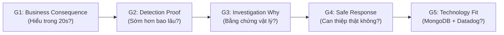
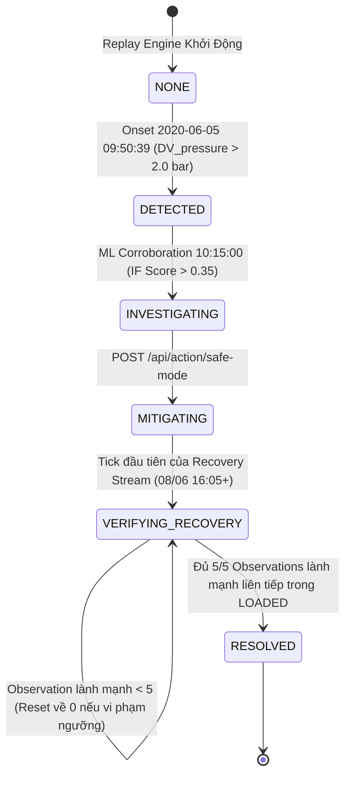
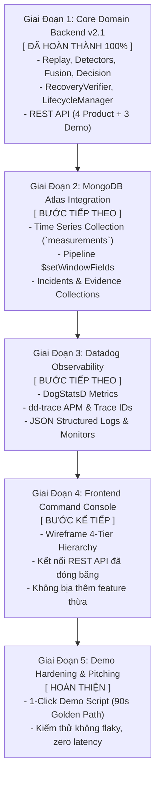

# COMPRESSORGUARD — MASTER CONTEXT & SYSTEM DOSSIER

> **Document Type:** Master Context & Single Source of Truth (SSOT)  
> **Status:** Active & Incrementally Appendable  
> **Target:** MUGVN Hackathon 2026 (MongoDB + Datadog)  
> **Core Mission:** **Detect earlier → Prove why → Act safely → Verify recovery.**  
> **Maintainer/Role:** Lead System Architect & Fleet Operations Engineering  

---

## MỤC LỤC TỔNG QUAN

1. [Phần 1: Executive Summary & Project North Star](#phần-1-executive-summary--project-north-star)
2. [Phần 2: Hackathon Strategy & Comparative Post-Mortem](#phần-2-hackathon-strategy--comparative-post-mortem)
3. [Phần 3: Physical Domain & Ground Truth Dataset (MetroPT-3)](#phần-3-physical-domain--ground-truth-dataset-metropt-3)
4. [Phần 4: Product Thesis & 90-Second Golden Experience Spec](#phần-4-product-thesis--90-second-golden-experience-spec)
5. [Phần 5: Backend Domain Architecture & Vertical Slice v2.1 (Frozen)](#phần-5-backend-domain-architecture--vertical-slice-v21-frozen)
6. [Phần 6: Master Spec Technology Blueprint (MongoDB & Datadog)](#phần-6-master-spec-technology-blueprint-mongodb--datadog)
7. [Phần 7: Strategic Roadmap & Rules of Engagement Cho AI Tiếp Theo](#phần-7-strategic-roadmap--rules-of-engagement-cho-ai-tiếp-theo)

---

## PHẦN 1: EXECUTIVE SUMMARY & PROJECT NORTH STAR

### 1.1 Định Vị Sản Phẩm (What is this?)
**CompressorGuard** là một **Incident Command Console cho Thiết Bị Vật Lý Trọng Yếu (Physical Assets)** — chuyên phục vụ hệ thống cung cấp khí nén **Air Production Unit (APU)** trên các đoàn tàu điện ngầm đô thị (Lisbon Metro).

> [!IMPORTANT]
> **Định vị cốt lõi:**
> - **KHÔNG PHẢI** là một dashboard hiển thị telemetry thông thường.
> - **KHÔNG PHẢI** là một công cụ chấm điểm anomaly đơn thuần.
> - **KHÔNG PHẢI** là một chatbot AI/LLM phụ trợ.
> - **LÀ** một **hệ thống vận hành vòng lặp khép kín (Closed-Loop Operational System)** cho phép chuyên viên vận hành hạm đội: **Phát hiện sớm $\rightarrow$ Chứng minh bằng chứng vật lý $\rightarrow$ Can thiệp an toàn $\rightarrow$ Kiểm chứng phục hồi từ dữ liệu cảm biến thực tế**.

---

### 1.2 User Persona & Ngữ Cảnh Vận Hành (Who & When?)
* **Persona:** **Fleet Operations Specialist (Chuyên viên Giám sát Vận hành Hạm đội Tàu)**.
* **Mối lo sợ lớn nhất:** Sự cố rò rỉ khí nén của máy nén tiến triển âm thầm, còi báo cơ học (`LPS = 1`) chỉ reo khi áp suất đã sập hoàn toàn trong đường hầm, buộc đoàn tàu phải dừng khẩn cấp giữa ray và bị kéo về ga sửa chữa, làm tê liệt tuyến tàu đô thị.
* **Nhiệm vụ hàng ngày:** Phải quan sát hàng triệu điểm dữ liệu từ 15 cảm biến, phân biệt trạng thái có tải (`LOADED`) và không tải (`UNLOADED`), tìm ra bất thường nhiệt động lực học và đưa ra quyết định xử lý trước khi thảm họa xảy ra.

---

### 1.3 Ba Tuyên Ngôn Bất Khả Chiến Bại (3 Killer Claims)
Khi trình bày với bất kỳ ai (Ban Giám khảo, Khách hàng, hay AI agent kế nhiệm), đây là 3 thông điệp bắt buộc phải ghi nhớ:

| # | Killer Claim | Ý Nghĩa Kỹ Thuật & Vận Hành |
|---|---|---|
| **1** | **33 Giờ 52 Phút Lead Time** | Phát hiện suy thoái từ **09:50 ngày 05/06/2020**, sớm hơn còi báo tụt áp cơ học truyền thống (**19:42 ngày 06/06/2020**) đúng **2032 phút** (33h 52m). |
| **2** | **Bằng Chứng > Điểm Anomaly (Evidence > Anomaly Score)** | Không yêu cầu người dùng "tin vào điểm số AI". Hệ thống dọn ra 4 tín hiệu đồng thời: Độ lệch áp suất xả $+23.75\sigma$ ($2.18\text{ bar}$ vs $-0.016\text{ bar}$), Trôi dạt nhiệt độ dầu $+5.71\sigma$ ($74.97^\circ\text{C}$ vs $54.98^\circ\text{C}$), Bước nhảy liên tục 3 chu kỳ, và Kiểm chứng đa biến bởi Isolation Forest ($0.382 > 0.35$). |
| **3** | **Kiểm Chứng Phục Hồi Khép Kín (Closed-Loop Physical Recovery)** | Hành động kích hoạt Safe Mode không phải là animation đổi màu badge. Nó thực sự rẽ nhánh luồng dữ liệu sang phân đoạn thực tế sau bảo trì (ngày 08/06/2020) và chỉ đóng sự cố khi và chỉ khi kiểm chứng đủ **5 cửa sổ đánh giá liên tiếp** trong trạng thái có tải (`LOADED`) đạt chuẩn vật lý. |

---

### 1.4 Giới Hạn Nghiêm Ngặt Về Phạm Vi (Strict Anti-Scope)
Để bảo toàn tính thực chiến và không làm loãng dự án hackathon, hệ thống áp dụng các nguyên tắc cấm:
* ❌ **CẤM LLM Chatbot:** Không làm trợ lý hỏi đáp hội thoại; chuyên viên vận hành cần hành động trong 5 giây, không ngồi chat.
* ❌ **CẤM Fake Fleet Simulator:** Không tạo ra 50 đoàn tàu ảo; tập trung tối đa vào "Vertical Slice" xuất sắc của thiết bị đơn lẻ `APU-COMP-01`.
* ❌ **CẤM Thuật toán ML phức tạp dư thừa:** Chỉ sử dụng duy nhất mô hình Isolation Forest trên chế độ `LOADED` để kiểm chứng đa biến.
* ❌ **CẤM Bày bừa biểu đồ đo lường thô:** Không hiển thị 15 biểu đồ sensor đồng thời trên màn hình chính gây quá tải thị giác.

---

## PHẦN 2: HACKATHON STRATEGY & COMPARATIVE POST-MORTEM

### 2.1 Bối Cảnh So Sánh Giữa Hai Dự Án
Trong workspace phát triển, chúng ta sở hữu 2 codebase:
1. `hackathon/` — **ThreatLens AI SOC Copilot** (Dự án hackathon trước đó).
2. `iot-hackathon/` — **CompressorGuard** (Dự án đang phát triển cho MUGVN Hackathon 2026).

Qua quá trình phân tích đối sánh sâu (Deep Post-Mortem), chúng ta rút ra những bài học sống còn về cách một dự án hackathon giành chiến thắng trước ban giám khảo.

---

### 2.2 Vì Sao `hackathon/` (ThreatLens AI) Gây Ấn Tượng Mạnh?
* **Bản chất kỹ thuật thực sự:** ThreatLens dùng mô hình Machine Learning khá đơn giản (Two-stage Logistic Regression) kết hợp với các luật YAML và MongoDB Atlas. Phần kỹ thuật toán học không quá phức tạp.
* **Nhưng nó thắng ở đâu?** Nó thắng ở **Surface-First & Narrative-Driven**:
  - Giao diện có tính hành động cực kỳ cao (Command Center, IP Blast Radius, Threat Investigator, Remediation Workflow).
  - Nó biến một capability (phân tích log web) thành một **trải nghiệm hoàn chỉnh**:
    $$\text{Ingest Logs} \longrightarrow \text{Correlation} \longrightarrow \text{Investigation} \longrightarrow \text{Evidence} \longrightarrow \text{Action}$$
  - Khi xem demo 3 phút, Giám khảo liên tục có việc để làm: *Có alert $\rightarrow$ click $\rightarrow$ thấy bằng chứng $\rightarrow$ hiểu chuyện gì xảy ra $\rightarrow$ ấn nút xử lý*.

---

### 2.3 Điểm Mù Ban Đầu Của `iot-hackathon/` (CompressorGuard)
* **Sức nặng kỹ thuật vượt trội:** CompressorGuard sở hữu nền tảng toán học, vật lý nhiệt động lực, bộ lọc dữ liệu thực MetroPT-3 (1.5 triệu dòng) và phân loại regime rất sâu sắc.
* **Nhược điểm cốt tử ban đầu:** Mắc phải hội chứng **"Engine is smart, trust me"**:
  - Hệ thống chỉ có script dòng lệnh hoặc test suite chạy ngầm.
  - Ban giám khảo không thể "cảm nhận" được sự nguy cấp của chiếc máy nén khí chỉ qua các dòng log terminal.
  - Nguy cơ bị đánh đồng với một bài tập thống kê dữ liệu thời gian (Time-series benchmark) thay vì một hệ thống vận hành thực chiến.

---

### 2.4 Định Luật Cốt Lõi Về Phân Tầng Sản Phẩm
Một sai lầm phổ biến của kỹ sư khi thấy dự án chưa đủ thuyết phục là **viết thêm feature** (thêm chatbot, thêm mô hình deep learning, thêm dashboard). Đây là con đường dẫn đến thất bại. Hãy nhớ phân tầng:

```
[ Engineering ]  -->  [ Capability ]  -->  [ Product ]  -->  [ Demo Experience ]
(Thuật toán,         (Phát hiện rò rỉ,     (Console giải quyết    (Kịch bản 90s
 toán học, DB)        tính delta áp suất)   vấn đề của Metro OP)   khiến judge thán phục)
```

> [!TIP]
> **Định luật hackathon:**
> $$\text{Feature} \neq \text{Capability} \neq \text{Product} \neq \text{Demo} \neq \text{Engineering}$$
> CompressorGuard đã thừa **Engineering** và **Capability**. Điều duy nhất còn thiếu là đóng gói nó thành một **Product** với một **Demo Experience** không thể bị đánh bại.

---

### 2.5 Năm Cổng Đánh Giá Của Ban Giám Khảo (5 Evaluation Gates)
Khi giám khảo chấm điểm một dự án hackathon, họ vô thức đi qua 5 cổng theo thứ tự ưu tiên:



1. **Gate 1 — Business Consequence (20 giây đầu):** Giám khảo phải hiểu ngay: APU hỏng $\rightarrow$ mất phanh/cửa $\rightarrow$ đoàn tàu chết đứng trong hầm $\rightarrow$ đình trệ toàn bộ mạng lưới metro.
2. **Gate 2 — Detection Proof:** Không phải claim suông: Hệ thống chỉ ra rò rỉ trước hệ thống cũ **33 giờ 52 phút**.
3. **Gate 3 — Investigation Why:** Trả lời dứt khoát câu hỏi "Tại sao?": Dẫn chứng áp suất xả tăng vọt và nhiệt độ dầu bốc cao vượt baseline.
4. **Gate 4 — Safe Response & Verified Recovery:** Kích hoạt Safe Mode và chứng minh hệ thống đã hồi phục bằng dữ liệu thực.
5. **Gate 5 — Technology Fit:** Chứng minh MongoDB (Time Series, Aggregations) và Datadog (Metrics, Traces) là giải pháp tối ưu cho bài toán này, không phải gắn vào để đối phó đề bài.

---

## PHẦN 3: PHYSICAL DOMAIN & GROUND TRUTH DATASET (METROPT-3)

### 3.1 Hồ Sơ Tập Dữ Liệu UCI MetroPT-3
* **Nguồn dữ liệu:** Kho lưu trữ UCI Machine Learning Repository & Nature Scientific Data (2022).
  - Dataset: *MetroPT-3 (Air Compressor)*.
  - Thực tế thu thập: Hệ thống cung cấp khí nén (Air Production Unit - APU) trên đoàn tàu điện ngầm Metro de Lisboa (Bồ Đào Nha).
* **Quy mô dữ liệu:**
  - Tổng số bản ghi: **1,516,948 dòng dữ liệu cảm biến**.
  - Tần số lấy mẫu gốc: **1 Hz** (1 giây/mẫu).
  - Chu kỳ truyền từ xa ban đầu: Batch 5 phút qua sóng di động GSM lên máy chủ trung tâm.
  - Kích thước: ~208 MB tệp CSV nguyên bản (`dataset/MetroPT3(AirCompressor).csv`).
* **Đặc tính Ground Truth:**
  - Không có nhãn bất thường cho từng dòng đơn lẻ (không có point-level synthetic labels).
  - Có **Event-level Ground Truth** thông qua nhật ký bảo dưỡng thực tế của đơn vị vận hành tàu đô thị (Maintenance Reports).

---

### 3.2 Hệ Thống Cảm Biến Của Air Production Unit (APU)
Hệ thống APU bao gồm máy nén piston, tháp làm khô không khí (Air Dryer), bình lắng dầu và các van xả. Toàn bộ 15 trường dữ liệu được phân chia thành 4 nhóm nghiệp vụ:

| Tên Cột Trong Dataset | Nhóm Thiết Bị | Đơn Vị | Ý Nghĩa Vật Lý & Vai Trò Trong Giám Sát |
|---|---|---|---|
| `timestamp` | Thời gian | YYYY-MM-DD HH:MM:SS | Dấu thời gian đo đạc thực tế của cảm biến |
| `TP2` | Áp suất | bar | Áp suất tại bình trung gian (Intermediate Pressure) |
| `TP3` | Áp suất | bar | Áp suất đầu ra của máy nén khí (Compressor Discharge Pressure) |
| `H1` | Áp suất | bar | Áp suất bình chứa chính (Main Reservoir Pressure) |
| `DV_pressure` | Áp suất xả | bar | **CẢM BIẾN CHỦ ĐẠO:** Áp suất van xả của tháp làm khô khí (Discharge Valve Pressure). Ở trạng thái bình thường mang tải, van đóng kín nên áp suất gần như bằng 0 (thực tế -0.016 bar). Khi van hở rò rỉ, áp suất xả tăng vọt lên > 2 bar. |
| `Reservoirs` | Áp suất | bar | Áp suất tổng tại các bình trữ khí phụ |
| `Oil_temp` | Nhiệt độ | °C | **CẢM BIẾN BẰNG CHỨNG:** Nhiệt độ dầu bôi trơn máy nén. Khi máy nén làm việc quá tải do rò rỉ khí, nhiệt độ dầu trôi dạt mạnh từ 54°C lên gần 75°C. |
| `Motor_current` | Dòng điện | A | Cường độ dòng điện cấp cho mô-tơ máy nén. Dùng để xác định chế độ có tải (`> 0.5A`) hay không tải. |
| `COMP` | Tín hiệu số | 0 / 1 | Trạng thái rơ-le điều khiển máy nén (Compressor Control Signal) |
| `DV_electric` | Tín hiệu số | 0 / 1 | Tín hiệu điện kích hoạt van xả điện từ (Discharge Valve Solenoid) |
| `TOWERS` | Tín hiệu số | 0 / 1 | Trạng thái van chuyển đổi tháp làm khô (Tháp 1 / Tháp 2) |
| `MPG` | Tín hiệu số | 0 / 1 | Tín hiệu van điều áp chính (Main Pressure Governor) |
| `LPS` | Còi cơ học | 0 / 1 | **LOW PRESSURE SWITCH:** Cảm biến rơ-le áp suất thấp cơ học. Bật lên 1 khi áp suất bình chính sập dưới ngưỡng an toàn tối thiểu (7.0 bar). Đây là ngưỡng cảnh báo truyền thống cũ. |
| `Pressure_switch`| Tín hiệu số | 0 / 1 | Công tắc áp suất khí nén |
| `Oil_level` | Mức dầu | 0 / 1 | Cảm biến phao báo mức dầu bôi trơn thấp |
| `Caudal_impulses`| Lưu lượng | xung/s | Tín hiệu xung đo lưu lượng khí qua ống dẫn |

---

### 3.3 Tầm Quan Trọng Tuyệt Đối Của Chế Độ Vận Hành (Operating Regimes)
Một sai lầm cơ bản trong phân tích chuỗi thời gian công nghiệp là **tính toán baseline gộp chung mọi chế độ**. 
Máy nén khí có chu kỳ đóng ngắt liên tục giữa 3 chế độ:

1. **`LOADED` (Mang tải nạp khí):** Mô-tơ quay mạnh (`Motor_current > 0.5A`), van xả đóng, khí nén được bơm vào bình trữ `H1`. Áp suất `TP3` tăng lên ~9.0 bar.
2. **`UNLOADED` (Chạy không tải):** Mô-tơ ngắt hoặc chạy không tải xả khí, áp suất giảm.
3. **`STANDBY` / `OFF` (Nghỉ hoàn toàn):** Không có dòng điện tiêu thụ.

> [!CAUTION]
> **Quy tắc phân vùng (Regime Separation Invariant):**
> Các ngưỡng vật lý và mô hình ML (Isolation Forest) **bắt buộc phải được đánh giá riêng biệt trong chế độ `LOADED`**. Nếu trộn lẫn dữ liệu `UNLOADED` hoặc `STANDBY`, phương sai sẽ bị bóp méo, gây ra hàng loạt cảnh báo giả (False Positives).

---

### 3.4 Cơ Chế Suy Thoái Vật Lý Của Sự Cố Vàng (Thermodynamic Failure Breakdown)
Vào đầu tháng 6/2020, một sự cố nghiêm trọng diễn ra trên đoàn tàu số hiệu APU-01 theo chuỗi phản ứng dây chuyền:

```
[Van Xả Hở Rò Rỉ] ──► [Áp Suất Xả DV_pressure Nhảy Vọt (+23.75σ)]
         │
         ▼
[Máy Nén Phải Bơm Bù Liên Tục] ──► [Nhiệt Độ Dầu Oil_temp Bốc Cao (+5.71σ)]
         │
         ▼
[Sau 33h 52m Chịu Đựng] ──► [Bình Trữ Khí Sập Áp, Rơ-le Cơ Học LPS=1 Bật Còi Báo Động]
```

1. **Giai đoạn bình thường (Normal Baseline):**
   - Áp suất xả `DV_pressure` ở mức: **$-0.016 \pm 0.09\text{ bar}$**.
   - Nhiệt độ dầu `Oil_temp` ở mức: **$54.98 \pm 3.5^\circ\text{C}$**.
2. **Thời điểm khởi phát suy thoái (Onset Milestone): `2020-06-05 09:50:39`**
   - Van xả của tháp làm khô khí bị hở (Mechanical pilot valve degradation).
   - Áp suất tại cảm biến `DV_pressure` đột ngột nhảy vọt lên **$2.1856\text{ bar}$** (tương đương độ lệch khổng lồ **$+23.75\sigma$**).
   - Nhiệt độ dầu máy nén `Oil_temp` bắt đầu leo dốc và đạt **$74.97^\circ\text{C}$** (**$+5.71\sigma$**).
   - Mô hình Multivariate Isolation Forest ghi nhận anomaly score vọt lên **$0.382$** (vượt ngưỡng kiểm chứng $0.35$).
3. **Thời điểm còi báo động cũ phát tác (Conventional Alert): `2020-06-06 19:42:19`**
   - Sau gần 34 giờ máy nén gồng gánh trong tình trạng rò rỉ, lưu lượng nạp không còn bù đắp được lượng thoát khí.
   - Áp suất bình chính sập, rơ-le cơ học nhảy: **`LPS = 1`**.
   - Còi báo động trong buồng lái hú vang, tàu bị cưỡng chế kéo về Depot.
4. **Khoảng thời gian dẫn trước (Early Lead Time):**
   $$T_{\text{lead}} = T_{\text{LPS (19:42:19)}} - T_{\text{Onset (09:50:39)}} = 2032\text{ phút} = \mathbf{33\text{ giờ } 52\text{ phút}}.$$

---

### 3.5 Dữ Liệu Phục Hồi Sau Bảo Trì (Post-Maintenance Recovery Ground Truth)
Sau khi đoàn tàu được đưa vào xưởng kỹ thuật sửa chữa thay thế van xả bị rò rỉ:
* **Thời điểm bắt đầu chuỗi dữ liệu sau bảo trì:** **`2020-06-08 16:05:00`**.
* **Trạng thái vật lý được xác lập lại:**
  - `DV_pressure` giảm về mức an toàn: **$-0.016\text{ bar}$** ($< 0.05\text{ bar}$).
  - `Oil_temp` hạ nhiệt dần về mức an toàn: **$64.1^\circ\text{C}$** ($< 67.0^\circ\text{C}$).
* **Cơ chế rẽ nhánh Replay Reversible Safe Mode:**
  Khi chuyên viên vận hành nhấn `[ACTIVATE SAFE MODE]`, con trỏ phát dữ liệu của `ReplayEngine` sẽ rẽ nhánh (stream branching) sang phân đoạn `2020-06-08 16:05:00` để bắt đầu quá trình kiểm chứng phục hồi từ cảm biến thực tế.

---

## PHẦN 4: PRODUCT THESIS & 90-SECOND GOLDEN EXPERIENCE SPEC

### 4.1 Triết Lý Thiết Kế Trải Nghiệm (Spec The Experience, Not The Interface)
Một sai lầm rất lớn trong phát triển phần mềm hackathon là vội vàng code giao diện HTML/Tailwind/CSS trước khi chốt luồng nhận thức (Cognitive Flow). 
Khi bạn nhảy vào code UI quá sớm, bạn sẽ tự thuyết phục bản thân rằng những nút bấm và bảng màu ngẫu nhiên là hợp lý, trong khi người dùng hoặc giám khảo nhìn vào lại thấy lộn xộn và không hiểu chuyện gì đang xảy ra.

> [!IMPORTANT]
> **Nguyên tắc vàng:**
> *"Đặc tả trải nghiệm nhận thức, không đặc tả giao diện cơ học."*
> Giám khảo không cần biết nút bấm nằm bên trái hay bên phải, bo góc bao nhiêu pixel. Giám khảo cần biết: **Họ phải trải qua những trạng thái tâm lý nào, theo thứ tự nào, và hệ thống chứng minh điều gì ở mỗi giây?**

---

### 4.2 Tiến Trình Nhận Thức Trong 90 Giây (The 5 Judge Questions)
Trong vòng 90 giây trình diễn live demo, màn hình console phải trả lời chính xác 5 câu hỏi xuất hiện trong tâm trí giám khảo mà không cần thuyết trình viên phải giải thích dài dòng:

```
[00:00 - 00:15]  1. TÔI LÀ AI? (WHO AM I?)
                 └──► Tôi là Fleet Operations Specialist, đang bảo vệ đoàn tàu APU-COMP-01.

[00:15 - 00:35]  2. ĐIỀU GÌ XẢY RA & SỚM HƠN BAO LÂU? (WHAT & HOW EARLY?)
                 └──► Máy nén rò rỉ van xả nghiêm trọng. Hệ thống phát hiện sớm 33h 52m!

[00:35 - 00:55]  3. VÌ SAO TÔI PHẢI TIN? (WHY TRUST?)
                 └──► 4 Bằng chứng đồng thời: Áp suất +23.75σ, Nhiệt độ +5.71σ, Bước nhảy 3 chu kỳ, ML 0.382.

[00:55 - 00:75]  4. TÔI CÓ THỂ LÀM GÌ? (WHAT CAN I DO?)
                 └──► Nhấn [ACTIVATE SAFE MODE] để cô lập van rò rỉ và rẽ nhánh luồng dữ liệu.

[00:75 - 00:90]  5. NÓ CÓ HIỆU QUẢ THẬT KHÔNG? (DID IT WORK?)
                 └──► Áp suất giảm về 0, dầu hạ nhiệt, kiểm chứng đủ 5/5 quan sát lành mạnh -> RESOLVED!
```

---

### 4.3 Bốn Tầng Phân Cấp Thông Tin (4 Tiers of Progressive Disclosure)
Để tránh làm loãng tâm trí của giám khảo với hàng chục con số kỹ thuật, thông tin được tổ chức thành 4 tầng hiển thị nghiêm ngặt:

```text
┌────────────────────────────────────────────────────────────────────────┐
│ TIER 1: PERIPHERAL AWARENESS (Nhận biết tức thì trong 3 giây)          │
│ • Định danh thiết bị: APU-COMP-01 (Lisbon Metro - Blue Line)           │
│ • Trạng thái sự cố: CRITICAL DEGRADATION DETECTED                      │
│ • Chỉ số anh hùng: 33H 52M EARLY LEAD TIME                             │
│ • Nút hành động chính: [ ACTIVATE SAFE MODE ]                          │
├────────────────────────────────────────────────────────────────────────┤
│ TIER 2: FACTUAL DECISION BASIS (Cơ sở ra quyết định trong 10 giây)     │
│ • 4 Thẻ Bằng Chứng Thực Tế:                                            │
│     1. Áp suất xả: 2.18 bar (+23.75σ) [Mức báo động đỏ CRITICAL]       │
│     2. Nhiệt độ dầu: 74.97 °C (+5.71σ) [Mức nghiêm trọng SEVERE]       │
│     3. Độ trễ thời gian: Step Diff > 0.5 bar [Bền vững 3 chu kỳ]       │
│     4. Mô hình Isolation Forest: 0.382 (> ngưỡng 0.35 xác nhận)        │
│ • Cột mốc thời gian: Cảnh báo cũ LPS=1 dự kiến xảy ra sau 33h 52m      │
│ • Thanh kiểm chứng phục hồi: 0/5 ──► 5/5 Quan sát lành mạnh đạt chuẩn  │
├────────────────────────────────────────────────────────────────────────┤
│ TIER 3: ON-DEMAND TRUST VERIFICATION (Mở ra khi bấm "Chi tiết bằng chứng")
│ • Chế độ vận hành: LOADED (Dòng điện > 0.5A, van kích hoạt)            │
│ • Tham chiếu bình thường: Áp suất (-0.016 ± 0.09 bar), Dầu (54.98 °C)  │
│ • Cửa sổ quan sát: Đạt liên tục trong cửa sổ trượt 10 mẫu gần nhất     │
│ • Nguồn gốc dữ liệu: Timestamp thực từ dữ liệu cảm biến ngày 05/06/2020│
├────────────────────────────────────────────────────────────────────────┤
│ TIER 4: BACKGROUND SUBSTANCE (Tầng ngầm: Terminal / Backend Logs)       │
│ • 1.5 triệu dòng CSV MetroPT-3 nguyên bản                              │
│ • Ma trận huấn luyện Scikit-learn và các mảng bộ nhớ đệm               │
│ • Distributed Traces và metrics đẩy lên Datadog                        │
└────────────────────────────────────────────────────────────────────────┘
```

---

### 4.4 Thiết Kế Bố Cục Incident Command Console (Wireframe)
Màn hình console vận hành được cấu trúc tối giản, không màu mè, hướng trực diện vào nghiệp vụ:

```text
┌────────────────────────────────────────────────────────────────────────────────────────┐
│  COMPRESSORGUARD // INCIDENT COMMAND CONSOLE                [Asset: APU-COMP-01]  LOADED │
├────────────────────────────────────────────────────────────────────────────────────────┤
│                                                                                        │
│  🔴 CRITICAL DEGRADATION DETECTED                      ⏱️ 33H 52M EARLY LEAD TIME      │
│     Onset: 2020-06-05 09:50:39                         Conventional LPS: 2020-06-06    │
│                                                                                        │
├────────────────────────────────────────────────────────────────────────────────────────┤
│  WHY WE BELIEVE IT (OPERATIONAL EVIDENCE PACK)                                         │
│                                                                                        │
│  ┌───────────────────────┐  ┌───────────────────────┐  ┌────────────────────────────┐  │
│  │ DISCHARGE PRESSURE    │  │ OIL TEMPERATURE       │  │ TEMPORAL & ML CORROBORATION│  │
│  │ 2.18 bar (+23.75σ)    │  │ 74.97 °C (+5.71σ)     │  │ Regime: LOADED             │  │
│  │ [███████████████████] │  │ [████████████░░░░░]   │  │ IF Score: 0.382 (>0.35)    │  │
│  │ Normal: -0.016 bar    │  │ Normal: 54.98 °C      │  │ Persistence: 3/3 Cycles    │  │
│  └───────────────────────┘  └───────────────────────┘  └────────────────────────────┘  │
│                                                                                        │
├────────────────────────────────────────────────────────────────────────────────────────┤
│  OPERATIONAL RESPONSE & VERIFICATION                                                   │
│                                                                                        │
│  Suggested Mitigation: Isolate Air Dryer Tower 2, switch to safe single-line mode.     │
│                                                                                        │
│  [⚡ ACTIVATE SAFE MODE]                  Current State: MITIGATING                     │
│                                           Physical Recovery: [✓][✓][✓][✓][✓] (5/5 Obs) │
│                                                                                        │
└────────────────────────────────────────────────────────────────────────────────────────┘
```

---

## PHẦN 5: BACKEND DOMAIN ARCHITECTURE & VERTICAL SLICE V2.1 (FROZEN)

### 5.1 Hiện Trạng Kỹ Thuật: Đã Hoàn Thiện & Đóng Băng (Frozen & Verified)
Toàn bộ phần lõi nghiệp vụ backend (**Vertical Slice Backend v2.1**) của CompressorGuard đã được hiện thực hóa 100%, vượt qua toàn bộ 12 test cases tích hợp, đạt tính tất định tuyệt đối và đã được **đóng băng (code frozen)**.

```text
                                  KIẾN TRÚC VERTICAL SLICE v2.1 ĐÃ ĐÓNG BĂNG
                                  
  ┌────────────────────────────────────────────────────────────────────────────────────────┐
  │                           EXISTING ENGINE (SOURCE OF TRUTH)                            │
  │     ReplayEngine ──► Detectors (6) ──► EvidenceFusion ──► DecisionEngine               │
  │     (1.5M dòng MetroPT-3)              (LOADED regime)    (Pure deterministic function)│
  └───────────────────────────────────────────┬────────────────────────────────────────────┘
                                              │ (Sensor facts, sigmas, anomaly scores)
                                              ▼
  ┌────────────────────────────────────────────────────────────────────────────────────────┐
  │                    INCIDENT LIFECYCLE MANAGER (src/engine/lifecycle.py)                │
  │     • Điều phối con trỏ replay: Degradation stream vs Post-maintenance stream          │
  │     • Explicit State Machine:                                                          │
  │       NONE ──► DETECTED ──► INVESTIGATING ──► MITIGATING ──► VERIFYING_RECOVERY ──► RESOLVED
  │     • Bảo vệ chuyển đổi trạng thái phi pháp (InvalidStateTransitionError -> HTTP 409)  │
  │     • Ticks sau RESOLVED là no-op idempotent                                           │
  └─────────────────────┬──────────────────────────────────────────▲───────────────────────┘
                        │ (Evaluate observation)                   │ (Recovery criteria)
                        ▼                                          │
  ┌───────────────────────────────────────────┐  ┌─────────────────┴───────────────────────┐
  │   RECOVERY VERIFIER & CRITERIA POLICY     │  │       PRESENTATION-AGNOSTIC REST API    │
  │   (src/engine/recovery.py)                │  │       (src/api/)                        │
  │   • Policy: RecoveryCriteria              │  │   Product Endpoints:                    │
  │     - dv_pressure < 0.05 bar              │  │     • GET  /api/incident                │
  │     - oil_temp < 67.0 °C                  │  │     • GET  /api/evidence                │
  │     - required_regime: LOADED             │  │     • POST /api/action/safe-mode        │
  │     - target_healthy_observations: 5      │  │     • GET  /api/recovery                │
  │   • Suspension: Giữ nguyên khi ko LOADED  │  │   Demo & Simulation Controls:           │
  │   • Invariant: Reset về 0 nếu vi phạm    │  │     • POST /demo/reset                  │
  │     ngay cả khi đã đạt 4/5 observations   │  │     • POST /demo/tick                   │
  └───────────────────────────────────────────┘  │     • POST /demo/jump (400 nếu sai)     │
                                                 └─────────────────────────────────────────┘
```

---

### 5.2 Tám Bất Biến Bắt Buộc Của Hệ Thống (8 Mandatory Invariants)
Bất kỳ ai chỉnh sửa mã nguồn backend này đều **không được phép phá vỡ** 8 nguyên tắc sau:

1. **Zero UI / HTML / CSS Code:** 100% mã nguồn trong `src/` là pure Python logic và REST API trả về JSON typed DTOs. Không render HTML trong backend.
2. **Zero Fake / Fabricated Telemetry:** 100% dữ liệu cảm biến lấy từ `dataset/MetroPT3(AirCompressor).csv`. Tuyệt đối không viết công thức giả lập hạ nhiệt nhân tạo.
3. **Engine là nguồn chân lý duy nhất (Single Source of Truth):** `lifecycle.py` và API routes không duplicate bất kỳ hằng số cảm biến nào. Mọi giá trị $2.18\text{ bar}$, $+23.75\sigma$, $+5.71\sigma$, $0.382$ đều sinh ra từ `detectors.py` và `DecisionEngine`.
4. **Ngữ nghĩa Cửa sổ Quan sát Phục hồi (Evaluation Observations):** Thay thế từ "cycle" mơ hồ bằng `consecutive_healthy_observations`. Tách riêng chính sách `RecoveryCriteria`. Nếu vi phạm ngưỡng ở mẫu thứ 4/5, bộ đếm lập tức **reset về 0**!
5. **Máy trạng thái tường minh & Bảo vệ HTTP 409:** Gọi `POST /api/action/safe-mode` khi đang ở `MITIGATING`, `VERIFYING_RECOVERY`, hoặc `RESOLVED` sẽ bị từ chối bằng HTTP 409 Conflict (`INVALID_STATE_TRANSITION`).
6. **Tách biệt Product Endpoints vs Demo Controls:** 4 endpoints nghiệp vụ nằm dưới `/api`, 3 endpoints điều khiển replay nằm dưới `/demo`.
7. **Clean Dependency Inversion:** Toàn bộ quá trình khởi tạo engine thông qua factory hoặc dependency injection. Mã nguồn `src/` hoàn toàn không phụ thuộc ngược vào `tests/`.
8. **Tính tất định 100% (Deterministic Replay):** Chạy 2 lượt mô phỏng độc lập từ đầu đến cuối cam kết kết quả trùng khớp $100\%$ không sai lệch (`test_deterministic_replay.py`).

---

### 5.3 Chi Tiết Máy Trạng Thái Sự Cố (Formal State Machine)



---

### 5.4 Hợp Đồng REST API Đóng Băng (Frozen API Contract & Schemas)

#### 1. `GET /api/incident`
Trả về tổng quan sự cố, trạng thái hạm đội và chỉ số Lead Time động ($2032\text{ phút} = \text{33h 52m}$):
```json
{
  "incident_id": "APU-INC-20200605-01",
  "asset_id": "APU-COMP-01",
  "lifecycle_state": "INVESTIGATING",
  "asset_health": "CRITICAL",
  "operational_confidence": "HIGH",
  "lead_time": {
    "lead_time_minutes": 2032,
    "lead_time_formatted": "33h 52m",
    "conventional_alert_timestamp": "2020-06-06T19:42:19Z",
    "earliest_detection_timestamp": "2020-06-05T09:50:39Z"
  },
  "summary": "Multi-detector physical signals confirmed and corroborated by multivariate Isolation Forest. Safe Mode recommended."
}
```

#### 2. `GET /api/evidence`
Dọn sẵn 4 thẻ bằng chứng vật lý theo mô hình phân tầng:
```json
{
  "incident_id": "APU-INC-20200605-01",
  "regime": "LOADED",
  "evidence_pack": [
    {
      "code": "PRESSURE_SEVERE",
      "signal_name": "Discharge Valve Pressure",
      "observed_value": 2.1856,
      "baseline_value": -0.0164,
      "unit": "bar",
      "sigma_deviation": 23.75,
      "status": "CRITICAL",
      "is_primary": true
    },
    {
      "code": "THERMAL_STRESS_DRIFT",
      "signal_name": "Compressor Oil Temperature",
      "observed_value": 74.97,
      "baseline_value": 54.98,
      "unit": "°C",
      "sigma_deviation": 5.71,
      "status": "SEVERE",
      "is_primary": false
    },
    {
      "code": "TEMPORAL_STEP_CONFIRMED",
      "signal_name": "Temporal Step Persistence",
      "observed_value": 2.202,
      "baseline_value": 0.0,
      "unit": "bar_diff",
      "sigma_deviation": 0.0,
      "status": "CONFIRMED",
      "is_primary": false
    },
    {
      "code": "ISOLATION_FOREST_ANOMALY",
      "signal_name": "Multivariate Isolation Forest",
      "observed_value": 0.382,
      "baseline_value": 0.35,
      "unit": "score",
      "sigma_deviation": 0.0,
      "status": "WARNING",
      "is_primary": false
    }
  ],
  "persistence": {
    "confirmed": true,
    "consecutive_samples": 10,
    "required_samples": 3
  }
}
```

#### 3. `POST /api/action/safe-mode`
Kích hoạt chuyển đổi chế độ an toàn và rẽ nhánh luồng dữ liệu sang dữ liệu thực tế sau bảo trì (Ngày 08/06/2020):
```json
{
  "action_id": "ACT-SM-001",
  "status": "ACTIVATED",
  "execution_mode": "SIMULATION_BRANCH",
  "target_state": "MITIGATING",
  "stream_branch": {
    "source": "METROPT-3_POST_MAINTENANCE",
    "offset_timestamp": "2020-06-08T16:05:00Z"
  }
}
```
*Lưu ý xử lý lỗi:* Nếu gọi endpoint này khi trạng thái không phải `DETECTED` hoặc `INVESTIGATING`, API lập tức trả về **HTTP 409 Conflict**:
```json
{
  "detail": "Action safe-mode is not permitted when incident is in state MITIGATING.",
  "error": "INVALID_STATE_TRANSITION"
}
```

#### 4. `GET /api/recovery`
Theo dõi tiến trình kiểm chứng phục hồi vật lý từng observation:
```json
{
  "incident_id": "APU-INC-20200605-01",
  "is_recovering": true,
  "is_verified": false,
  "consecutive_healthy_windows": 4,
  "target_healthy_windows": 5,
  "latest_telemetry": {
    "dv_pressure_bar": -0.016,
    "oil_temp_c": 64.1,
    "regime": "LOADED"
  },
  "criteria": {
    "dv_pressure_max": 0.05,
    "oil_temp_max": 67.0,
    "required_regime": "LOADED"
  }
}
```

#### 5. Demo Simulation Controls (`/demo/*`)
* `POST /demo/reset`: Nhận body `{"milestone": "onset_0950"}` $\rightarrow$ Reset Replay Engine về mốc khởi phát.
* `POST /demo/jump`: Nhận body `{"milestone": "ml_corroborated_1015"}` $\rightarrow$ Tua nhanh tới mốc ML xác nhận. Trả về **HTTP 400 Bad Request** nếu milestone không hợp lệ.
* `POST /demo/tick`: Phát tiếp 1 bản ghi telemetry tiếp theo. Khi sự cố đã `RESOLVED`, gọi tick sẽ trả về HTTP 200 no-op an toàn.

---

## PHẦN 6: MASTER SPEC TECHNOLOGY BLUEPRINT (MONGODB & DATADOG)

### 6.1 Kiến Trúc Tích Hợp MongoDB Atlas (Operational Data Platform)
Trong CompressorGuard, MongoDB không đơn thuần là nơi chứa dữ liệu tĩnh; nó là nền tảng xử lý dữ liệu vận hành đa phương thức (Multimodal Operational Platform) giải quyết đồng thời chuỗi thời gian, tài liệu sự cố và tìm kiếm vector.

```text
┌────────────────────────────────────────────────────────────────────────────────────────┐
│                               MONGODB ATLAS ARCHITECTURE                               │
├────────────────────────────────────────────────────────────────────────────────────────┤
│ 1. TIME SERIES COLLECTION: `measurements`                                              │
│    • timeField: "timestamp"                                                            │
│    • metaField: "metadata" -> { asset_id: "APU-COMP-01", line: "Linha Azul" }         │
│    • granularity: "seconds"                                                            │
│    • Aggregation Pipeline: $setWindowFields tính rolling baseline, delta, sigma.        │
│    • TTL (expireAfterSeconds): Tự động dọn dẹp telemetry thô sau 7 ngày.              │
├────────────────────────────────────────────────────────────────────────────────────────┤
│ 2. DOCUMENT COLLECTIONS (ACID & Relational Context)                                    │
│    • `incidents`: Lưu trữ vòng đời sự cố, lead time, audit logs của thao tác Safe Mode.│
│    • `evidence_records`: Lưu snapshot 4 thẻ bằng chứng vật lý tại thời điểm phát hiện. │
│    • `maintenance_history`: Nhật ký bảo dưỡng thực tế từ đơn vị vận hành Lisbon Metro. │
├────────────────────────────────────────────────────────────────────────────────────────┤
│ 3. VECTOR SEARCH COLLECTION: `incident_embeddings` (P1)                                │
│    • Vector Index: 384 dimensions (cosine similarity)                                  │
│    • Tìm kiếm các sự cố rò rỉ van tương tự trong lịch sử hạm đội.                     │
└────────────────────────────────────────────────────────────────────────────────────────┘
```

#### Pipeline Phân Tích Cửa Sổ Bằng `$setWindowFields`:
Để chứng minh năng lực vượt trội của MongoDB đối với dữ liệu chuỗi thời gian, hệ thống sử dụng aggregation pipeline tính toán độ lệch chuẩn và giá trị trung bình động (Rolling Stats) trực tiếp trên cơ sở dữ liệu:
```javascript
db.measurements.aggregate([
  { $match: { "metadata.asset_id": "APU-COMP-01" } },
  {
    $setWindowFields: {
      partitionBy: "$metadata.asset_id",
      sortBy: { timestamp: 1 },
      output: {
        rolling_avg_dv: {
          $avg: "$dv_pressure_bar",
          window: { range: [-600, 0], unit: "second" } // Cửa sổ trượt 10 phút
        },
        rolling_std_dv: {
          $stdDevSamp: "$dv_pressure_bar",
          window: { range: [-600, 0], unit: "second" }
        }
      }
    }
  },
  {
    $project: {
      timestamp: 1,
      dv_pressure_bar: 1,
      rolling_avg_dv: 1,
      sigma_deviation: {
        $divide: [
          { $subtract: ["$dv_pressure_bar", "$rolling_avg_dv"] },
          { $cond: [{ $eq: ["$rolling_std_dv", 0] }, 1, "$rolling_std_dv"] }
        ]
      }
    }
  }
])
```

#### Luận Điểm Bảo Vệ Trước Giám Khảo: *"Tại sao phải dùng MongoDB?"*
> *"Nếu chỉ cần vẽ biểu đồ cảm biến, người ta dùng cơ sở dữ liệu time-series đơn giản. Nhưng trong điều hành sự cố khẩn cấp của hạm đội, chuyên viên không chỉ nhìn điểm dữ liệu lẻ loi. Họ cần kết hợp **chuỗi thời gian vận hành tần số cao**, **trạng thái sự cố đa tầng**, **nhật ký audit thao tác an toàn**, và **lịch sử bảo dưỡng tương đồng** trong cùng một nền tảng dữ liệu duy nhất. MongoDB cho phép mô hình hóa cả 4 khía cạnh này với hiệu năng vượt trội và tính linh hoạt tuyệt đối."*

---

### 6.2 Kiến Trúc Giám Sát Datadog (Unified Observability Control Plane)
Datadog đóng vai trò là bảng điều khiển quan sát tổng thể (Observability Control Plane) kết nối metrics, distributed traces và structured logs thành một thể thống nhất:

```
FastAPI Domain API ──► dd-trace (APM) ──────► Datadog Traces (/api/incident, /api/evidence)
       │
       ├──► DogStatsD (Metrics) ─────► Datadog Gauges (dv_pressure, oil_temp, lead_time)
       │
       └──► JSON Log Formatter ──────► Datadog Logs (với dd.trace_id correlation)
```

#### 1. Custom Metrics Qua DogStatsD:
* `compressorguard.telemetry.dv_pressure_bar`: Áp suất van xả thời gian thực.
* `compressorguard.telemetry.oil_temp_c`: Nhiệt độ dầu máy nén.
* `compressorguard.ml.anomaly_score`: Điểm số bất thường của Isolation Forest.
* `compressorguard.incident.lead_time_seconds`: Thời gian phát hiện sớm (cố định ở mức 121,920 giây = 33h 52m khi có sự cố).
* `compressorguard.recovery.consecutive_observations`: Bộ đếm tiến trình phục hồi vật lý ($0 \rightarrow 5$).

#### 2. APM & Distributed Tracing (`dd-trace`):
* Tự động instrument ứng dụng FastAPI (`ddtrace-run uvicorn ...`).
* Đo đạc chính xác thời gian phản hồi (latency) của các thao tác nghiệp vụ quan trọng:
  - Endpoint `/api/incident` ($< 15\text{ms}$).
  - Endpoint `/api/evidence` ($< 25\text{ms}$).
  - Thao tác chuyển đổi trạng thái `/api/action/safe-mode` ($< 50\text{ms}$).

#### 3. Log Management Tương Quan Với Trace ID:
Mọi log ghi nhận sự kiện vòng đời (`DETECTED`, `MITIGATING`, `RESOLVED`) đều được xuất dưới dạng JSON có gắn `dd.trace_id` và `dd.span_id`:
```json
{
  "timestamp": "2026-10-08T00:30:00Z",
  "level": "INFO",
  "message": "Safe mode activated. Branching replay stream to post-maintenance telemetry.",
  "incident_id": "APU-INC-20200605-01",
  "asset_id": "APU-COMP-01",
  "dd.trace_id": "18446744073709551615",
  "dd.span_id": "9223372036854775807"
}
```

#### 4. Datadog Monitors & Alerts:
* **Monitor 1 (Early Warning):** Cảnh báo khi $\text{DV\_pressure} > 2.0\text{ bar}$ liên tục trong chế độ `LOADED` $\rightarrow$ Gửi webhook kích hoạt Incident Engine.
* **Monitor 2 (Recovery Audit):** Kích hoạt thông báo thành công khi `compressorguard.recovery.consecutive_observations == 5`.

---

## PHẦN 7: STRATEGIC ROADMAP & RULES OF ENGAGEMENT CHO AI TIẾP THEO

### 7.1 Lộ Trình Triển Khai Toàn Diện (Phased Master Roadmap)



| Giai Đoạn | Trọng Tâm Nghiệp Vụ | Trạng Thái | Hướng Dẫn Cho AI Triển Khai |
|---|---|---|---|
| **Phase 1: Backend Domain Vertical Slice v2.1** | Hiện thực hóa toàn bộ logic nghiệp vụ máy trạng thái, kiểm chứng phục hồi 5 observations, không viết UI, không fake telemetry. | ✅ **HOÀN THÀNH (FROZEN)** | Đã kiểm thử 12/12 tests passing. Tuyệt đối không sửa đổi logic lõi nếu không có yêu cầu đặc biệt. |
| **Phase 2: MongoDB Atlas Integration** | Tích hợp MongoDB Time Series collection cho `measurements`, viết aggregation pipeline `$setWindowFields` tính rolling metrics, lưu trữ collection `incidents` và `evidence_records`. | ⏳ **SẴN SÀNG TRIỂN KHAI** | Giữ nguyên API contract. MongoDB đóng vai trò persistence layer và analytics engine hỗ trợ cho FastAPI. |
| **Phase 3: Datadog Observability** | Cấu hình DogStatsD đẩy custom metrics, gắn thư viện `dd-trace` vào FastAPI, cấu hình định dạng log JSON gắn liền `dd.trace_id`. | ⏳ **CHỜ PHASE 2** | Đảm bảo mọi request qua `/api/*` đều sinh ra traces rõ ràng trên Datadog APM dashboard. |
| **Phase 4: Incident Console Frontend** | Xây dựng giao diện web tối giản theo đúng Wireframe và 4 tầng thông tin tại Phần 4. Gọi trực tiếp vào 4 endpoints `/api/*` và 3 endpoints `/demo/*`. | ⏳ **CHỜ PHASE 3** | Không tự ý sáng tạo thêm các nút chat AI hay menu phức tạp. Bám sát kịch bản nhận thức 90 giây. |
| **Phase 5: Demo Hardening & Rehearsal** | Đóng gói script chạy demo 1 dòng lệnh (`./demo.sh` hoặc `run_demo.py`), chuẩn bị slide thuyết trình theo cấu trúc 5 Cổng Đánh Giá (G1 - G5). | ⏳ **BƯỚC CUỐI** | Đảm bảo buổi diễn tập demo chạy mượt mà 100% trong điều kiện ngắt mạng Internet (Local Replay Fallback). |

---

### 7.2 Quy Tắc Ứng Xử Bất Khả Xâm Phạm Cho AI Kế Tiếp (Rules of Engagement)

Khi bạn (AI kế tiếp) nhận nhiệm vụ tiếp tục phát triển codebase này, bạn **PHẢI** tuân thủ nghiêm ngặt các quy tắc sau:

1. **Tôn trọng tính toàn vẹn của mã nguồn đã đóng băng:**
   - Trước khi sửa bất kỳ file nào trong `src/engine/` hoặc `src/api/`, phải chạy lệnh:
     ```bash
     python -m pytest tests/test_api_vertical_slice.py tests/test_deterministic_replay.py -v
     ```
   - Nếu test fail, bạn đang vi phạm kiến trúc. Phải hoàn nguyên (revert) ngay.
2. **Tuyệt đối không bịa đặt số liệu (Zero Fake Data):**
   - Mọi dữ liệu sensor phải bắt nguồn từ `ReplayEngine` đọc từ file CSV thực tế.
   - Không được viết hàm giả lập kiểu `temp = temp - 1` để lừa giao diện. Phải sử dụng stream branching sang phân đoạn sau bảo trì ngày 08/06/2020.
3. **Tuân thủ hợp đồng REST API đã định:**
   - Frontend chỉ được phép giao tiếp qua 4 Product Endpoints (`/api/incident`, `/api/evidence`, `/api/action/safe-mode`, `/api/recovery`) và 3 Demo Controls (`/demo/reset`, `/demo/tick`, `/demo/jump`).
   - Xử lý đúng mã lỗi **HTTP 409 Conflict** khi người dùng bấm đúp nút Safe Mode.
4. **Appendable Single Source of Truth:**
   - Khi hoàn thành tích hợp MongoDB hoặc Datadog, hãy **cập nhật bổ sung trực tiếp vào cuối file `master_context.md` này** để duy trì ngữ cảnh xuyên suốt cho các phiên làm việc tương lai.

---
*Tài liệu được khởi tạo và biên soạn bởi Antigravity Agentic Assistant — MUGVN Hackathon 2026.*
