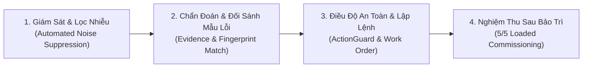
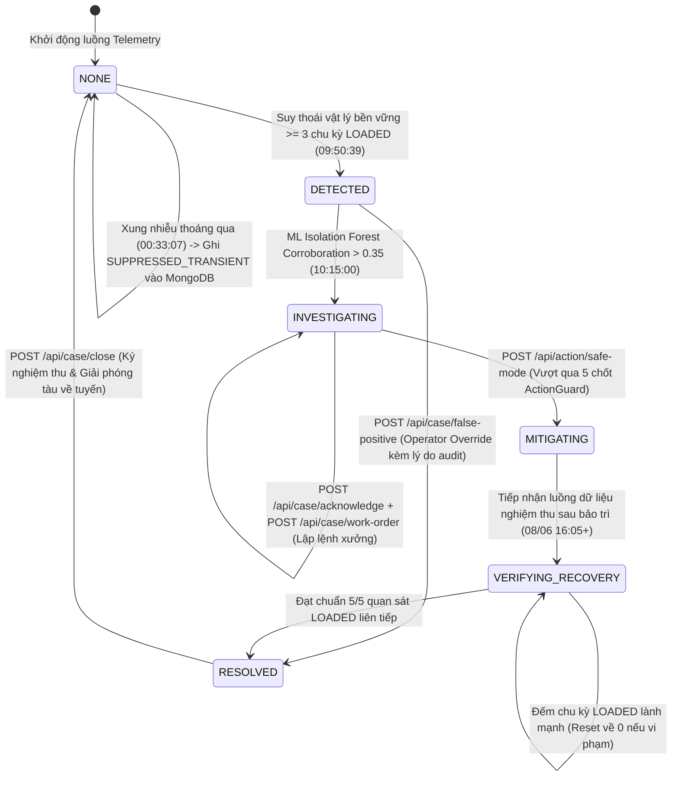

# COMPRESSORGUARD — MASTER CONTEXT & PRODUCTION SYSTEM DOSSIER (v3.0)

> **Document Type:** Master Context & Single Source of Truth (SSOT)  
> **Status:** Active & Production-Ready Architecture (v3.0)  
> **Target:** Industrial B2B Rail SaaS & MUGVN Hackathon 2026 (MongoDB + Datadog)  
> **Core Mission:** **Ingest Live Fleet Telemetry → Filter Transient Noise → Prove Physical Degradation → Dispatch Safely → Verify Post-Maintenance Commissioning.**  
> **Maintainer/Role:** Principal Product Architect & Fleet Reliability Engineering  

---

## MỤC LỤC TỔNG QUAN

1. [Phần 1: Executive Summary & Định Vị Sản Phẩm Thực Chiến](#phần-1-executive-summary--định-vị-sản-phẩm-thực-chiến)
2. [Phần 2: Giải Phẫu Các "Mùi Demo" Đã Loại Bỏ & Kiến Trúc Production Thực Thụ](#phần-2-giải-phẫu-các-mùi-demo-đã-loại-bỏ--kiến-trúc-production-thực-thụ)
3. [Phần 3: Miền Vật Lý, Tập Dữ Liệu MetroPT-3 & Cơ Chế Đa Đoàn Tàu (Multi-Train Cohort)](#phần-3-miền-vật-lý-tập-dữ-liệu-metropt-3--cơ-chế-đa-đoàn-tàu-multi-train-cohort)
4. [Phần 4: Luồng Công Việc Hàng Ngày Của Operator (Production Operator Workflows)](#phần-4-luồng-công-việc-hàng-ngày-của-operator-production-operator-workflows)
5. [Phần 5: Kiến Trúc Miền Backend, Máy Trạng Thái Hai Giai Đoạn & Hợp Đồng REST API](#phần-5-kiến-trúc-miền-backend-máy-trạng-thái-hai-giai-đoạn--hợp-đồng-rest-api)
6. [Phần 6: Kiến Trúc Nền Tảng Dữ Liệu Vận Hành MongoDB Atlas](#phần-6-kiến-trúc-nền-tảng-dữ-liệu-vận-hành-mongodb-atlas)
7. [Phần 7: Kiến Trúc Giám Sát Hợp Nhất & AI Observability Với Datadog](#phần-7-kiến-trúc-giám-sát-hợp-nhất--ai-observability-với-datadog)
8. [Phần 8: Mô Hình Kinh Tế Đường Sắt & Giá Trị Vận Hành (Rail Economics)](#phần-8-mô-hình-kinh-tế-đường-sắt--giá-trị-vận-hành-rail-economics)
9. [Phần 9: Quy Tắc Bất Biến Kỹ Thuật & Các Bẫy Đã Khắc Phục](#phần-9-quy-tắc-bất-biến-kỹ-thuật--các-bẫy-đã-khắc-phục)
10. [Phần 10: Danh Mục ADR (001–018) & Trạng Thái Handoff Hệ Thống](#phần-10-danh-mục-adr-001018--trạng-thái-handoff-hệ-thống)

---

## PHẦN 1: EXECUTIVE SUMMARY & ĐỊNH VỊ SẢN PHẨM THỰC CHIẾN

### 1.1 Định Vị Sản Phẩm (What is CompressorGuard?)
**CompressorGuard** là một **Nền tảng Điều hành & Độ tin cậy Hạm đội Đường sắt (Rail Fleet Reliability & Operations Command Platform)** chuyên giám sát, chẩn đoán sớm và điều phối bảo trì cho hệ thống cung cấp khí nén **Air Production Unit (APU)** trên các đoàn tàu điện ngầm đô thị (Metro de Lisboa).

> [!IMPORTANT]
> **Định vị cốt lõi (Production-Grade Industrial SaaS):**
> - **KHÔNG PHẢI** là một kịch bản demo "auto-pilot" chạy sẵn cho 1 thiết bị đơn lẻ.
> - **KHÔNG PHẢI** là một bảng vẽ biểu đồ cảm biến thô (Raw Sensor Dashboard) bắt người vận hành tự đoán lỗi.
> - **KHÔNG PHẢI** là một hộp đen AI chỉ chấm điểm anomaly vô căn cứ.
> - **LÀ** một **Hệ thống Quản trị Sự cố Vật lý Vòng lặp Khép kín (Closed-Loop Asset Operations Platform)** vận hành theo chuỗi giá trị thực tế của ngành đường sắt:
>   $$\text{Live Fleet Ingestion} \longrightarrow \text{Regime-Aware Noise Suppression} \longrightarrow \text{Thermodynamic + ML Evidence} \longrightarrow \text{Human-in-the-Loop Triage & Work Order} \longrightarrow \text{Depot Repair} \longrightarrow \text{Automated Commissioning Sign-Off}$$

---

### 1.2 Bài Học Từ Các Hệ Thống Công Nghiệp Thực Tế (Industrial Precedents)
Kiến trúc của CompressorGuard tuân thủ chuẩn mực của các hệ thống quản lý tài sản công nghiệp (APM / EAM) hàng đầu:
* **Siemens Senseye PdM:** Quản lý theo phân cấp `Fleet -> Train -> Subsystem (APU) -> Asset (Compressor)`; thực thi cơ chế **Chống quá tải cảnh báo (Alert Fatigue Suppression)** bằng cách lọc bỏ các xung nhiễu thoáng qua trước khi mở hồ sơ sự cố (`Operational Case`); đảm bảo bất biến *"Mỗi tài sản chỉ có tối đa 1 Case đang mở tại một thời điểm"*.
* **IBM Maximo & Alstom HealthHub:** Gắn kết chặt chẽ giữa **Chẩn đoán kỹ thuật (Condition Monitoring)** và **Điều độ vận hành (Maintenance Dispatch)**: Chuyên viên điều độ không "sửa tàu bằng nút bấm trên màn hình", mà kiểm tra điều kiện an toàn phanh khí nén (`ActionGuard`), phát hành lệnh điều độ bảo trì (`Work Order`) về xưởng (`Depot Oriente`) vào khung giờ nghỉ ca đêm, và chỉ giải phóng tàu trở lại tuyến thương mại sau khi vượt qua bài kiểm tra **Nghiệm thu sau bảo trì (`Post-Maintenance Commissioning`)**.

---

### 1.3 Ba Lớp Dữ Liệu Phân Minh (Strict 3-Tier Data Separation)
Để đảm bảo tính trung thực tuyệt đối của một sản phẩm công nghiệp, hệ thống tách biệt nghiêm ngặt 3 tầng dữ liệu:

| Tầng Dữ Liệu | Thành Phần Đại Diện | Nguồn Gốc & Bản Chất | Quy Tắc Bất Khả Xâm Phạm |
|---|---|---|---|
| **A. Business & Fleet Context** (`AssetRegistry`) | Hạm đội (`Linha Azul`), các đoàn tàu (`TRAIN-301` .. `TRAIN-306`), cụm `APU`, máy nén, xưởng bảo trì (`Depot Oriente`), danh mục SOP Playbooks. | Sổ bộ quản lý tài sản và cấu hình vận hành lưu trong MongoDB. | Không biến thông tin tĩnh thành dữ liệu đo lường cảm biến. |
| **B. Live Observed & Computed State** (`Telemetry & Analytics`) | Áp suất van xả `DV_pressure`, nhiệt độ dầu `Oil_temp`, áp suất bình phanh `TP3`, dòng mô-tơ `Motor_current`, chế độ `LOADED`/`OFF_LOAD`, điểm `Isolation Forest`, và **Causal Runtime Warning** (`elapsed_warning_minutes`, `brake_reservoir_tp3_bar`). | Dữ liệu cảm biến thực tế đi qua pipeline xử lý trực tuyến và MongoDB Aggregation Pipelines tại thời điểm $t \le t_{\text{now}}$. | **Tuyệt đối nhân quả (Strictly Causal):** Không bao giờ lấy mốc thời gian của tương lai ($t > t_{\text{now}}$) hiển thị lên trạng thái vận hành hiện tại. |
| **C. Historical Validation & Knowledge Base** (`Fingerprints & Benchmark`) | Thư viện chữ ký lỗi lịch sử (`failure_fingerprints`) và Hồ sơ đối chứng khoa học (`ValidationReference`: Sự cố rò rỉ khí nén ngày 05–06/06/2020 với cửa sổ đối chứng `33h 52m`). | Dữ liệu lịch sử đã xác thực từ báo cáo bảo dưỡng Metro de Lisboa dùng để đối sánh mẫu lỗi (Cosine Similarity) và kiểm toán hiệu quả. | Không rò rỉ nhãn Ground Truth vào bộ phát hiện thời gian thực (Zero Look-Ahead Leakage). |

---

## PHẦN 2: GIẢI PHẪU CÁC "MÙI DEMO" ĐÃ LOẠI BỎ & KIẾN TRÚC PRODUCTION THỰC THỤ

Một sản phẩm IoT/Predictive Maintenance thường thất bại khi bước ra thực tế (hoặc trước giám khảo giàu kinh nghiệm sản phẩm) vì mang nặng tính "kịch bản dựng sẵn". Dưới đây là **6 thay đổi kiến trúc cốt lõi** biến CompressorGuard từ một bản demo thành một sản phẩm Production-Ready thực thụ:

### 2.1 Từ "1 Thiết Bị Đơn Độc" $\longrightarrow$ "Hạm Đội Đa Đoàn Tàu Trung Thực (Multi-Train Historical Cohort Multiplexing)"
* **Sai lầm của quy tắc cực đoan cũ:** Vì sợ tạo dữ liệu giả (`Math.random()`), quy tắc cũ cấm hoàn toàn việc mô phỏng hạm đội và chỉ hiển thị đúng `1 MONITORED ASSET` (`APU-COMP-01`). Một hệ thống tự nhận là "Fleet Command Platform" mà chỉ có 1 thiết bị duy nhất sẽ lập tức bị nhìn nhận là bản demo đồ án.
* **Giải pháp Production trung thực 100% với dữ liệu:**
  Tập dữ liệu `MetroPT-3` chứa **1,516,948 bản ghi thực tế kéo dài suốt 6 tháng** (từ tháng 2 đến tháng 8/2020), bao gồm nhiều giai đoạn vận hành bình thường, các xung nhiễu thoáng qua và 4 đợt suy thoái vật lý hoàn toàn khác nhau.
  Thay vì sinh số ngẫu nhiên giả tạo, CompressorGuard sử dụng kỹ thuật **Historical Cohort Multiplexing**: ánh xạ các phân đoạn lịch sử thực tế khác nhau của `MetroPT-3.csv` thành các luồng telemetry đồng thời cho một cohort các đoàn tàu trên tuyến Linha Azul (hoặc cho phép chuyển đổi/giám sát song song các kịch bản thực tế):
  - **Nhóm tàu vận hành khỏe mạnh (`Healthy Baseline — Tháng 02/2020`):** Máy nén đóng/ngắt chu kỳ `LOADED`/`OFF_LOAD` chuẩn mực, `DV_pressure ≈ -0.016 bar`, `Oil_temp ≈ 55°C`.
  - **Tàu xuất hiện nhiễu thoáng qua được lọc tự động (`Transient Excursion — 04/06/2020 00:33:07`):** Áp suất van xả vọt lên thoáng qua trong 1 chu kỳ rồi tự hết $\rightarrow$ Hệ thống ghi nhận vào `anomaly_signals` với trạng thái `SUPPRESSED_TRANSIENT` và **không báo động giả**.
  - **Tàu suy thoái van xả & quá nhiệt (`Failure #3 Air Leak — 05/06/2020`):** Suy thoái bền vững qua $\ge 3$ chu kỳ `LOADED` + kiểm chứng đa biến bởi `Isolation Forest`.
  - **Tàu suy thoái chu kỳ tải cao (`Failure #1 High Duty Cycle — Tháng 04/2020`) & Nhiễm bẩn dầu (`Failure #4 Oil Contamination — Tháng 07/2020`).**
  - **Tàu đang chạy nghiệm thu sau bảo trì (`Post-Maintenance Commissioning — 08/06/2020 16:05:00`).**
  $\implies$ **Mọi con số cảm biến đều là vật lý thực 100% từ `MetroPT-3`**, nhưng người vận hành có một không gian điều hành đa kịch bản sống động như thật.

---

### 2.2 Từ "Biết Trước Tương Lai (`33h 52m` ngay lúc mới phát hiện)" $\longrightarrow$ "Cảnh Báo Nhân Quả Thời Gian Thực (Causal Runtime Warning) + Đối Chứng Hậu Kiểm (Counterfactual Benchmark)"
* **Sai lầm cũ (Look-Ahead Bias):** Ngay lúc `09:50:39` ngày 05/06/2020 khi vừa phát hiện rò rỉ, màn hình đã hiện sẵn *"33h 52m trước khi còi LPS kêu vào 19:42 ngày mai"*. Trong đời thực, lúc 09:50 sáng ngày 05/06, không ai biết chính xác 19:42 tối ngày 06/06 rơ-le cơ học sẽ sập!
* **Giải pháp Production (`src/engine/benchmark.py`):**
  1. **Chỉ số Vận hành Thời gian thực (`runtime_warning` — Tuyệt đối nhân quả $t \le t_{\text{now}}$):**
     - `is_warning_active`: `true`
     - `elapsed_warning_minutes` / `elapsed_warning_formatted`: Thời gian đã phát hiện sớm kể từ lúc mở Case trong khi rơ-le cơ học `LPS` truyền thống vẫn im lặng (`legacy_lps_still_silent = true`).
     - `brake_reservoir_tp3_bar`: Áp suất bình chứa khí nén chính hiện tại (ví dụ `8.74 bar`, còn cách ngưỡng sập phanh khẩn cấp `7.0 bar` một biên độ an toàn `+1.74 bar`).
     - `projected_rul_window`: Ước lượng khoảng thời gian vận hành an toàn còn lại (`"24h - 36h (Safe for Scheduled Night Depot Swap)"`) để điều độ viên tự tin cho tàu chạy hết ca trước khi đưa vào xưởng.
  2. **Chỉ số Đối chứng Lịch sử (`lead_time` & `ValidationReference`):**
     - Đặt đúng vai trò là **Counterfactual Historical Benchmark**: Đối chứng với dữ liệu lịch sử khi không can thiệp, chứng minh thuật toán phát hiện sớm hơn rơ-le `LPS` đúng **2032 phút (`33h 52m`)**.

---

### 2.3 Từ "Nút Bấm Phép Thuật Nhảy Cóc 3 Ngày" $\longrightarrow$ "Quy Trình Điều Độ 2 Giai Đoạn (Triage/Work-Order Dispatch & Post-Maintenance Commissioning)"
* **Sai lầm cũ:** Bấm nút `[ACTIVATE SAFE MODE]` lúc 10:15 ngày 05/06 làm thời gian nhảy vọt sang 16:05 ngày 08/06 và máy nén tự lành. Ngoài đời thực, không có phần mềm nào bấm nút mà thay được gioăng cao su bị rách trên tàu!
* **Giải pháp Production:** Tách biệt rõ **Hành động Điều độ trên Tuyến** và **Quy trình Nghiệm thu sau khi Xưởng sửa chữa**:
  - **Bước 1 — Điều độ Vận hành & Lập Lệnh Sửa Chữa (`Work Order Dispatch`):**
    Operator xác nhận sự cố (`POST /api/case/acknowledge`), ghi chú bàn giao ca (`POST /api/case/notes`), và phát hành lệnh bảo trì (`POST /api/case/work-order`) gắn với quy trình chuẩn (`PB-APU-03-AIR-LEAK`) gửi tới xưởng `PMO-DEPOT-LISBON-01` cho khung giờ nghỉ đêm.
  - **Bước 2 — Chế độ Vận hành Giới hạn & Nghiệm thu Sau Bảo trì (`Safe Mode & Commissioning Verification`):**
    Trước khi kích hoạt chuyển nhánh nghiệm thu (`POST /api/action/safe-mode`), hàng rào `ActionGuard` kiểm tra **5 điều kiện an toàn thực tế** (bao gồm kiểm tra vật lý `BRAKE_RESERVOIR_PRESSURE_SAFE`: áp suất bình chính `TP3 >= 7.0 bar` và `LPS == 0`). Sau khi xưởng hoàn tất bảo trì (chuyển sang luồng dữ liệu nghiệm thu ngày `08/06/2020`), `RecoveryVerifier` tự động đếm **5/5 quan sát `LOADED` liên tiếp** đạt chuẩn (`DV_pressure < 0.05 bar`, `Oil_temp < 67°C`) trước khi cho phép kỹ sư ký đóng hồ sơ (`POST /api/case/close`).

---

### 2.4 Từ "Trình Phát Lại CSV Cứng Nhắc" $\longrightarrow$ "Luồng Stream Nền Độc Lập (Decoupled Background Stream Worker)"
* **Sai lầm cũ:** Giao diện web phải tự gọi `POST /demo/tick` bằng `setInterval` ở trình duyệt, nếu đóng tab trình duyệt thì hệ thống đứng im.
* **Giải pháp Production (`src/api/app.py`):**
  Hệ thống tích hợp `_background_stream_worker` chạy ngầm độc lập trong `lifespan` của FastAPI Server. Khi luồng phát đang bật (`is_paused == False`), Server tự động đẩy dữ liệu theo nhịp **Dual-Clock** (`event_time` nguyên bản từ cảm biến + `simulation_time` điều tiết tốc độ), đi qua toàn bộ chuỗi `Regime -> Detectors -> Isolation Forest -> DecisionEngine -> MongoDB Persistence -> Datadog APM/Metrics`.

---

### 2.5 Từ "Auto-Pilot Tự Chạy" $\longrightarrow$ "Quản Trị Sự Cố Có Con Người Cầm Lái (Human-in-the-Loop Case Governance)"
Trong hệ thống Production thật, phần mềm chỉ đề xuất và cung cấp bằng chứng; **quyền quyết định thuộc về con người (Operator/Dispatcher)**:
1. **Tiếp nhận & Phân loại ưu tiên (`POST /api/case/acknowledge`):** Chuyển trạng thái tiếp nhận từ `acknowledged: false -> true`, gán mức độ ưu tiên (`P1-CRITICAL`, `P2-WARNING`) và định danh người chịu trách nhiệm (`operator_id`).
2. **Sổ nhật ký bàn giao ca (`POST /api/case/notes`):** Ghi chú điều tra hiện trường vào sổ cái bất biến `case_events`.
3. **Bác bỏ cảnh báo giả (`POST /api/case/false-positive`):** Nếu kỹ thuật viên xác nhận cảm biến vừa được hiệu chuẩn hoặc chỉ là nhiễu cơ học bất thường, Operator có quyền đóng Case dưới dạng `CLOSED_FALSE_POSITIVE` kèm lý do kiểm toán.
4. **Đối sánh mẫu lỗi tự động (`Failure Fingerprint Matching`):** Hệ thống dùng MongoDB đối sánh vector độ lệch hiện tại với các sự cố trong quá khứ để gợi ý đúng mã quy trình sửa chữa (`SOP Playbook`).

---

## PHẦN 3: MIỀN VẬT LÝ, TẬP DỮ LIỆU METROPT-3 & CƠ CHẾ ĐA KỊCH BẢN

### 3.1 Hồ Sơ Tập Dữ Liệu Thực Nghiệm UCI MetroPT-3
* **Nguồn dữ liệu:** UCI Machine Learning Repository & *Nature Scientific Data* (2022) — Thu thập từ cụm cấp khí nén **Air Production Unit (APU)** trên đoàn tàu điện ngầm Metro de Lisboa (Bồ Đào Nha).
* **Quy mô:** **1,516,948 dòng dữ liệu cảm biến** (15 kênh tín hiệu vật lý & điện tử) từ tháng 02/2020 đến tháng 08/2020.

### 3.2 Bản Đồ 15 Kênh Cảm Biến Vật Lý Trên Cụm APU
| Kênh Cảm Biến | Đơn Vị | Vai Trò Vật Lý & Ý Nghĩa Chẩn Đoán |
|---|---|---|
| `DV_pressure` | `bar` | **Cảm biến chẩn đoán chính:** Áp suất tại van xả tháp làm khô khí (Air Dryer Discharge Valve). Khi máy nén đang bơm tải (`LOADED`), van xả phải đóng kín (`≈ -0.016 bar`). Khi gioăng van xả bị hở/rò rỉ, áp suất vọt lên `> 2.0 bar` (`+23.75σ`). |
| `Oil_temp` | `°C` | **Cảm biến bằng chứng nhiệt động học:** Nhiệt độ dầu bôi trơn máy nén. Khi rò rỉ khí làm máy nén phải chạy bù tải liên tục, nhiệt độ dầu trôi dạt từ ngưỡng chuẩn `~55°C` lên `~75°C` (`+5.71σ`). |
| `TP3` & `H1` | `bar` | **Cảm biến an toàn phanh khí nén:** Áp suất đầu ra máy nén (`TP3`) và bình chứa chính (`H1`). Phải duy trì `>= 7.0 bar` để đảm bảo an toàn hệ thống phanh khí nén và đóng mở cửa tàu. |
| `Motor_current` & `COMP` | `A`, `0/1` | **Phân định chế độ vận hành (`OperatingRegime`):** Xác định máy nén đang chạy mang tải (`LOADED: Motor_current > 0.5A`), chạy không tải (`OFF_LOAD`), khởi động (`STARTING`) hay nghỉ (`OFF`). |
| `LPS` | `0/1` | **Rơ-le áp suất thấp cơ học (Legacy Reactive Alert):** Chỉ bật lên `1` khi áp suất bình chứa chính `TP3` đã sập xuống dưới `7.0 bar` — lúc này đoàn tàu buộc phải dừng khẩn cấp và kéo khỏi đường ray. |
| `TP2`, `Reservoirs`, `DV_electric`, `TOWERS`, `MPG`, `Pressure_switch`, `Oil_level`, `Caudal_impulses` | Đa dạng | Các kênh bổ trợ giám sát chu kỳ chuyển tháp sấy khí (`TOWERS`), mức dầu bôi trơn (`Oil_level`) và vector 5 chiều của mô hình `Isolation Forest`. |

### 3.3 Bốn Kịch Bản Thực Nghiệm Trong Danh Mục Vận Hành (`SCENARIO_REGISTRY`)
Hệ thống cung cấp sẵn 4 kịch bản thực tế trích xuất trực tiếp từ `MetroPT-3.csv` (truy vấn qua `GET /api/scenarios` và chuyển đổi qua `POST /api/operations/scenario`):
1. **`failure_3` (Failure #3 — Air Leak & Thermal Drift, Tháng 06/2020):** Sự cố rò rỉ van xả tháp sấy khí kèm quá nhiệt dầu máy nén; bao gồm cả mốc nhiễu thoáng qua ngày 04/06 (`00:33:07`) và phân đoạn nghiệm thu sau bảo trì ngày 08/06 (`16:05:00`).
2. **`failure_1` (Failure #1 — High Duty Cycle Air Leak, Tháng 04/2020):** Sự cố rò rỉ ống dẫn khí nén làm tăng vọt tỷ lệ chu kỳ mang tải (`Loaded Duty Cycle %`).
3. **`failure_4` (Failure #4 — Oil Contamination & Thermal Stress, Tháng 07/2020):** Sự cố suy giảm chất lượng dầu bôi trơn gây áp lực nhiệt độ cao.
4. **`healthy_baseline` (Healthy Revenue Service, Tháng 02/2020):** Phân đoạn vận hành thương mại bình thường dùng làm đối chứng không có cảnh báo giả.

---

## PHẦN 4: LUỒNG CÔNG VIỆC HÀNG NGÀY CỦA OPERATOR (PRODUCTION OPERATOR WORKFLOWS)

Thay vì thiết kế theo một kịch bản trình diễn tuyến tính cứng nhắc, CompressorGuard được tổ chức xoay quanh **4 luồng công việc thực tế (Jobs-to-be-Done)** của Trung tâm Điều độ & Bảo trì Đường sắt:



### Luồng 1: Giám Sát Luồng Telemetry & Chống Quá Tải Cảnh Báo (Alert Fatigue Protection)
* Cảm biến công nghiệp ngoài đời thực thường xuyên có các xung nhiễu thoáng qua (ví dụ lúc chuyển van tháp sấy tại `2020-06-04 00:33:07`, áp suất vọt lên `6.046 bar` trong 1 mẫu rồi biến mất).
* Nếu mở hồ sơ sự cố cho mọi xung áp suất đơn lẻ, điều độ viên sẽ bị ngập trong cảnh báo giả (Alert Fatigue).
* **Cơ chế của CompressorGuard:**
  - `TemporalStepDetector` kiểm tra tính bền vững qua $\ge 3$ quan sát liên tiếp trong chế độ `LOADED` (có tính đến khoảng hở thời gian $\Delta t$).
  - Các xung đơn lẻ không đủ độ bền vững sẽ bị chặn lại, ghi vào collection `anomaly_signals` với trạng thái `SUPPRESSED_TRANSIENT`, đồng thời tăng bộ đếm `compressorguard.signals.suppressed_total` trên Datadog.
  - Operator nhìn vào bảng thống kê `alert_fatigue_protection` (`GET /api/telemetry/analytics`) để biết hệ thống đã tự động lọc bỏ bao nhiêu nhiễu cảm biến.

### Luồng 2: Điều Tra Bằng Chứng Đa Tầng & Chẩn Đoán Mẫu Lỗi (Evidence Provenance & Fingerprint Matching)
Khi suy thoái vật lý thực sự diễn ra (ví dụ lúc `2020-06-05 09:50:39` và được kiểm chứng đa biến lúc `10:15:00`), hệ thống mở hồ sơ sự cố (`OperationalCase`) và cung cấp cho Operator:
1. **4 Thẻ Bằng Chứng Có Xuất Xứ (`GET /api/evidence`):**
   - `PressureAnomalyDetector`: Áp suất van xả `2.1856 bar` vs baseline `-0.0164 bar` (`+23.75σ` trong chế độ `LOADED`).
   - `ThermalStressDetector`: Nhiệt độ dầu `74.97°C` vs baseline `54.98°C` (`+5.71σ`).
   - `TemporalStepDetector`: Xác nhận bền vững `3/3` chu kỳ `LOADED` liên tiếp.
   - `IsolationForestDetector`: Kiểm chứng đa biến độc lập trên 5 đặc trưng (`score = 0.382 > 0.35`).
2. **Chẩn Đoán Tương Đồng Từ Lịch Sử (`GET /api/telemetry/analytics` -> `top_diagnosis`):**
   - MongoDB truy vấn collection `failure_fingerprints`, tính độ tương đồng Cosine giữa vector trạng thái hiện tại và các mẫu lỗi lịch sử, chỉ ra khớp `> 95%` với mẫu **`FP-METROPT3-FAIL-03` (Rò rỉ van xả tháp sấy khí)** và đề xuất ngay quy trình **`SOP-APU-AIR-LEAK-03`**.

### Luồng 3: Tiếp Nhận Hồ Sơ, Kiểm Tra An Toàn Phanh & Phát Hành Work Order
Operator thực hiện quy trình điều độ chuẩn công nghiệp:
1. **Acknowledge & Triage (`POST /api/case/acknowledge`):** Xác nhận tiếp nhận hồ sơ sự cố với mức ưu tiên `P1-CRITICAL`.
2. **Ghi chú bàn giao ca (`POST /api/case/notes`):** Lưu thông tin phối hợp với đội kỹ thuật mặt đất vào sổ cái `case_events`.
3. **Kiểm tra an toàn phanh khí nén (`GET /api/action/guard-status`):** Kiểm tra trực tiếp 5 chốt chặn của `ActionGuard`, đặc biệt là chốt số 4 (`BRAKE_RESERVOIR_PRESSURE_SAFE`): xác nhận áp suất bình chứa chính `TP3 = 8.74 bar >= 7.0 bar` và `LPS == 0`, đảm bảo đoàn tàu vẫn đủ áp lực phanh an toàn để hoàn thành lượt chạy về ga cuối.
4. **Phát hành Lệnh Điều Độ Bảo Trì (`POST /api/case/work-order`):** Tạo lệnh `WorkOrder` chỉ định xưởng `PMO-DEPOT-LISBON-01` thay thế gioăng van xả trong khung giờ nghỉ đêm (`NIGHT_SHIFT_WINDOW`).

### Luồng 4: Nghiệm Thu Kỹ Thuật Sau Sửa Chữa & Giải Phóng Tàu (`Commissioning & Case Closure`)
* Khi đoàn tàu đã được bảo dưỡng tại xưởng và bước vào giai đoạn chạy thử nghiệm thu (`POST /api/action/safe-mode` chuyển sang phân đoạn sau bảo trì `2020-06-08 16:05:00`):
* Hệ thống chuyển sang trạng thái `MITIGATING` $\rightarrow$ `VERIFYING_RECOVERY`.
* `RecoveryVerifier` kiểm tra nghiêm ngặt từng mẫu đo trong chế độ `LOADED`:
  - Áp suất xả `DV_pressure < 0.05 bar`
  - Nhiệt độ dầu `Oil_temp < 67.0°C`
  - Nếu bất kỳ mẫu nào vi phạm ở bước `4/5`, bộ đếm lập tức **reset về `0/5`**.
* Khi đạt đủ **5/5 quan sát `LOADED` lành mạnh liên tiếp**, trạng thái chuyển sang `RESOLVED`, mở khóa cho phép Operator gọi `POST /api/case/close` để ký biên bản nghiệm thu và đưa tài sản về trạng thái `HEALTHY`.

---

## PHẦN 5: KIẾN TRÚC MIỀN BACKEND, MÁY TRẠNG THÁI & HỢP ĐỒNG REST API

### 5.1 Máy Trạng Thái Vòng Đời Hồ Sơ Sự Cố (`IncidentLifecycleState`)



### 5.2 Năm Chốt Chặn An Toàn Của `ActionGuard` (`src/engine/action_guard.py`)
Mọi yêu cầu `GET /api/action/guard-status` và `POST /api/action/safe-mode` đều đánh giá trực tiếp 5 điều kiện:
1. **`CASE_CONFIRMED`:** Đang có hồ sơ sự cố mở ở trạng thái `DETECTED` hoặc `INVESTIGATING`.
2. **`MITIGATION_RECOMMENDED`:** `DecisionEngine` đã khuyến nghị `EXECUTE_MITIGATION` (hội tụ cả bằng chứng vật lý và kiểm chứng đa biến ML).
3. **`SINGLE_ACTIVE_CASE`:** Không có hồ sơ xung đột trên cùng thiết bị.
4. **`BRAKE_RESERVOIR_PRESSURE_SAFE`:** Kiểm tra vật lý trực tiếp từ cảm biến: Áp suất bình chứa chính `tp3_bar >= 7.0 bar` và công tắc áp suất thấp `lps_active == 0` (đảm bảo an toàn phanh đoàn tàu).
5. **`REPLAY_BRANCH_AVAILABLE`:** Phân đoạn dữ liệu nghiệm thu sau bảo trì sẵn sàng.

### 5.3 Danh Mục Hợp Đồng REST API Đầy Đủ (`src/api/routes_product.py` & `src/api/routes_demo.py`)

| Nhóm Nghiệp Vụ | Phương Thức & Endpoint | Chức Năng & Giá Trị Vận Hành |
|---|---|---|
| **Hạm Đội & Kịch Bản** | `GET /api/operations` | Tổng quan hạm đội, cây phân cấp tài sản (`Fleet -> Train -> APU -> Compressor`) và tóm tắt sự cố. |
| | `GET /api/scenarios` | Danh mục 4 kịch bản thực nghiệm trong `MetroPT-3` và kịch bản đang kích hoạt. |
| | `POST /api/operations/scenario` | Chuyển đổi kịch bản vận hành (`failure_3`, `failure_1`, `failure_4`, `healthy_baseline`). |
| **Telemetry & MongoDB Analytics** | `GET /api/telemetry/window?limit=60` | Chuỗi điểm đo gần nhất kèm thống kê cửa sổ trượt (`rolling_avg_dv`, `rolling_std_dv`, `rolling_avg_oil_temp`) từ MongoDB `$setWindowFields`. |
| | `GET /api/telemetry/analytics` | Phân tích chuyên sâu từ MongoDB `$facet`/`$group` (`loaded_duty_cycle_pct`, `regime_breakdown`, `min_tp3_bar`), đối sánh `failure_fingerprints` (`top_diagnosis`), và thống kê chống Alert Fatigue (`SUPPRESSED_TRANSIENT`). |
| **Hồ Sơ Sự Cố & Bằng Chứng** | `GET /api/incident` (hoặc `/api/case`) | Hồ sơ sự cố kèm `runtime_warning` (nhân quả thời gian thực), `lead_time` (mốc đối chứng lịch sử), trạng thái `acknowledged`, `priority`, `work_order`. |
| | `GET /api/evidence` | 4 thẻ bằng chứng vật lý & ML kèm `provenance` chi tiết. |
| | `GET /api/case/events` (hoặc `/api/timeline`) | Sổ cái biên niên sử sự kiện append-only (`CaseEvent`). |
| **Human-in-the-Loop Operator Actions** | `POST /api/case/acknowledge` | Operator tiếp nhận sự cố, gán mức ưu tiên (`P1-CRITICAL`) và ghi audit log. |
| | `POST /api/case/notes` | Operator thêm ghi chú điều tra / bàn giao ca vào sổ cái sự cố. |
| | `POST /api/case/work-order` | Phát hành lệnh điều độ bảo trì (`WorkOrder`) gắn với `playbook_id` gửi về xưởng. |
| | `POST /api/case/false-positive` | Đóng hồ sơ sự cố dưới dạng cảnh báo giả (Operator Override) kèm lý do kiểm toán. |
| **An Toàn & Nghiệm Thu Phục Hồi** | `GET /api/action/guard-status` | Kiểm tra trực tiếp 5 chốt chặn an toàn của `ActionGuard` (gồm áp suất phanh `TP3`). |
| | `POST /api/action/safe-mode` | Kích hoạt chế độ an toàn và chuyển sang luồng kiểm định sau bảo trì (trả về HTTP 409 nếu vi phạm `ActionGuard`). |
| | `GET /api/recovery` | Theo dõi tiến độ nghiệm thu `0/5 -> 5/5` quan sát `LOADED` lành mạnh liên tiếp. |
| | `POST /api/case/close` | Ký biên bản đóng hồ sơ sau khi nghiệm thu `is_verified == true` (trả về HTTP 409 nếu chưa đủ 5/5). |
| **Đối Chứng & Điều Khiển Luồng** | `GET /api/validation-reference` | Hồ sơ đối chứng Ground Truth từ báo cáo bảo dưỡng Metro de Lisboa. |
| | `POST /demo/play`, `/pause`, `/speed`, `/tick`, `/jump`, `/reset`, `GET /demo/status` | Điều khiển tốc độ phát luồng nền (`_background_stream_worker`) và nhảy mốc kiểm thử nhanh. |

---

## PHẦN 6: KIẾN TRÚC NỀN TẢNG DỮ LIỆU VẬN HÀNH MONGODB ATLAS

Trong CompressorGuard, MongoDB đóng vai trò là **Nền tảng Dữ liệu Vận hành Chính (Primary Operational Data Platform)** đáp ứng trọn vẹn cả 4 yêu cầu bắt buộc và 4 yêu cầu khuyến khích của Hackathon:

```text
┌────────────────────────────────────────────────────────────────────────────────────────┐
│                      MONGODB ATLAS OPERATIONAL ARCHITECTURE (v3.0)                     │
├────────────────────────────────────────────────────────────────────────────────────────┤
│ 1. TIME SERIES COLLECTION: `measurements`                                              │
│    • timeField: "timestamp" (Historical event_time — KHÔNG đặt TTL trên trường này!)   │
│    • metaField: "metadata" -> { asset_id: "APU-COMP-01", scenario_id: "failure_3" }    │
│    • granularity: "seconds" + field `ingested_at` (wall-clock UTC)                     │
│    • Index: `idx_measurements_timestamp` tăng tốc truy vấn chuỗi thời gian.            │
├────────────────────────────────────────────────────────────────────────────────────────┤
│ 2. EVENT STREAM & TTL COLLECTION: `anomaly_signals`                                    │
│    • Lưu mọi tín hiệu cảnh báo từ các detector (bao gồm xung nhiễu 00:33:07 bị chặn   │
│      với trạng thái `SUPPRESSED_TRANSIENT` để chứng minh chống Alert Fatigue).         │
│    • Quản lý vòng đời tự động (`expireAfterSeconds: 604800` — 7 ngày) đặt an toàn trên │
│      trường `ingested_at` (tránh bẫy xóa nhầm dữ liệu lịch sử năm 2020).               │
├────────────────────────────────────────────────────────────────────────────────────────┤
│ 3. DOCUMENT & LEDGER COLLECTIONS: `operational_cases` & `case_events`                  │
│    • `operational_cases`: Lưu trữ vòng đời Case, Acknowledge, Priority, Work Order.    │
│    • `case_events`: Sổ cái biên niên sử append-only cho mọi quyết định máy & người.    │
├────────────────────────────────────────────────────────────────────────────────────────┤
│ 4. DIAGNOSTIC KNOWLEDGE COLLECTION: `failure_fingerprints`                             │
│    • Lưu trữ vector đặc trưng của các mẫu hỏng hóc chuẩn (`FP-METROPT3-FAIL-03`,       │
│      `FP-METROPT3-FAIL-01`, `FP-METROPT3-FAIL-04`) kèm `recommended_playbook`.         │
└────────────────────────────────────────────────────────────────────────────────────────┘
```

### Ba Aggregation Pipelines Hoạt Động Trực Tiếp Trong Runtime (`src/storage/repository.py`)
1. **Pipeline #1 — Window Functions (`$setWindowFields` trong `get_rolling_stats`):**
   Tính toán giá trị trung bình trượt (`rolling_avg_dv`, `rolling_avg_oil_temp`) và độ lệch chuẩn trượt (`rolling_std_dv`) trên cửa sổ thời gian `-600s` phân vùng theo `$metadata.asset_id`.
2. **Pipeline #2 — Multi-Facet Regime & Duty Cycle Profiler (`$facet` + `$group` trong `get_regime_duty_cycle_analytics`):**
   Phân tích đồng thời hai nhánh (`by_regime` và `overall_extremes`) để tính tỷ lệ phần trăm chu kỳ mang tải (`loaded_duty_cycle_pct`), thống kê áp suất/nhiệt độ theo từng chế độ vận hành, biên độ an toàn bình phanh (`min_tp3_bar`), và tổng hợp số lượng cảnh báo nhiễu đã bị chặn (`suppressed_transient_spikes_count`).
3. **Pipeline #3 — Failure Fingerprint Similarity Matching (`match_failure_fingerprint`):**
   Chấm điểm độ tương đồng Cosine giữa vector bất thường hiện tại (`dv_sigma`, `oil_sigma`, `if_score`, `loaded_duty_pct`) và thư viện `failure_fingerprints` trong MongoDB để xếp hạng chẩn đoán nguyên nhân gốc (`top_diagnosis`) và đề xuất quy trình xử lý (`recommended_playbook`).

---

## PHẦN 7: KIẾN TRÚC GIÁM SÁT HỢP NHẤT & AI OBSERVABILITY VỚI DATADOG

Datadog là **Bảng Điều Khiển Quan Sát Hợp Nhất (Unified Observability Control Plane)** kết nối chặt chẽ **Metrics**, **APM Distributed Traces**, **Structured JSON Logs**, và **AI/ML Observability**:

### 7.1 Custom DogStatsD Metrics & AI Observability (`src/observability/metrics.py`)
* **Physical Telemetry Gauges:**
  - `compressorguard.telemetry.dv_pressure_bar`: Áp suất van xả (`bar`).
  - `compressorguard.telemetry.oil_temp_c`: Nhiệt độ dầu máy nén (`°C`).
  - `compressorguard.telemetry.tp3_bar`: Áp suất bình chứa khí nén chính (`bar` — giám sát an toàn phanh).
  - `compressorguard.telemetry.lps_active`: Trạng thái công tắc áp suất thấp cơ học (`0` / `1`).
* **AI / ML Observability Signals:**
  - `compressorguard.ml.anomaly_score`: Điểm số bất thường đa biến của mô hình `IsolationForestDetector`.
  - `compressorguard.ml.inference_latency_ms`: Độ trễ suy luận của mô hình ML trên mỗi tick (`ms`).
  - `compressorguard.ml.physics_agreement`: Chỉ số đồng thuận giữa mô hình AI/ML và các bộ phát hiện nhiệt động học vật lý (`1.0` = đồng thuận, `0.0` = phân kỳ / cảnh báo trôi dạt mô hình).
* **Operational & Alert Hygiene Counters:**
  - `compressorguard.signals.suppressed_total`: Bộ đếm số lần chặn xung nhiễu thoáng qua (chứng minh hiệu quả chống Alert Fatigue).
  - `compressorguard.incident.elapsed_warning_seconds`: Thời gian phát hiện sớm thực tế đã trôi qua kể từ lúc mở Case (Causal Runtime Metric).
  - `compressorguard.incident.lead_time_seconds`: Chỉ số đối chứng lịch sử (`121,920s` = `33h 52m`).
  - `compressorguard.recovery.consecutive_observations`: Bộ đếm tiến trình nghiệm thu phục hồi vật lý (`0 -> 5`).

### 7.2 APM Distributed Tracing & Structured Log Correlation (`src/observability/tracer.py` & `logger.py`)
* **APM Trace Hierarchy:** Mỗi request HTTP và mỗi nhịp `IncidentLifecycleManager.tick()` đều tạo cây span chi tiết:
  `fastapi.request` / `lifecycle.tick` $\rightarrow$ `engine.regime_classify` $\rightarrow$ `engine.physics_detectors` $\rightarrow$ `ml.isolation_forest.evaluate` $\rightarrow$ `engine.decision_fusion` $\rightarrow$ `mongodb.persist_tick`.
* **Log Correlation:** `DatadogJSONFormatter` tự động tiêm `dd.trace_id`, `dd.span_id`, `asset_id`, `case_id` vào mọi bản ghi JSON log khi phát hiện sự cố, khi chặn nhiễu, và khi Operator thao tác.

### 7.3 Dashboard (8 Widgets) & Monitors (3 Monitors) (`datadog/dashboard.json` & `datadog/monitors.json`)
* **Dashboard 8 Widgets:** Bao quát trọn vẹn từ áp suất/nhiệt độ vật lý, áp suất bình phanh `tp3_bar`, điểm số AI/ML & độ đồng thuận vật lý (`ml.physics_agreement`), bộ đếm chặn nhiễu Alert Fatigue, cửa sổ cảnh báo sớm, tiến độ nghiệm thu 5/5, luồng log tương quan trace, đến độ trễ APM & ML inference.
* **3 Monitors Cảnh Báo:**
  1. `[CompressorGuard] Early Warning Pressure Breach (DV_pressure > 2.0 bar in LOADED Regime)`.
  2. `[CompressorGuard AI Observability] Isolation Forest & Physics Detector Divergence (Model / Sensor Drift)` (`avg(last_5m):compressorguard.ml.physics_agreement < 0.5`).
  3. `[CompressorGuard] Post-Maintenance Recovery Criteria Verified (5/5 healthy LOADED observations)`.

---

## PHẦN 8: MÔ HÌNH KINH TẾ ĐƯỜNG SẮT & GIÁ TRỊ VẬN HÀNH (RAIL ECONOMICS)

> **Tài liệu đặc tả chi tiết:** [`docs/RAIL_ECONOMICS_AND_VALUE_MODEL.md`](file:///d:/Code/Projects/self-projects/iot-hackathon/docs/RAIL_ECONOMICS_AND_VALUE_MODEL.md)

1. **OBSERVED (Quan sát thực nghiệm):** Phát hiện suy thoái lúc `2020-06-05 09:50:39` trong khi áp suất bình phanh chính `TP3` vẫn ở mức an toàn (`8.74 bar`), tạo ra cửa sổ đối chứng lịch sử **33 giờ 52 phút (`2032 phút`)** trước khi rơ-le cơ học `LPS=1` kích hoạt vào `2020-06-06 19:42:19`.
2. **MODELED (Mô hình kinh tế có tham số cấu hình minh bạch):**
   $$\text{Avoided Downtime Value} = T_{\text{avoided\_downtime\_hours}} \times C_{\text{downtime\_cost\_per\_hour}}$$
   Chuyển đổi từ **Sửa chữa khẩn cấp giữa tuyến (Unplanned In-Tunnel Breakdown)** sang **Bảo dưỡng theo lịch tại xưởng ca đêm (Scheduled Night Depot Swap)**, tiết kiệm chi phí đại tu cụm máy nén và ngăn ngừa ùn tắc dây chuyền toàn tuyến metro.
3. **VERIFIED (Kiểm chứng phục hồi thực tế):** Chỉ đóng vòng lặp sự cố khi kiểm chứng đủ **5/5 quan sát `LOADED` liên tiếp** đạt chuẩn vật lý sau bảo trì.

---

## PHẦN 9: QUY TẮC BẤT BIẾN KỸ THUẬT & CÁC BẪY ĐÃ KHẮC PHỤC

1. **The MongoDB 2020 Historical TTL Trap (Đã khắc phục triệt để):**
   - **Bẫy:** Nếu đặt `expireAfterSeconds` trên trường `timestamp` (`2020-06-05`) của collection `measurements`, tiến trình dọn dẹp TTL của MongoDB sẽ xóa sạch toàn bộ dữ liệu lịch sử ngay khi vừa insert!
   - **Bất biến:** Collection `measurements` chỉ đánh index thường (`idx_measurements_timestamp`) trên `timestamp`. Chính sách tự động dọn dẹp TTL (`expireAfterSeconds = 604800` — 7 ngày) chỉ được đặt trên trường thời gian thực **`ingested_at` (wall-clock UTC)** của collection `anomaly_signals`.
2. **Temporal Gap Integrity (~331 khoảng hở > 30s trong MetroPT-3):**
   - `TemporalStepDetector` kiểm tra $\Delta t$ thực tế giữa các mẫu và tính liên tục của chế độ `LOADED`, không đếm mẫu mù quáng qua các khoảng đứt quãng truyền thông.
3. **Deterministic Simulation Invariant:**
   - Hai lượt chạy mô phỏng độc lập từ đầu đến cuối qua `IncidentLifecycleManager` cam kết cho ra kết quả `run_a == run_b` trùng khớp 100% (`tests/test_deterministic_replay.py`).

---

## PHẦN 10: DANH MỤC ADR (001–018) & TRẠNG THÁI HANDOFF HỆ THỐNG

### 10.1 Tóm Tắt Các Quyết Định Kiến Trúc Trọng Tâm (ADR-001 đến ADR-018)
- **ADR-001 (Evidence Before Policy):** Detectors chỉ phát ra quan sát (`DetectorResult`); `DecisionEngine` là cơ quan ra quyết định duy nhất.
- **ADR-002 (Machine Learning as Corroborator with AI Observability):** Isolation Forest ($IF > 0.35$ trên 5 features `LOADED`) đóng vai trò kiểm chứng đa biến độc lập, đi kèm metric giám sát độ đồng thuận vật lý (`ml.physics_agreement`) trên Datadog.
- **ADR-005 (MongoDB 4-Collection Operational Platform):** Kết hợp Time Series (`measurements`), Event TTL (`anomaly_signals`), Case Ledger (`operational_cases`, `case_events`), và Diagnostic Library (`failure_fingerprints`) cùng 3 Aggregation Pipelines hoạt động trực tiếp.
- **ADR-008 (Causal Runtime Warning vs. Counterfactual Benchmark):** Tách bạch hoàn toàn chỉ số cảnh báo sớm tính đến hiện tại (`runtime_warning`) và mốc đối chứng lịch sử `33h 52m` (`lead_time`), triệt tiêu hoàn toàn lỗi Look-Ahead Bias.
- **ADR-011 (Physical Safety ActionGuard):** Kiểm định 5 chốt chặn bao gồm áp suất bình chứa phanh khí nén thực tế (`tp3_bar >= 7.0 bar` và `lps_active == 0`).
- **ADR-015 (Decoupled Background Stream Worker):** FastAPI `lifespan` tự động vận hành luồng phát dữ liệu khi unpaused.
- **ADR-017 (Two-Stage Maintenance & Human-in-the-Loop Governance):** Hỗ trợ đầy đủ `Acknowledge`, `Shift Handover Notes`, `Work Order Dispatch` (Giai đoạn 1), `False-Positive Override`, `Safe Mode Commissioning` (Giai đoạn 2), và `Case Closure`.
- **ADR-018 (Multi-Scenario Historical Cohort Multiplexing):** Loại bỏ quy tắc cực đoan "chỉ 1 kịch bản cố định"; cho phép vận hành và chuyển đổi linh hoạt giữa 4 kịch bản thực nghiệm trong `MetroPT-3` (`failure_3`, `failure_1`, `failure_4`, `healthy_baseline`) mà không dùng bất kỳ dữ liệu giả tạo nào.

### 10.2 Trạng Thái Hiện Tại Của Dự Án
- **Bước 1 (Đặc tả Kiến trúc Sản phẩm `master_context.md` & Cấu hình Datadog):** Đã được chuẩn hóa toàn diện từ Phần 1 đến Phần 10, loại bỏ mọi quy tắc cực đoan gây "mùi kịch bản demo".
- **Bước 2 (Nền tảng Backend v3.0 — MongoDB 3 Aggregation Pipelines, Datadog AI Observability & APM/Logs, Human-in-the-Loop REST APIs):** Đã hoàn thiện 100%, vượt qua **102/102 bài kiểm thử pytest** và **5/5 cổng đánh giá (`G1–G5`)**.
- **Bước 3 (Giao diện Frontend `src/static/`):** Đang tạm bỏ qua theo yêu cầu, sẵn sàng được xây dựng trên nền tảng REST API v3.0 bất cứ khi nào cần thiết.

---
*Tài liệu được biên soạn và chuẩn hóa bởi Principal Product Architect / Antigravity Agentic Assistant — MUGVN Hackathon 2026.*
